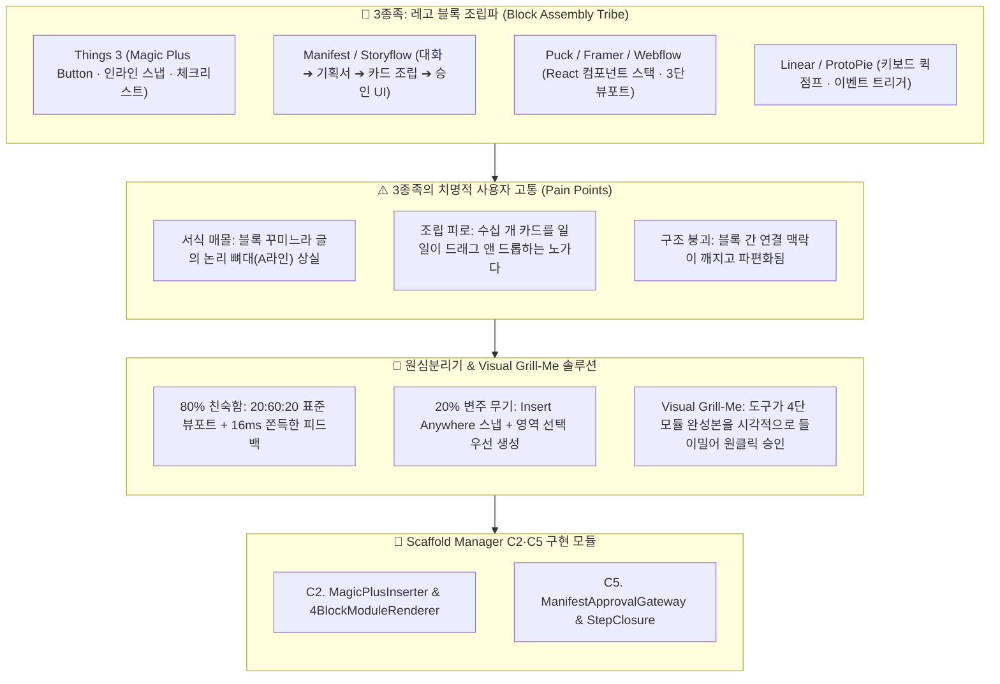

# 📋 (PM 보고서 v2-3) 3종족 레고 블록 조립파 레퍼런스 심층 탈곡 및 80-20 역설계 분석 보고서

> [!abstract] 📢 **PM Executive Summary: 3종족 분석의 핵심 명제**
> **"3종족(블록 조립파)은 '직관적인 D&D 조립 쾌감과 마찰 없는 손맛'을 제공하지만, 사용자가 서식 꾸미기와 블록 배치에 매몰되어 '글의 핵심 척추(A라인)와 논리적 위계'를 상실하게 만듭니다.**  
> 우리는 3종족의 80% 업계 표준인 **'3단 뷰포트(20:60:20)와 16ms 마이크로 인터랙션'**을 계승하고, **'Things 3의 Magic Plus 인라인 스냅'과 'Manifest의 대화 추출 파이프라인'**을 결합하여, 사용자가 블록 조립 노가다를 하지 않고 도구가 완성 블록을 시각적으로 들이미는 **'Visual Grill-Me 4단 모듈러 비계'**를 완성합니다."
> 
> * **분석 대상 3종족 군**: [[(web&강추)Things 3|Things 3]], [[(web&강추)Puck|Puck]], [[(web&강추)Framer|Framer]], [[(web&강추)Webflow|Webflow]], [[(web&강추)매니패스트|Manifest]], [[(web&강추)storyflow|Storyflow]], [[Linear(AI-Design 협업툴)|Linear]], [[(web)ProtoPie|ProtoPie]], [[(web&강추)Google Docs|Google Docs]], [[(web)Boords|Boords]], [[(web)Boarder|Boarder]], [[(web&강추)Clip Studio|Clip Studio]]
> * **핵심 해결 과제**: 반복 노가다 피로도(매번 복붙하고 정렬하는 피로)와 시각적 가독성 저주(텍스트벽)의 완벽한 해소

---

## 🗺️ 3종족 아키텍처 해체 및 Scaffold Manager 전이 맵



---

# 1부. 3종족 레퍼런스 심층 비교 매트릭스 (Tribe 3 Matrix)

| 서비스명 | 핵심 인터랙션 메커니즘 | 사용자에게 주는 심리적 보상 | 치명적 결핍 (사용자 고통) | 쿨하게 버린 80% (의도적 결핍) | Scaffold Manager 이식 부품 |
| :--- | :--- | :--- | :--- | :--- | :--- |
| **[[ (web&강추)Things 3 \| Things 3 ]]** | **Magic Plus Button (D&D 스냅)**<br/>& 노드 속 2단계 미니 체크리스트 | *"손끝에서 느껴지는 감각이 깃털처럼 가볍고 쫀득하다"* | 무거운 계층 트리 폴더링 불가, 긴 장문 문서 작성 불가 | 복잡한 프로젝트 통계 대시보드, 다중 태그 교집합 필터링 | **`MagicPlusInserter`**<br/>(원하는 위치 인라인 스냅 드래그) |
| **[[ (web&강추)매니패스트 \| Manifest ]]** | **대화/자료 기반 기획서 자동 추출**<br/>& 영역 선택 우선 생성 / 승인 UI | *"자료와 대화만 던졌는데 와이어프레임까지 단숨에 뽑힌다"* | 정해진 카드 규격 외의 자유 텍스트 편집 제약, 높은 토큰 소모 | 자유 비정형 마크다운 에디터, 단일 무한 줌인 트리 | **`IngestExtractionPipeline`**<br/>& **`SelectiveAreaGenerator`** |
| **[[ (web&강추)storyflow \| Storyflow ]]** | **화이트보드 섹션 카드 나열**<br/>➔ 보드에서 바로 폴더 묶기 | *"포스트잇 브레인스토밍이 원클릭으로 PPT/원고가 된다"* | AI가 생성해 주는 스토리라인 품질이 유치하고 단편적임 | 정밀한 단락별 스타일 CSS 편집, 코드 레벨 컴포넌트 제어 | **`SectionCardCluster`**<br/>(아웃라인 노드의 섹션 카드화) |
| **[[ (web&강추)Puck \| Puck ]]** | **React 기반 컴포넌트 빌더**<br/>(좌 아웃라인 - 중앙 캔버스 - 우 속성) | *"내 컴포넌트가 위지윅 화면에서 완벽하게 조립된다"* | 텍스트 작성이 아닌 컴포넌트 배치 툴이라 글쓰기 흐름 단절 | 문서 작성에 필요한 키보드 연속 타이핑 리듬 | **`Standard3SplitLayout`**<br/>(좌 아웃라인 - 중앙 작업 - 우 인스펙터) |
| **[[ (web&강추)Framer \| Framer ]]** | **반응형 스택 컴포넌트 조립**<br/>& 실시간 AI 레이아웃 생성 | *"디자이너가 코딩 없이 프로덕션 사이트를 배포한다"* | 레이아웃 제약이 너무 많아 비개발자/비디자이너는 학습 곡선 큼 | 순수 텍스트 중심의 경량 문서화, 아웃라이너 위계 조작 | **`StackModuleRenderer`**<br/>(4단 모듈 카드의 자동 스택 렌더링) |
| **[[ (web&강추)Webflow \| Webflow ]]** | **AI 세션 대화 + 실시간 프리뷰**<br/>나란한 듀얼 뷰포트 | *"AI에게 말하는 족족 우측 프리뷰 화면이 실시간으로 바뀐다"* | 웹 빌더 특유의 극심한 학습 곡선과 무거운 로딩 속도 | 가벼운 일상 메모, 0.5초 이내 첫 줄 진입 속도 | **`DualSessionPreview`**<br/>(좌측 지시 ➔ 우측 실시간 렌더링) |
| **[[ Linear(AI-Design 협업툴) \| Linear ]]** | **인간과 AI의 구조화된 협업**<br/>& 키보드 점프(`Cmd+K`) 조작성 | *"마우스 없이 빛의 속도로 작업이 정리되고 흘러간다"* | 프로젝트 관리 티켓 중심이라 긴 글의 서사적 흐름 조망 불가 | 자유로운 2차원 캔버스 낙서, 서식 꾸미기 | **`CommandKQuickJump`**<br/>(마찰 제로 키보드 단축키 체계) |
| **[[ (web)ProtoPie \| ProtoPie ]]** | **트리거-리스폰스 분리**<br/>인터랙션 블록 모듈화 | *"복잡한 로직도 이벤트와 반응 블록으로 깔끔히 조립된다"* | 로직 조립에 집중되어 있어 문서/텍스트 콘텐츠 생성 불가 | 자연어 글쓰기, 마크다운 위계 정리 | **`TriggerResponseBlock`**<br/>(1줄 트리거 ➔ 1줄 액션 바인딩) |
| **[[ (web&강추)Google Docs \| Google Docs ]]** | **인라인 AI 수정 팝업**<br/>& 문서 좌측 아웃라인 개요 연동 | *"글을 쓰다가 막히는 문단만 핀셋으로 AI에게 고치게 한다"* | 전체 맥락을 잃고 부분 문장만 번지르르하게 고치는 한계 | 비선형 2차원 캔버스 조망, 버전 분기 브랜칭 | **`InlineSelectionPopup`**<br/>(선택 노드 즉각 AI 팝업 디렉션) |

---

# 2부. 3종족의 80% 공통 성공 공식 (The Familiar)

블록 조립파 레퍼런스들이 공통적으로 지키고 있는 **"마찰 없는 직관성을 보장하는 80%의 업계 표준선"**입니다.

```
┌────────────────────────────────────────────────────────────────────────┐
│                   🏛️ 3종족의 80% 공통 성공 공식 (직관성의 표준선)       │
├────────────────────────────────────────────────────────────────────────┤
│  1. 뷰포트 레이아웃 : 좌측 트리(20%) : 중앙 작업판(60%) : 우측 패널(20%)    │
│  2. 마이크로 인터랙션 : 16ms 쫀득한 애니메이션 피드백 (체크 시 0.1초 튕김)    │
│  3. 모듈 조립 문법   : 4단 일관 블록 ([헤더] ➔ [트리거] ➔ [객체] ➔ [인용구])│
│  4. 시각적 밀도 제어 : 순수 텍스트 30% 미만 vs 비주얼 객체(카드/표) 70% 이상│
└────────────────────────────────────────────────────────────────────────┘
```

### 1. 20 : 60 : 20 표준 뷰포트와 F자 스캐닝
* **성공 공식**:
  * Puck, Framer, Webflow, Things 3 모두 동일합니다.
  * 좌측에서 구조를 잡고, 중앙에서 작업하며, 우측에서 세부 속성을 제어하는 구조입니다.
  * 중앙 작업판은 가로폭이 너무 넓어지면 가독성이 떨어지므로, **최대 폭 700~900px 내외로 통제**되어 F자 시선 이동을 최적화합니다.

### 2. 쫀득한 마이크로 인터랙션 (Tactile Feedback)
* **Things 3의 정수**:
  * 노드를 완료(`Space`)하거나 승인할 때 기계적으로 글자가 바뀌는 것이 아니라, **0.1초 동안 살짝 튕기며 사라지는 경쾌한 애니메이션**이 작업자에게 도파민 피드백을 선사합니다.
  * 이 '손맛'이 장시간 작업의 피로도를 획기적으로 낮춥니다.

### 3. 일관된 4단 모듈 조립 공식
* **성공 공식**:
  * 블록 조립파의 핵심은 일관된 시각 패턴의 반복입니다.
  * **[이모지 헤더] ➔ [1줄 트리거] ➔ [코드/캡처 객체] ➔ [결론 인용구 콜아웃]**의 4단 구조가 소주제마다 반복될 때, 사용자의 뇌는 패턴을 예측하고 인지 피로를 0으로 유지합니다.

---

# 3부. 3종족의 20% 킬러 무기와 쿨한 트레이드오프

### 1. [[ (web&강추)Things 3 | Things 3 ]] : Magic Plus Button & When vs Deadline
* **20% 킬러 무기**:
  * **Insert Anywhere UX**: 화면 우하단의 `+` 버튼을 드래그하여 목록의 원하는 노드 사이 또는 하위 슬롯으로 정확히 인라인 스냅 삽입.
  * **When vs Deadline**: 오늘 집중할 범위(`When`)와 절대적 납기(`Deadline`)를 분리하여 마감 스트레스 경감.
* **쿨하게 버린 것**: 무거운 계층 트리와 복잡한 데이터베이스 쿼리 기능.

### 2. [[ (web&강추)매니패스트 | Manifest ]] : 자료 추출 & 영역 선택 우선 생성
* **20% 킬러 무기**:
  * 대화 내역이나 잡담 메모로부터 기획서 초안을 뽑아내는 인제스천 파이프라인.
  * 전체를 무차별 생성하지 않고, **사용자가 지정한 특정 영역만 선택적으로 우선 생성**하게 만드는 제어권.
  * 단계마다 인간의 승인을 거치는 **사용자 검토 및 승인 UI**.
* **쿨하게 버린 것**: 자유로운 비정형 줄글 에디터.

### 3. [[ (web&강추)storyflow | Storyflow ]] : 화이트보드 ➔ 섹션 카드 ➔ 폴더화
* **20% 킬러 무기**:
  * 화이트보드에 자유롭게 나열된 카드들을 드래그로 묶어 즉시 폴더화하고, 이를 SNS 포스트나 슬라이드로 즉시 변환.
* **쿨하게 버린 것**: 심도 있는 장문 집필 기능.

---

# 4부. [Scaffold Manager 승부수] Visual Grill-Me로 3종족의 서식 매몰 해체

### 💡 3종족의 치명적 결핍: "블록 조립 노가다와 논리 척추 상실"

Notion이나 블록 빌더를 쓰는 사용자는 블록을 예쁘게 배치하고 서식을 꾸미느라 정작 **글의 논리적 뼈대(A라인 척추)**를 잃어버립니다.  
또한 수십 개의 카드를 일일이 마우스로 끌어다 놓아야 하는 극심한 조립 피로에 시달립니다.

Scaffold Manager는 사용자가 블록을 일일이 조립하게 방치하지 않고, **도구가 먼저 4단 모듈 조립 공식에 맞춘 완성형 비주얼 카드를 렌더링하여 마우스 원클릭으로 채택하게 만드는 'Visual Grill-Me 4단 모듈러 비계'**로 승부합니다.

```
[원천 자료 투입] (대화 내역, 메모, 벤치마킹 캡처)
                    │
                    ▼ (Manifest식 자동 인제스천 & 4단 블록화)
┌──────────────────────────────────────────────────────────────┐
│  👁️ Visual Grill-Me: 3종족을 위한 4단 모듈 카드 썸네일 제시   │
│  "원천 자료를 바탕으로 가장 완벽한 4단 조립 카드를 뽑았습니다.│
│   손맛에 맞는 최적의 비주얼 블록을 선택하십시오."            │
└──────────────────────────────────────────────────────────────┘
                    │
                    ▼
┌──────────────────────────────────────────────────────────────┐
│  [🧩 4BlockModuleRenderer: 1클릭 완성형 카드]                 │
│  ├─ 1. [이모지 헤더] ➔ 🎯 핵심 주제 명시                     │
│  ├─ 2. [1줄 트리거]  ➔ 40~60자 단문 액션 선언                 │
│  ├─ 3. [비주얼 객체] ➔ 다이어그램 / 표 / 코드 스니펫          │
│  └─ 4. [결론 콜아웃] ➔ 단도직입 판정문 (Punchline)            │
└──────────────────────────────────────────────────────────────┘
                    │
                    ▼ (Things 3식 매직 플러스 인라인 스냅)
[원하는 아웃라인 노드 위치에 0초 만에 스냅 바인딩 ➔ 조립 피로 0 달성]
```

### 🛠️ 3종족 흡수를 위한 Scaffold Manager 3대 전용 컴포넌트

1. **`MagicPlusInserter`**:
   - Things 3의 인터랙션을 볼트 `.outline` 에디터에 이식. 노드 사이를 마우스로 가리키거나 드래그할 때 파란 가이드선이 뜨며 원하는 슬롯에 즉각 인라인 스냅 삽입.
2. **`4BlockModuleRenderer`**:
   - 텍스트 벽을 차단하기 위해 [헤더 + 1줄 트리거 + 비주얼 객체 + 결론 인용구]를 하나의 완성된 위지윅 카드로 자동 렌더링.
3. **`ManifestApprovalGateway`**:
   - AI가 생성한 블록에 대해 [수락 / 수정 / 재생성]을 1초 만에 판정하는 사용자 검토 및 승인 게이트웨이.

---

# 5부. PM 총평 및 C라인 실행 제언

### 📢 PM 제언 요약
* **가져올 것**: Things 3의 **매직 플러스(Insert Anywhere 스냅)**와 **16ms 쫀득한 피드백**, Manifest의 **자료 추출 및 단계별 승인 UI**, Puck/Framer의 **20:60:20 표준 뷰포트**.
* **버릴 것**: 서식 꾸미기 매몰, 수작업 블록 D&D 노가다, 복잡한 CSS 스타일 제어.
* **독창적 20%**: 사용자가 블록을 손으로 쌓지 않아도, 도구가 4단 모듈 완성본을 **Visual Grill-Me 썸네일로 먼저 제시하여 원클릭 스냅 삽입**시키는 초마찰 조립 경험.

### 📌 즉시 실행 액션 아이템
- [ ] **Action 1**: 현재 볼트의 `.outline` 에디터 노드들 사이에 Things 3 스타일의 마우스 호버 가이드 인디케이터(`MagicPlusInserter`) CSS/JS 인터랙션 프로토타입 구현.
- [ ] **Action 2**: 4단 모듈 조립 공식([이모지 헤더] ➔ [1줄 트리거] ➔ [코드/표] ➔ [결론 인용구])을 하나의 컴포넌트로 묶어 렌더링하는 `4BlockModuleRenderer` 위젯 제작.

---

> [!tip] 📎 **출처 및 관련 문서**
> * 원심분리기 기준: [[(통합 원심분리기) 레퍼런스 역설계 통합 기준표.outline]]
> * 역공학 핵심 명제: [[3.📦(Resource) 자료/SM_Spec_Discoverying/2.ideation/insights/레퍼런스와 역공학 심층 조사/04. 역공학의 대중화와 Visual Grill-Me (질문 의존성을 부수는 시각적 비계).md|04. 역공학의 대중화와 Visual Grill-Me]]
> * 레퍼런스 원문: [[(web&강추)Things 3.md]], [[(web&강추)매니패스트.md]], [[(web&강추)Puck.md]], [[(web&강추)Framer.md]], [[Linear(AI-Design 협업툴).md]], [[(web&강추)storyflow.md]]
