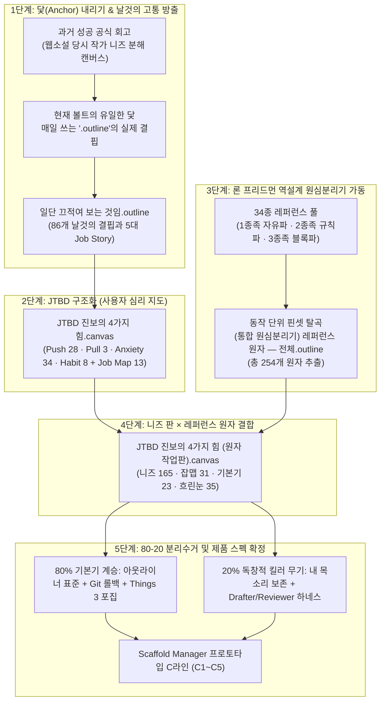
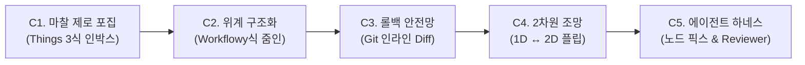

# 📋 (PM 보고서) JTBD 니즈 판에 레퍼런스 원자 254장을 붙여 본 결과

> [!abstract] 📢 **PM Executive Summary: 캔버스와 아웃라인을 관통하는 단 하나의 결론**
> 
> **"우리가 겪는 고통의 40%는 'AI가 일을 망칠까 봐 못 맡기는 불안(Anxiety)'에서 나옵니다.**
> **34개 글로벌 레퍼런스에서 뜯어낸 254개의 동작 원자를 맞대어본 결과, 시장의 현주소는 명확했습니다.**
> 
> 1. **'원본 파괴 불안(버전 복원·인라인 Diff·제안 모드)'은 남들이 이미 다 푼 80% 업계 표준(위생 요인)**입니다. 우리가 창의력을 낭비할 곳이 아니라, 표준 인터랙션 그대로 가져다 튼튼한 바닥으로 깔아야 합니다.
> 2. **'AI의 폭주와 환각을 가두는 하드 게이트'**는 일반 문서 툴에는 없고, `ai-job-search`나 `Archify` 같은 소수의 코드 하네스에만 격리되어 있습니다.
> 3. **'내 목소리·내 생각의 주체성을 지키는 장치(AI Slop 차단, 인지 부채 방지)'는 전 세계 34개 레퍼런스 어디에도 없습니다.**
> 
> **따라서 Scaffold Manager의 승부수는 명확합니다.** 남들이 이미 완성한 '버전 관리와 줌인' 위에, 아무도 풀지 못한 **'작성자의 주체성을 지키는 에이전트 하네스(Visual Grill-Me × Reviewer 가혹 난타)'**를 얹는 것입니다."
> 
> * **보고 대상**: Rin · 민규 서 (Founders & Core Builders)
> * **보고 작성**: Antigravity (Product Manager)
> * **분석 정본**:
>   - 니즈 정본: [[일단 끄적여 보는 것임.outline]] (날것의 고통 86개)
>   - 원자 정본: [[(통합 원심분리기) 레퍼런스 원자 — 전체.outline]] (34종 레퍼런스 동작 원자 254장)
>   - 시각화 작업판: [[JTBD 진보의 4가지 힘.canvas]] (니즈 구조화) ➔ [[JTBD 진보의 4가지 힘 (원자 작업판).canvas]] (니즈-원자 결합판)

---

## 🗺️ 전체 작업 파이프라인 브리핑: "우리는 왜, 무엇을 해왔는가?"

여러 캔버스와 아웃라인을 오가며 눈과 뇌가 피로했던 이유는, 이 작업들이 **서로 다른 차원의 도구(1차원 트리 ➔ 2차원 캔버스 ➔ 다차원 원자 매핑)**에서 순차적으로 빌드업되었기 때문입니다. 전체 작업 흐름을 한 장의 지도로 복원하면 다음과 같습니다.



---

# 1부. 닻(Anchor)과 날것의 결핍: `일단 끄적여 보는 것임.outline`

### 1-1. 분석의 절대적 출발점: 현재 매일 쓰는 `.outline`
남의 멋진 SaaS를 구경하는 것이 목적이 아닙니다. 우리의 유일한 닻은 **"지금 우리가 매일 옵시디언 볼트에서 `.outline`을 쓰며 느끼는 생생한 고통과 갈증"**입니다.
`일단 끄적여 보는 것임.outline`은 과거 웹소설 프로젝트에서 작가 1명을 극한까지 파고들어 과업을 쪼갰던 성공 방정식 그대로, 작업자의 내면에서 터져 나온 86개의 고통 문장을 기록한 문서입니다.

### 1-2. 5대 핵심 Job Story (사용자가 우리 제품을 고용하는 순간)
사용자가 기존 도구(워드, 노션, 메모장)를 집어던지고 Scaffold Manager를 켜는 결정적 순간들입니다.

| 번호 | 사용자의 생생한 육성 (속마음) | 구체적 과업 (Action) | 심층 의도 (Pain & Goal) | 대응 C라인 |
| :---: | :--- | :--- | :--- | :---: |
| **01** | *"내 문서는 이미 콩깍지가 씌었다. 회의 들어가기 전에 가혹하게 털려보고 싶다."* | 기획서 초안의 논리적 허점과 맹점을 Reviewer 모드로 난타 | 상사나 동료 앞에서 망신당하기 전에, AI를 '가혹한 비판자'로 고용해 취약한 가설을 미리 보강하고 싶다. | **C5 (Reviewer 하드게이트)** |
| **02** | *"이 문장을 지웠다가 나중에 후회할까 봐 한 글자도 과감하게 못 지우겠다."* | 아웃라인 노드 수정 전 체크포인트 찍고 인라인 Diff 대조 | 수정을 망설이게 만드는 롤백 불안증을 제거하여, 언제든 1초 만에 복구할 수 있는 안전망 위에서 대담하게 고치고 싶다. | **C3 (Git-Outline 안전망)** |
| **03** | *"생각은 쏟아지는데 목차부터 잡으려니 머리가 굳어버린다."* | 인박스에 파편화된 메모를 흩뿌리고 원클릭으로 아웃라인 루트 노드로 변환 | 처음부터 깔끔하게 정리하려는 강박을 버리고, 일단 배설하듯 적은 뒤 나중에 구조를 맞추고 싶다. | **C1 (무마찰 인박스 포집)** |
| **04** | *"기껏 다듬어둔 완성 노드가 AI 재생성 돌릴 때 통째로 날아가는 게 끔찍하다."* | 확정된 상위 노드는 자물쇠로 잠그고(Lock), 미완성 블록만 다중 대안(v1/v2/v3) 발산 | AI의 무분별한 덮어쓰기 스트레스를 없애고, 확정본을 지키면서 필요한 부분만 안전하게 생성하고 싶다. | **C5 (노드 픽스)** |
| **05** | *"텍스트 위아래 스크롤만으로는 대안들의 인과관계가 한눈에 안 들어온다."* | 아웃라인 트리를 2차원 캔버스 브랜치 뷰로 플립하여 대안 조망 | 긴 문서의 스크롤 피로도를 줄이고, 복잡한 설계 흐름을 조감도 보듯 시각적으로 한눈에 비교하고 싶다. | **C4 (1D ↔ 2D 플립)** |

---

# 2부. 사용자 심리 지형도: `JTBD 진보의 4가지 힘.canvas` 브리핑

아웃라인의 86개 니즈를 Bob Moesta의 **'진보의 4가지 힘(Forces of Progress)'**과 **'잡 맵(Job Map) 8단계'** 캔버스에 재배치하여 사용자의 심리 지형도를 시각화했습니다.

```
                  [ 새로운 해결책으로의 이동 ]
                             ▲
    ① 밀어냄 (Push) · 28장    │    ② 끌어당김 (Pull) · 3장
    현재 방식의 고통과 문제      │    새 도구가 보여줄 매력적인 미래
  ───────────────────────────┼───────────────────────────
    ④ 붙잡음 (Habit) · 8장    │    ③ 망설임 (Anxiety) · 34장 ★ (40%)
    익숙한 기존 관성/세팅 피로   │    새 도구/AI가 일을 망칠까 봐 생기는 공포
                             ▼
                  [ 기존 방식에 잔류/포기 ]
```

### 2-1. ③ 망설임 (Anxiety) — 34장 (전체 니즈의 40% 몰림 현상)
가장 결정적인 발견입니다. 사용자가 새 도구(특히 AI 기반 도구)를 쓰지 못하고 주저하는 이유는 기능 부족이 아니라 **'AI에 대한 불신과 공포'** 때문이었습니다.

* **시킨 대로 안 한다 (10장)**: 단어 하나에 꽂혀 삼천포로 급발진, 장황한 계획질로 토큰 낭비, 지침 누락, 고삐 풀린 망아지 폭주, 맥락 표류, 알맹이 거세.
* **결과를 못 믿겠다 (10장)**: 앞쪽엔 5천억 써놓고 뒤쪽엔 8천억 써놓는 수치 정합성 왜곡, 환각 지뢰, 당당한 거짓 확신(가스라이팅), 출처 없는 블랙박스, 뜬구름 형용사 남발, 영혼 없는 칭찬봇(Yes-Man).
* **원본을 망가뜨릴까 봐 (6장)**: 정본 작업 공간 오염, 영구 삭제 파멸 공포, 롤백 불가 불안증.
* **내 것이 아니게 된다 (5장 - ★ 핵심)**: 영혼 없는 AI 상투어(AI Slop) 혐오, 지적 소유권(Ownership) 상실감, 인지 부채(Cognitive Debt), 사고력 퇴화, '복붙한 성의 없는 작성자' 낙인 공포.
* **회사 보안·규정 사고 (3장)**: 사내 기밀 유출, 라이선스 침해, 감사 추적(Audit Trail) 부재.

### 2-2. ① 밀어냄 (Push) — 28장 (지금 당장 떠나고 싶은 고통)
* **머리가 무겁다 (8장)**: 백지 공포증, 목차 탐색의 막막함, 뇌 용량 과부하, 디테일의 늪에서 미아 방지, 사각지대(Blind Spot).
* **옮겨 담는 노가다 (7장)**: 텍스트 다이어그램 도식화 노가다, 원소스 멀티뷰 재가공 피로, 슬라이드 덱 변환, 파편화된 SaaS 구독료 인질극.
* **문서가 썩고 어긋난다 (5장)**: 사문화된 유령 문서 방치, 볼트 내 지식 상충(Conflict), 의사결정 맥락(Why) 유실, 문서가 최종 무덤(Dead End)이 되는 회의감.
* **남 앞에서 체면 (5장)**: 논리적 무결성 입증, 노이즈 제로 정제 뷰 공유, PR 형태의 변경 요약 안도감.
* **근거가 흩어진다 (3장)**: 레퍼런스 맥락 영구 보존, 도표/시각 자산 유실 불안.

### 2-3. ④ 붙잡음 (Habit, 8장)과 ② 끌어당김 (Pull, 3장)의 의미
* **붙잡음 (8장)**: "매번 컨텍스트를 설명하고 복붙하는 피로(Context Tax)"와 "프롬프트 타이핑 노동/퇴고의 늪" 때문에 결국 손에 익은 워드나 메모장으로 회귀함.
* **끌어당김 (3장)**: "회의 전 3분 오디오 다이제스트", "소크라테스식 반론을 통한 지적 샌드백", "의사결정 설득력 확보". 원자가 적은 이유는 사용자가 고통 중심으로 적었기 때문이며, 실제로는 제품의 핵심 가치 제안이 될 영역입니다.

---

# 3부. 시장의 실측 지도: `JTBD 진보의 4가지 힘 (원자 작업판).canvas`

34종 글로벌 레퍼런스에서 뜯어낸 **254개의 동작 원자(Atomic Interactions)**를 니즈 판 위에 직접 올려놓고 매핑했습니다. 이를 통해 **"시장이 이미 해결한 곳(80% 표준)"**과 **"아직 아무도 해결하지 못한 빈자리(20% 킬러 무기)"**가 확연히 드러났습니다.

### 3-1. 원자 254장 매핑 통계 요약

| 구분 | 수량 | 내용 및 배치 기준 |
| :--- | :---: | :--- |
| **니즈 덩어리에 붙은 원자** | **165장** | 사용자 고통을 직접 덜어주는 레퍼런스의 구체적 기능/인터랙션 |
| **잡 맵 단계에 붙은 원자** | **31장** | 특정 고통 문장 없이 작업 단계(정하기~마무리)에 기여하는 기능 |
| **🧱 기본기 (업계 표준선)** | **23장** | 여러 도구가 공통으로 지원하는 조작/화면 표준 (우리가 창의력을 쓰지 않고 따를 영역) |
| **🕶️ 흐린눈 (지금은 버릴 것)** | **35장** | 현재 MVP 스코프에 불필요하거나 니즈에 닿지 않는 레퍼런스 기능 (의도적 배제) |
| **원자 다출처 레퍼런스 Top 5** | — | Workflowy (23) · Git (20) · ai-job-search (19) · Scrivener (16) · Heptabase (14) |

---

### 3-2. 5대 결정적 PM 인사이트 (시장 벤치마킹 결론)

#### 💡 발견 1. "원본을 망가뜨릴까 봐"는 이미 업계의 80% 표준이다
* **데이터**: 원자 **24장이 12개 레퍼런스**에서 고르게 추출됨.
* **남들이 이미 하고 있는 것**:
  - 버전 기록 및 복원: Dynalist ("restore any version"), Scrivener (스냅샷), Overleaf (히스토리).
  - 확정 전 제안/미리보기: Google Docs (제안 모드), Webflow (섹션 미리보기), ai-job-search (승인 전 쓰기 금지).
  - 안전망: Git (revert, reflog), Dynalist (매일 자동 백업), Archify (검증 통과본만 교체).
* **PM의 판단**: 과거 기획에서는 "Git의 불변 안전망"을 우리만의 독창적 20% 무기로 보았으나, 시장 전체를 조망한 결과 이는 **'따라가지 않으면 탈락하는 80% 기본 표준(위생 요인)'**입니다.
  - **단, 차별화 포인트는 남아 있습니다**: 기존 도구들의 버전 관리는 대부분 '문서 전체 단위'이거나 무겁습니다. 아웃라이너 환경에서 **"단일 노드 단위 로컬 체크포인트 & 초록/빨강 인라인 Diff"**로 극도로 가볍게 구현한 제품은 여전히 드뭅니다.

#### 💡 발견 2. AI를 가두는 장치는 '하네스형 도구' 두 곳에만 몰려 있다
* **데이터**: *시킨 대로 안 한다*(15장)와 *결과를 못 믿겠다*(11장)를 합한 26장 중 **13장이 `ai-job-search`와 `Archify`** 두 곳에 집중됨.
* **핵심 하네스 장치들**:
  - **검증 게이트**: Archify (스키마·HTML·경로 검사를 통과해야만 원본 교체).
  - **행동 반경 통제**: ai-job-search (초안만 생성하고 전송은 절대 불가, 시도 횟수 하드 리밋).
  - **선택적 국소 교체**: Framer Agent (지정한 블록에만 AI 변경 집중), Google Docs (선택 영역 AI).
  - **출처 고정**: Archify (주장마다 번호 출처와 커밋 고정), Linear (AI의 추론 과정 열람).
* **PM의 판단**: 시중의 일반 문서 툴(Workflowy AI, 노션 AI, 구글 시트 AI 등)은 AI를 "단순 호출"할 뿐 "가두는 통제 장치"가 전혀 없습니다. **개발자 진영의 코드 하네스(Drafter vs Reviewer 분업, 하드 게이팅) 사상을 문서 에디터로 이식하는 것**이 강력한 차별점이 됩니다.

#### 💡 발견 3. "내 것이 아니게 된다"를 지켜주는 기능은 전 세계에 단 하나도 없다 (★ 20% 킬러 무기)
* **데이터**: 원자가 단 **2장**에 불과하며, 그마저도 인터랙션 기능이 아님.
  - Dabble: 웹사이트에 "NO SUBSTITUTES · 100% Human WORDS"라고 배너만 걸어둠 (단순 선언).
  - Linear: AI에게 일을 맡겨도 "사람이 주 담당자이고 AI는 기여자"라는 역할 규칙만 둠.
* **사용자의 핵심 고통**:
  - 영혼 없는 AI 상투어(AI Slop), 지적 소유권 상실, 인지 부채(내가 안 써서 생기는 맹점), 사고력 퇴화, '복붙한 성의 없는 작성자' 낙인 공포.
* **PM의 판단**: **Scaffold Manager의 20% 독창적 킬러 무기 1순위입니다.**
  - 34개 레퍼런스 어디에도 "사용자의 고유 문체와 인지적 깊이를 보존해 주는 인터랙션"은 없습니다.
  - AI에게 글 전체 대필을 맡기는 것이 아니라, **'소크라테스식 반론을 던져 내 생각의 해상도를 올려주는 지적 샌드백(Visual Grill-Me)'**, **'내 문체와 논리 뼈대를 지키며 빈칸만 핀셋 제안하는 비계(Scaffold)'** 인터랙션이야말로 시장에 존재하지 않는 절대적 블루오션입니다.

#### 💡 발견 4. "머리가 무겁다 / 노가다"는 이미 답이 차고 넘친다
* **데이터**: *머리가 무겁다*(29장)와 *옮겨 담는 노가다*(19장)에 원자가 집중됨.
  - 백지 공포 해소: Workflowy/Overleaf/Scrivener의 템플릿 시스템, Heptabase의 섹션 및 시각 보드.
  - 노가다 해소: Boords (대본 ➔ 스토리보드), Manifest (기획서 ➔ 유저플로우), Figma Dev Mode (디자인 ➔ 코드).
* **PM의 판단**: 이 영역은 새로 발명할 필요가 전혀 없습니다. **검증된 UI/UX 패턴(Things 3의 인박스 포집, Workflowy의 줌포커스, 템플릿 복제)을 그대로 차용(80%)**하여 개발 비용을 아껴야 합니다.

#### 💡 발견 5. '의도적 흐린눈(35장)'으로 MVP 스코프를 완벽히 통제했다
* **데이터**: 35장의 원자가 '흐린눈' 영역에 격리됨.
* **PM의 판단**: 협업 권한 관리, 복잡한 퍼블리싱/도메인 세팅, 서식 꾸미기(Rich Styling) 등 지금 당장 가설 검증에 불필요한 기능들을 철저히 쳐내어, **초기 프로토타입이 비대해지는 재앙을 사전에 차단**했습니다.

---

# 4부. 최종 실행 블루프린트: Scaffold Manager C라인 MVP 스펙

위의 분석을 종합하여, 매일 쓰는 `.outline`의 결핍을 타격하는 **5단계 C라인 파이프라인 MVP 스펙**으로 매듭짓습니다.



### 4-1. C라인 단계별 구현 사양 (80% 표준 vs 20% 무기)

| 구간 | 해결하는 핵심 결핍 | 채택할 레퍼런스 원자 (80% 표준) | 우리만의 20% 킬러 무기 (Novelty) |
| :--- | :--- | :--- | :--- |
| **C1. 포집<br/>(Capture)** | "생각은 쏟아지는데 목차부터 잡으려니 머리가 굳는다" | **Things 3**<br/>- 단축키 팝업 무마찰 입력창<br/>- 포스트잇처럼 줄바꿈으로 흩뿌리기 | **원클릭 아웃라인 변환**<br/>- 비정형 메모 덩어리를 즉시 `.outline` 루트 노드 위계로 자동 묶기 |
| **C2. 구조화<br/>(Structure)** | "문서가 길어지면 스크롤 피로도와 인지 부하가 심하다" | **Workflowy & Scrivener**<br/>- 단일 노드 줌인(Zoom-in Focus)<br/>- 무한 인덴트(Tab / Shift+Tab) 조작 | **URL to Scaffold 골격 추출**<br/>- 잘 짜인 레퍼런스 URL에서 알맹이는 빼고 목차 뼈대만 빈 슬롯으로 복제 |
| **C3. 안전망<br/>(Safety Net)** | "지웠다가 후회할까 봐 한 글자도 과감하게 못 지우겠다" | **Git & Google Docs**<br/>- 로컬 체크포인트 스냅샷<br/>- 초록(`+`)/빨강(`-`) 인라인 Diff 대조 | **노드 단위 핀셋 체리픽**<br/>- 문서 전체 롤백이 아닌, 마음에 드는 단일 노드만 단축키(`Tab` 승인 / `Esc` 거절)로 국소 반영 |
| **C4. 캔버스 플립<br/>(Visualization)** | "1차원 줄글로는 대안들의 인과관계가 한눈에 안 들어온다" | **Obsidian Canvas & GitKraken**<br/>- 2차원 노드-엣지 시각화<br/>- 브랜치 갈래 나란히 비교 | **1D ↔ 2D 무지연 동기화 플립**<br/>- `.outline` 트리가 버튼 하나로 2차원 캔버스로 변환되고, 캔버스 수정이 즉시 아웃라인에 양방향 동기화 |
| **C5. 하네스<br/>(Harness)** | "AI가 원본을 덮어쓰고 내 목소리를 지워버릴까 봐 두렵다" | **ai-job-search & Archify**<br/>- 확정 영역 잠금(Lock)<br/>- 스키마 검증 통과 전 교체 금지 | **Adversarial Reviewer & 문체 보존**<br/>- **노드 픽스**: 확정 노드는 잠그고 미완성 노드만 대안(v1/v2/v3) 발산<br/>- **Reviewer 가혹 난타**: 회의 전 논리적 허점을 AI가 비판자로 공격 |

---

### 4-2. PM 액션 아이템 (Action Plan)

1. **사용자 심층 확인 (20% 가설 검증)**:
   - "내 것이 아니게 된다(AI Slop, 인지 부채)"에 대해 실제 작업자 인터뷰를 진행하여, 사용자가 AI 글쓰기에서 가장 모욕감이나 피로를 느꼈던 순간의 시나리오를 구체화합니다.
2. **C3 (Git 안전망) & C5 (노드 픽스) 핵심 컴포넌트 개발 착수**:
   - `NodeCheckpointStore`: 노드 편집 전 상태를 메모리/로컬에 임시 스냅샷으로 저장.
   - `InlineDiffDecorator`: 수정 제안 시 취소선과 하이라이트로 전후 차이를 한눈에 표시.
   - `NodeLockManager`: `Ctrl + L` 단축키로 특정 노드를 AI 편집 불가 상태로 보호.
3. **빈 레퍼런스 보강 및 흐린눈 유지**:
   - 노트로만 정리된 레퍼런스 중 핵심인 `ai-job-search`와 `Archify`의 실제 코드 하네스 로직만 집중 분석하고, 나머지 35개 흐린눈 카드는 철저히 봉인합니다.

---

## 5. 정본 출처 링크 (Traceability)

- **니즈 정본**: [[일단 끄적여 보는 것임.outline]] (날것의 니즈 86개)
- **원자 정본**: [[(통합 원심분리기) 레퍼런스 원자 — 전체.outline]] (254개 동작 원자)
- **JTBD 브리핑판**: [[JTBD 진보의 4가지 힘.canvas]]
- **JTBD 원자 작업판**: [[JTBD 진보의 4가지 힘 (원자 작업판).canvas]]
- **파이프라인 지휘본부**: [[1.🎯(Project) 프로젝트/🍽️래퍼런스 뜯어보기/비슷한 작업을 이전에 했었지. 그땐 그랬지.md]]
- **역설계 원심분리기 로드맵**: [[1.🎯(Project) 프로젝트/🍽️래퍼런스 뜯어보기/역설계 원심분리기 작업의 본질과 실천 로드맵.md]]
- **32종 역설계 PM 보고서**: [[1.🎯(Project) 프로젝트/🍽️래퍼런스 뜯어보기/(PM 보고서) Scaffold Manager 주요 레퍼런스 32종 전면 탈곡 및 80-20 역설계 분석 보고서.md]]
