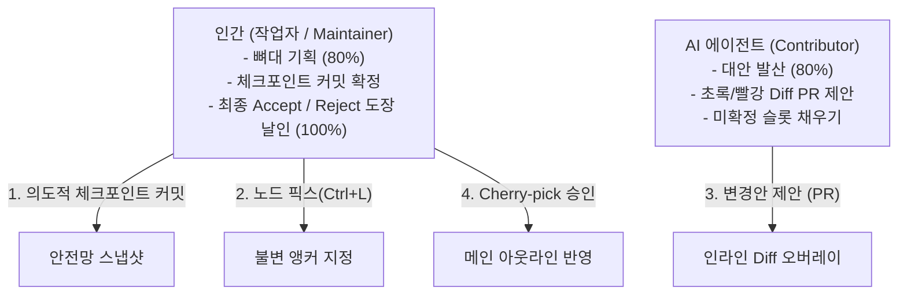

![[Pasted image 20261016144846.png]]

> **"소프트웨어 엔지니어가 거침없이 코드를 엎을 수 있는 이유는 Git의 불변성(Immutability)과 되돌리기(Revert)가 보장되기 때문이다. 아웃라이너에도 '과감한 파괴와 실험의 면책권'이 필요하다."**

* **분석 대상**: Git (버전 관리 & 형상 관리 엔진)
* **3대 종족 분류**: **3종족 (레고 조립 & 안전망·통제파)**
* **핵심 참조 레퍼런스**: [[(web&강추)Git]]
* **연계 인박스 회의록**:
  - [[EXP07 — 아웃라이너 Git 사상 이식 (로컬 스테이징 · 인라인 Diff 대조 · 브랜치 캔버스 시각화)]]
  - [[EXP01 — 줌 안 버전 탭 (줌 인 노드 내 무지연 전후 대조)]]
  - [[EXP02 — 아웃라인·캔버스 플립 전환 (2차원 공간 조망과 가지치기)]]
  - [[EXP10 — 아웃라인 다중 노드 동시 선택 (멀티 셀렉션 및 일괄 AI 디렉션)]]

---

# 🏛️ 1. 80%의 전형성 실측치 (The Familiar)

| 실측 항목 | Git 원본의 전형적 수치/형태 | Scaffold Manager에 차용할 업계 표준선 |
| :--- | :--- | :--- |
| **겉면을 찢은 3대 핵심 뼈대** | 3종족 / DAG(단방향 비순환 그래프) / 부모-자식 커밋 스냅샷 | **단일 트리 + 스냅샷 히스토리 체인** |
| **생각의 최소 단위** | `Commit` 및 `Hunk` (변경 텍스트 조각) | **노드 (Node) 단위의 텍스트 블록** |
| **화면 분할과 조망** | 작업 파일 50% : Diff 대조창 50% | **좌측 아웃라인 트리 ↔ 인라인 Diff 오버레이** |
| **조작 속도와 마찰** | 변경 감지 0ms / Diff 렌더링 즉시 발생 | AI 수정안 발생 즉시 **단축키 0타(자동 오버레이)** |
| **도파민 점수판** | `git commit` 완료 시 해시값 생성 & 그래프 반영 | **`[✓ Accept]` 승인 시 녹색 하이라이트가 깔끔한 본문으로 스냅 고정** (16ms 로컬 렌더) |

---

# 🚀 2. 20%의 변주 실측치 (MAYA Innovation)

### ① 의도된 트레이드오프 (린의 설계 피드백 반영 ⭐)
* **버린 10% (배제)**: 모든 타이핑과 이동을 자잘하게 다 기록하는 더러운 Undo/스테이징 히스토리 배제.
* **몰빵한 90% (집중)**: 사용자가 명시적으로 단축키(`Ctrl+S` 또는 `Ctrl+Shift+C`)로 찍은 **`[의도적 체크포인트 커밋]`**만 깔끔하게 보존.
* **효과**: 언제든 되돌아갈 수 있는 명확한 마일스톤이 존재하므로, 그 사이에는 AI에게 어떤 파괴적 수정을 맡겨도 불안감이 없음.

### ② 단 하나의 시그니처 무기: 초록/빨강 인라인 Diff + 부분 승인 (Cherry-pick)
* **메커니즘**: AI가 제안한 수정안을 별도 창으로 띄우지 않고, 원본 노드 위에 삭제는 **`붉은 취소선`**, 추가는 **`녹색 하이라이트`**로 겹쳐서 표시.
* **부분 승인**: 5개 노드가 바뀌었을 때 `Tab`(승인) / `Esc`(거절)로 **마음에 드는 노드만 골라서(Cherry-pick) 채택**.

### ③ 이종 도메인 교배
* 개발자의 전유물이었던 **'GitKraken식 브랜칭'**을 비전형적 글쓰기 기획으로 가져옴:
  - 1차원 수직 아웃라인을 `Ctrl+Space`로 2차원 캔버스로 플립([[EXP02]]).
  - v1, v2, v3 목차 갈래를 캔버스에 나란히 펼쳐놓고, 최선의 브랜치를 메인 트리로 병합(Merge).

---

# 🤝 3. 인간 vs AI 분업비 실측치 (Division of Labor)

* **역할 분담**:
  - **AI (Contributor)**: Pull Request 작성자처럼 초록/빨강 변경안을 들고 오는 기여자의 역할.
  - **인간 (Maintainer)**: 확정된 노드는 `Ctrl+L`로 잠그고(EXP08), AI의 변경안 중 좋은 노드만 `Accept` 승인하는 총책임자.

---

# 🛠️ 4. Scaffold Manager 이식 확정 컴포넌트 규격 (Component Specs)

1. **`NodeCheckpointStore` (노드 체크포인트 엔진)**
   - 매 단계 저장이 아닌, 사용자가 명시적으로 찍은 스냅샷만 해시 단위로 로컬 보존하는 경량 스토리지.
2. **`InlineDiffDecorator` (인라인 Diff 렌더러)**
   - 노드 내부 텍스트의 변경점을 `+ (Green)` / `- (Red)`로 오버레이하는 CSS/위지윅 스니펫.
3. **`CherryPickToolbar` (노드별 선별 승인 액션 바)**
   - 노드 옆에 붙는 `[✓ Accept]` / `[✗ Reject]` 키보드 단축키 게이트웨이.
4. **`CanvasBranchFlipper` (캔버스 브랜칭 플립 토글)**
   - 1차원 아웃라인과 2차원 대안 브랜치 캔버스 간의 0ms 플립 전환기.
