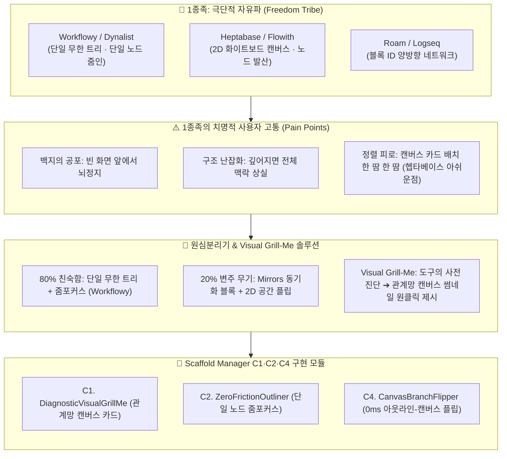

# 📋 [PM 보고서 v2-1] 1종족 극단적 자유파 레퍼런스 심층 탈곡 및 80-20 역설계 분석 보고서

> [!abstract] 📢 **PM Executive Summary: 1종족 분석의 핵심 명제**
> **"1종족(자유파)은 인간에게 '무한한 발상의 자유'를 주었지만, 동시에 '백지 공포증(Blank Slate Paralysis)'과 '수작업 정렬 피로'라는 저주를 안겼습니다.**  
> 우리는 자유파의 80% 기본기인 **'단일 무한 트리 줌포커스(Zoom-in Focus)'와 '16ms 타이핑 리듬'**을 완벽히 흡수하되, 사용자를 빈 화면 앞에 방치하지 않고 **도구가 먼저 3대 뼈대를 시각적으로 들이미는 'Visual Grill-Me 관계망 캔버스'**로 1종족의 치명적 한계를 격파합니다."
> 
> * **분석 대상 1종족 군**: [[(web&강추)Workflowy|Workflowy]], [[(web)Dynalist|Dynalist]], [[Heptabase(헵타베이스)|Heptabase]], [[(web)롬리서치[조사해야함]|Roam Research]], [[(web)logseq [조사해야댐]|Logseq]], [[(web)flowith.io|Flowith]], [[(web&강추)Figma|Figma]], [[(book)생각하고 계획하고 일하라 WorkFlowy|WorkFlowy 서적]]
> * **핵심 해결 과제**: 아웃라인 진입 시 사용자가 겪는 블랙박스 장벽(어디서부터 시작할지 모르는 막막함) 분쇄

---

## 🗺️ 1종족 아키텍처 해체 및 Scaffold Manager 전이 맵



---

# 1부. 1종족 레퍼런스 심층 비교 매트릭스 (Tribe 1 Matrix)

| 서비스명 | 핵심 인터랙션 메커니즘 | 사용자에게 주는 심리적 보상 | 치명적 결핍 (사용자 고통) | 쿨하게 버린 80% (의도적 결핍) | Scaffold Manager 이식 부품 |
| :--- | :--- | :--- | :--- | :--- | :--- |
| **[[ (web&강추)Workflowy \| Workflowy ]]** | **단일 무한 트리 줌인(Zoom-in)**<br/>& **미러(Mirrors)** 블록 동기화 | *"내 모든 생각이 하나의 거대한 우주 안에 완벽히 연결되어 있다"* | 초기 구조 가이드 전무, 서식 꾸미기 불가, 텍스트 벽 발생 | 복잡한 파일/폴더 트리, 무거운 마크다운 수식, 리치 미디어 | **`ZoomInFocusEngine`**<br/>(노드 클릭 시 단일 화면 줌인 집중) |
| **[[ (web)Dynalist \| Dynalist ]]** | **무제한 블릿 + 폴더 트리**<br/>& LaTeX / 마크다운 완벽 지원 | *"제한 없이 방대한 자료를 공학적으로 정리할 수 있다"* | 개발 중단(옵시디언 집중), 딱딱한 텍스트 에디터 느낌 | 칸반 보드 뷰, 블록 실시간 동기화 미러 기능 | **`MarkdownBulletAdapter`**<br/>(옵시디언 표준 마크다운 호환) |
| **[[ Heptabase(헵타베이스) \| Heptabase ]]** | **2D 화이트보드 캔버스**<br/>& 시각적 카드 군집화 | *"복잡한 개념들이 공간 속에서 한눈에 조망된다"* | **카드 크기/배치 수작업 피로**, PDF 임베드 붕괴, 마크다운 깨짐 | 키보드 중심의 빠른 선형 타이핑 리듬, 가벼운 실행 속도 | **`AutoLayoutCanvas`**<br/>(수작업 배치 없는 자동 캔버스화) |
| **[[ (web)flowith.io \| Flowith ]]** | **Follow-up 노드 캔버스 AI**<br/>& 변경 가능한 변수 UI | *"AI와의 대화가 끊기지 않고 2차원 가지로 뻗어나간다"* | 노드가 비대해지면 어디서부터 읽어야 할지 시각적 인지 과부하 | 선형 아웃라인의 정갈한 위계 정리, 최종 문서 조판 기능 | **`BranchNodeGenerator`**<br/>(AI 대안 답변의 2차원 분기 시각화) |
| **[[ (web)롬리서치[조사해야함] \| Roam Research ]]** | **블록 단위 고유 ID**<br/>& 양방향 네트워크 그래프 | *"블록 하나를 어디서든 호출해 재조합할 수 있다"* | 긴 글(장문) 집필 시 극심한 불편함, 높은 구독료 | 전통적인 선형 글쓰기 경험, 직관적인 위지윅 조판 | **`AtomicBlockRef`**<br/>(노드별 고유 해시 ID 및 참조 링크) |
| **[[ (web)logseq [조사해야댐] \| Logseq ]]** | **로컬 퍼스트 아웃라이너**<br/>& PDF 하이라이트 연결 | *"내 데이터가 내 컴퓨터에 안전하게 보존된다"* | 쿼리 문법의 높은 러닝커브, 모바일 동기화 불안정 | 클라우드 기반의 실시간 협업, 무마찰 온보딩 | **`LocalFirstVault`**<br/>(볼트 기반 로컬 안전 보존) |
| **[[ (web&강추)Figma \| Figma ]]** | **무한 2차원 자유 캔버스**<br/>& Dev Mode / 인스펙터 | *"디자이너와 개발자가 단일 캔버스에서 소통한다"* | 텍스트 논리 구조화 도구로 사용하기엔 과도하게 무거움 | 텍스트 기반 논증 체계, 자동 아웃라이닝 | **`InspectorPropertyView`**<br/>(우측 속성 인스펙터 패널) |

---

# 2부. 1종족의 80% 공통 성공 공식 (The Familiar)

자유파 레퍼런스들이 공통적으로 지키고 있는 **"절대 훼손해서는 안 되는 80%의 사용성 표준선"**입니다.

```
┌────────────────────────────────────────────────────────────────────────┐
│                   🏛️ 1종족의 80% 공통 성공 공식 (자유의 기본기)         │
├────────────────────────────────────────────────────────────────────────┤
│  1. 네비게이션 : 단일 노드 줌포커스 (Zoom-in Focus & Breadcrumb)       │
│  2. 사고 단위  : 원자적 불릿 노드 (단문 40~60자 + 엔터/탭 무마찰)       │
│  3. 조작감     : 16ms 무지연 로컬 렌더링 + 0타 진입 (키보드 100% 네비게이션) │
│  4. 참조성     : 블록 단위 고유 식별자(ID) 기반의 양방향 연결         │
└────────────────────────────────────────────────────────────────────────┘
```

### 1. 단일 노드 줌포커스 (Single-Node Zoom Focus)
* **표준 메커니즘**:
  * 문서 전체를 항상 펼쳐두면 작업 기억(Working Memory)이 마비됩니다.
  * 최상위 루트 노드부터 최하위 자식 노드까지, **어떤 불릿이든 클릭하면 그 노드가 최상위 화면으로 전환되는 줌인(Zoom-in)**이 발생하고 상단에 빵부스러기(Breadcrumb) 경로가 표시됩니다.
  * *이 수칙은 Scaffold Manager의 핵심 뷰포트로 100% 계승되어야 합니다.*

### 2. 16ms 타이핑 리듬과 0타 진입
* **수치화 지표**:
  * 엔터(`Enter`)를 치면 즉시 다음 행 노드 생성, 탭(`Tab`)을 치면 16ms 이내에 1Depth 들여쓰기, 쉬프트탭(`Shift+Tab`)은 내어쓰기.
  * 마우스로 손이 갈 필요 없이 **키보드만으로 모든 생각의 위계를 조작**할 수 있어야 합니다.

### 3. 미러(Mirrors)와 블록 참조 (Transclusion)
* **표준 메커니즘**:
  * 1종족 파워 유저들이 가장 열광하는 기능은 '복사-붙여넣기'가 아닌 **'동일 블록의 다중 렌더링(Mirroring)'**입니다.
  * 한 곳에서 노드 내용을 수정하면 참조된 모든 위치에서 실시간 동기화되는 메커니즘입니다.

---

# 3부. 1종족의 20% 킬러 무기와 쿨한 트레이드오프

### 1. [[ (web&강추)Workflowy | Workflowy ]] : 미러(Mirrors) & 칸반 플립
* **20% 킬러 무기**:
  * **미러 블록**: 정보의 중복을 없애고 세컨드 브레인의 단일 진실 공급원(SSOT) 구축.
  * **원클릭 칸반 보드 전환**: 불릿 트리를 마우스 원클릭으로 Trello식 칸반 보드로 시각 전환.
* **쿨하게 버린 것**: 서식 꾸미기(폰트/크기 커스텀), 파일 분리 시스템(모든 데이터를 단 하나의 페이지에 몰빵).

### 2. [[ Heptabase(헵타베이스) | Heptabase ]] : 2D 화이트보드 공간 시각화
* **20% 킬러 무기**:
  * 텍스트 아웃라인의 1차원 한계를 깨부수고, 카드를 2차원 평면 위에 자유롭게 배치하여 시각적 관계망(Graph)을 조망.
* **쿨하게 버린 것**: 빠른 선형 키보드 타이핑 속도.
* **⚠️ 민규 서의 고통점 회고**:
  > *"카드 배치랑 크기 조절 한 땀 한 땀 해야 하는 거 겁나 짱나네... 50개면 50개 다 이러고 있어야 됨."*  
  > ➔ **Scaffold Manager의 솔루션**: 마우스 노가다 배치가 아닌, **아웃라인 위계에 따라 캔버스 노드가 물리 법칙(D3 힘 지향 그래프)으로 자동 정렬되는 오토 레이아웃** 구현.

### 3. [[ (web)flowith.io | Flowith ]] : Follow-up 노드 캔버스 AI
* **20% 킬러 무기**:
  * AI와의 대화가 수직 스크롤로 사라지지 않고, 이전 노드 옆에 새 노드가 2차원 분기로 뻗어나가며 질문과 답변의 계보를 보존.
* **쿨하게 버린 것**: 최종 문서 컴파일 조판 및 장문 퇴고 기능.

---

# 4부. [Scaffold Manager 승부수] Visual Grill-Me로 1종족의 백지 공포 해체

### 💡 1종족의 치명적 결핍: "어디서부터 시작해야 하지?"

Workflowy나 헵타베이스를 켠 사용자가 마주하는 첫 화면은 **거대한 백지(Blank Canvas)**입니다.  
사용자는 빈 화면 앞에서 극심한 인지 마비(Cognitive Freezing)를 겪으며, AI 챗봇에 "어떻게 글을 쓸까?"라고 묻다가 텍스트벽의 저주에 빠집니다.

```
[사용자의 복합 레퍼런스 투입] (책 목차, 인터뷰 메모, 두서없는 아이디어)
                    │
                    ▼ (Scaffold Manager 사전 전신 스캔)
┌──────────────────────────────────────────────────────────────┐
│  👁️ Visual Grill-Me: 1종족을 위한 관계망 캔버스 단면 제시  │
│  "당신의 아이디어는 3개의 핵심 성단(Cluster)으로 나뉩니다.   │
│   어떤 중심 닻(Anchor)부터 아웃라인으로 엮을까요?"          │
└──────────────────────────────────────────────────────────────┘
                    │
         ┌──────────┴──────────┐
         ▼                     ▼
[단면 A: 인과 관계망 캔버스]     [단면 B: 핵심 위계 아웃라인]
(요소 간 화살표 그래프 프리뷰)     (핵심 3단 목차 불릿 프리뷰)
         │                     │
         └──────────┬──────────┘
                    ▼ (원클릭 선택)
[백지 공포 0초 만에 분쇄 ➔ 즉시 줌인하여 첫 줄 타이핑 시작]
```

### 🛠️ 1종족 흡수를 위한 Scaffold Manager 3대 전용 컴포넌트

1. **`DiagnosticVisualGrillMe (관계망 모드)`**:
   - 텍스트 질문을 던지지 않고, 투입된 자료의 핵심 키워드를 **2차원 관계망 노드 맵 썸네일**로 자동 시각화하여 사용자가 '마음에 드는 중심 노드'를 클릭하게 유도.
2. **`ZeroFrictionOutliner`**:
   - Workflowy의 장점인 단일 노드 줌인(`Zoom-in`)과 16ms 키보드 네비게이션을 지원하여, 선택된 단면 위에서 0타로 본문 타이핑 개시.
3. **`CanvasBranchFlipper`**:
   - 헵타베이스처럼 마우스로 카드를 수작업 배치하는 고통을 제거. 1차원 아웃라인 상태에서 `Tab` 키를 누르면 **자동 정렬된 2차원 브랜치 캔버스**로 0ms 플립 전환.

---

# 5부. PM 총평 및 C라인 실행 제언

### 📢 PM 제언 요약
* **가져올 것**: Workflowy의 **단일 노드 줌포커스**, 블록 동기화 **미러**, Flowith의 **대안 답변 2차원 분기**.
* **버릴 것**: 헵타베이스식 **수작업 카드 배치 노가다**, Roam식 **복잡한 쿼리 문법**, 끝없는 **자유 방임형 백지**.
* **독창적 20%**: 사용자가 백지 앞에서 얼어붙기 전에, 도구가 먼저 자료를 스캔해 **'관계망 캔버스 단면'**을 썸네일로 들이미는 **Visual Grill-Me 온보딩**.

### 📌 즉시 실행 액션 아이템
- [ ] **Action 1**: 현재 볼트의 `.outline` 에디터에 단일 노드 줌인(Breadcrumb 경로 네비게이션) 모듈 인터랙션 프로토타입 추가.
- [ ] **Action 2**: 텍스트 아웃라인을 읽어와 수작업 드래그 없이 노드 간 연결선을 자동으로 그려주는 SVG 캔버스 플립 엔진(`CanvasBranchFlipper`) 초안 설계.

---

> [!tip] 📎 **출처 및 관련 문서**
> * 원심분리기 기준: [[(통합 원심분리기) 레퍼런스 역설계 통합 기준표.outline]]
> * 역공학 핵심 명제: [[3.📦(Resource) 자료/SM_Spec_Discoverying/2.ideation/insights/레퍼런스와 역공학 심층 조사/04. 역공학의 대중화와 Visual Grill-Me (질문 의존성을 부수는 시각적 비계).md|04. 역공학의 대중화와 Visual Grill-Me]]
> * 레퍼런스 원문: [[(web&강추)Workflowy.md]], [[(web)Dynalist.md]], [[Heptabase(헵타베이스).md]], [[(web)flowith.io.md]], [[(web)롬리서치[조사해야함].md]]
