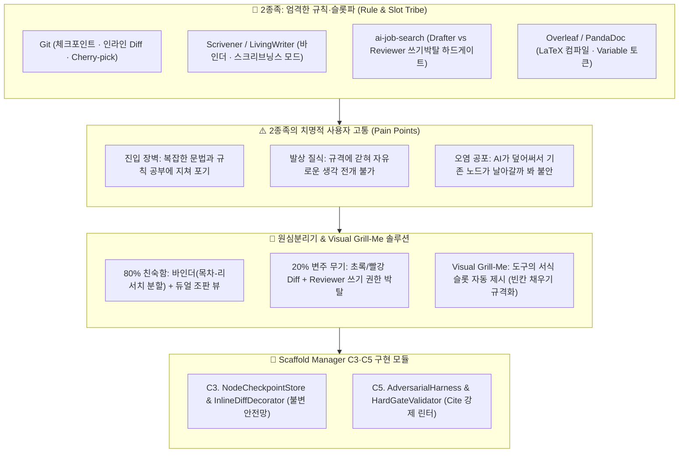

# 📋 [PM 보고서 v2-2] 2종족 엄격한 규칙·슬롯파 레퍼런스 심층 탈곡 및 80-20 역설계 분석 보고서

> [!abstract] 📢 **PM Executive Summary: 2종족 분석의 핵심 명제**
> **"2종족(규칙·슬롯파)은 '완벽한 데이터 무결성과 100% 비즈니스 규격'을 제공하지만, '극심한 진입 장벽과 숨 막히는 서식 규칙'으로 아이디어의 초기 발상을 질식시킵니다.**  
> 우리는 2종족의 80% 규격 뼈대인 **'바인더(원고-자료 통합)와 엄격한 메타데이터 인스펙터'**를 토대로 삼고, 각 레퍼런스의 20% 정수인 **'Git의 인라인 Diff/체크포인트'와 'ai-job-search의 쓰기 박탈 Reviewer'**를 도려내어, 사용자에게 문법 공부를 강요하지 않고 규격을 시각적으로 채우는 **'Visual Grill-Me 서식 슬롯 엔진'**을 구축합니다."
> 
> * **분석 대상 2종족 군**: [[(web&강추)Git|Git]], [[(web)스크리브너 [조사해야함]|Scrivener]], `ai-job-search`, [[(web&강추)Overleaf|Overleaf]], [[(web&강추)PandaDoc|PandaDoc]], [[(web)LivingWriter|LivingWriter]], [[(web)Dabble|Dabble]], [[(web)Reedy Book Studio|Reedsy]], [[(web)어도비 xd & InDesign|InDesign]], [[(SEO)바이브 라이팅의 아주 좋은 사례|Google Sheets AI]]
> * **핵심 해결 과제**: AI 협업 시 발생하는 데이터 오염 공포(작성 노드 증발), 환각(Hallucination), 출처(Cite) 누락 및 지시 무시 방지

---

## 🗺️ 2종족 아키텍처 해체 및 Scaffold Manager 전이 맵



---

# 1부. 2종족 레퍼런스 심층 비교 매트릭스 (Tribe 2 Matrix)

| 서비스명 | 핵심 인터랙션 메커니즘 | 사용자에게 주는 심리적 보상 | 치명적 결핍 (사용자 고통) | 쿨하게 버린 80% (의도적 결핍) | Scaffold Manager 이식 부품 |
| :--- | :--- | :--- | :--- | :--- | :--- |
| **[[ (web&강추)Git \| Git ]]** | **명시적 체크포인트 커밋**<br/>& **초록/빨강 인라인 Diff** | *"언제든 되돌릴 수 있다는 확신이 주는 절대적 창작의 자유"* | 비개발자가 도저히 접근할 수 없는 터미널 CLI와 리베이스 공포 | 자잘한 마이크로 자동저장, 비선형 위지윅 텍스트 인터랙션 | **`NodeCheckpointStore`**<br/>& **`InlineDiffDecorator`** |
| **[[ (web)스크리브너 [조사해야함] \| Scrivener ]]** | **바인더 (원고+리서치)**<br/>& **스크리브닝스 모드** | *"방대한 50페이지 글도 잘게 쪼개어 모듈로 장악할 수 있다"* | 복잡한 인터페이스, 모바일/웹 동기화의 구시대적 한계 | 가벼운 웹 브라우징 접근성, 현대적 실시간 클라우드 협업 | **`ScriveningsLinearReader`**<br/>& **`ManuscriptBinder`** |
| **`ai-job-search`** | **쓰기 권한 박탈 Reviewer**<br/>& **결정론적 하드 게이트** | *"AI의 번지르르한 거짓말과 환각을 0초 만에 찢어버린다"* | 유연성이 전혀 없고 단 1개의 룰 위반에도 생성이 전면 중단됨 | 부드럽고 친절한 대화형 챗봇 경험, 주관적 타협 생성 | **`AdversarialHarness`**<br/>& **`HardGateValidator`** |
| **[[ (web&강추)Overleaf \| Overleaf ]]** | **좌측 코드 - 우측 조판**<br/>듀얼 뷰포트 & LaTeX 템플릿 | *"학술/출판 비즈니스 표준 규격을 100% 무결하게 충족한다"* | LaTeX 문법 오류 시 컴파일이 뻗어버리는 극심한 스트레스 | 마우스 중심의 직관적 드래그 앤 드롭 편집, 즉각적 발상 | **`DualSplitPreview`**<br/>(작업판과 결과물의 실시간 대조) |
| **[[ (web&강추)PandaDoc \| PandaDoc ]]** | **Variable 토큰 바인딩**<br/>& Content Library 조립 | *"정형화된 계약/제안서 슬롯을 레고처럼 안전하게 채운다"* | 규격 외의 자유로운 줄글 서술이나 스토리텔링 불가능 | 자유로운 비정형 발상, 다차원 캔버스 사고 전개 | **`VariableTokenSlot`**<br/>(슬롯 자동 완성 및 토큰 바인딩) |
| **[[ (web)LivingWriter \| LivingWriter ]]** | **소설 플롯 보드 그리드**<br/>& 본문 인물 자동 스마트 태깅 | *"복잡한 복선과 인물 관계가 글 속에서 자동으로 연결된다"* | 소설 외의 비즈니스 기획서, 엔지니어링 문서에는 부적합 | 범용 문서 작성 서식, 코드 에디터 인터랙션 | **`EntityAutoTagger`**<br/>(주요 키워드 자동 위키링크 연결) |
| **[[ (web)Dabble \| Dabble ]]** | **원고-플롯-인물-노트 트리**<br/>& 씬(Scene) 카드 타임라인 | *"스토리 전개 시간축과 세부 장면이 한눈에 동기화된다"* | 계층 구조가 고정되어 있어 커스텀 파이프라인 변경 불가 | 다채로운 커스텀 위젯 조립, 확장 플러그인 생태계 | **`TimelinePlotCard`**<br/>(시간축 기준 C라인 카드 매핑) |
| **[[ (web)Reedy Book Studio \| Reedsy ]]** | **Front / Body / Back matter**<br/>출판 전문 조판 규격 | *"원클릭으로 서점 유통 가능한 완벽한 전자책이 빌드된다"* | 너무 출판에만 한정되어 있어 아이디어 인큐베이팅 불가 | 초기 메모 및 브레인스토밍 캔버스 | **`FrontMatterStandard`**<br/>(볼트 표준 13종 속성 자동 규격화) |

---

# 2부. 2종족의 80% 공통 성공 공식 (The Familiar)

규칙·슬롯파가 공유하는 **"문서 무결성을 유지하기 위한 80%의 업계 표준선"**입니다.

```
┌────────────────────────────────────────────────────────────────────────┐
│                   🏛️ 2종족의 80% 공통 성공 공식 (무결성의 뼈대)        │
├────────────────────────────────────────────────────────────────────────┤
│  1. 데이터 통합 : 바인더 구조 (좌측 목차 원고 + 우측 참고 자료 분리)       │
│  2. 듀얼 조판   : 작업판(에디터) 60% vs 실시간 컴파일 프리뷰 40% 듀얼 대조  │
│  3. 모듈 퇴고   : 쪼개서 쓰고(블록 집필) 합쳐서 읽는(선형 스크롤) 이원화    │
│  4. 규격 린터   : 저장 전 필수 항목 누락을 검증하는 결정론적 검사 관문     │
└────────────────────────────────────────────────────────────────────────┘
```

### 1. 스크리브너식 바인더 (The Binder)와 원고-자료의 분리
* **성공 공식**:
  * 글을 잘 쓰는 시스템은 반드시 **'내가 쓰는 원고(Manuscript)'와 '참고할 백데이터(Research)'를 한 화면에서 완벽히 분리 관리**합니다.
  * 창을 껐다 켰다(`Alt+Tab`) 하지 않고, 우측에 참고 자료(PDF, 회의록, 아티클)를 띄워둔 채 중앙에서 내 아웃라인을 조립하는 것이 표준입니다.

### 2. 스크리브닝스 모드 (Scrivenings Mode): 쪼개서 쓰고 합쳐서 본다
* **성공 공식**:
  * 쓸 때는 **단일 노드(40~60자 블록)**에만 집중하여 인지 과부하를 막고,
  * 퇴고할 때는 폴더를 클릭하여 **수십 개의 쪼개진 노드를 하나의 긴 스크롤 문서로 매끄럽게 합쳐서 전체 톤앤매너를 점검**합니다.
  * *이 메커니즘은 Scaffold Manager의 핵심 뷰 모드로 직결됩니다.*

### 3. 하드 게이트와 결정론적 린터 (Deterministic Linter)
* **성공 공식**:
  * AI에게 "알아서 잘 써줘"라는 타협은 없습니다.
  * 필수 메타데이터, 출처(Cite) 링크, 금지어가 누락되면 컴파일 자체가 거부되는 **하드 게이트**가 존재해야만 비즈니스급 무결성이 유지됩니다.

---

# 3부. 2종족의 20% 킬러 무기와 쿨한 트레이드오프

### 1. [[ (web&강추)Git | Git ]] : 롤백 면책 장치 & 초록/빨강 Diff
* **20% 킬러 무기**:
  * **불변 안전망**: 언제든 마음에 드는 시점으로 원클릭 롤백할 수 있는 스냅샷 체크포인트.
  * **인라인 Diff**: 삭제(`- Red`)와 추가(`+ Green`)를 시각적으로 즉시 대조.
  * **Cherry-pick**: AI 수정안 중 원하는 노드만 골라서 `[✓ 수락] / [✗ 거절]`.
* **쿨하게 버린 것**: 자잘한 타이핑마다 저장되는 불필요한 자동저장 히스토리.

### 2. `ai-job-search` : 쓰기 권한이 박탈된 Reviewer 하네스
* **20% 킬러 무기**:
  * 단일 AI에게 글 작성을 전담시키지 않고, **파일 쓰기/수정 도구가 완전히 박탈된 독립 Reviewer 에이전트**를 투입.
  * Reviewer는 오직 원천 자료(`documents/`)와 대조하여 거짓 주장이나 미사여구를 찾아내고 수정안 diff만 제출.
* **쿨하게 버린 것**: 빠르고 부드러운 단일 챗봇의 편의성.

### 3. [[ (web&강추)PandaDoc | PandaDoc ]] : Variable 토큰 바인딩
* **20% 킬러 무기**:
  * 문서 본문 곳곳에 `[회사명]`, `[담당자]`, `[목표일자]` 같은 정형 슬롯을 변수로 심어두고, 원천 데이터가 바뀌면 전체 문서의 해당 토큰이 일괄 동기화.
* **쿨하게 버린 것**: 비정형의 자유로운 에세이 집필 경험.

---

# 4부. [Scaffold Manager 승부수] Visual Grill-Me로 2종족의 발상 질식 해체

### 💡 2종족의 치명적 결핍: "규칙과 문법이 너무 숨 막힌다"

Overleaf나 LaTeX, 엄격한 린터를 마주한 사용자는 복잡한 서식 태그와 컴파일 에러 앞에서 질식합니다.  
민규 서의 고통 기록([(seo)바이브코딩 툴 아쉬운점](file:///c:/Users/user/Desktop/개똥이 머릿속/3.📦(Resource) 자료/🛖Scaffold_Manager_주요_레퍼런스/(seo)바이브코딩 툴(안티그래비티)_아쉬운점1.md))에서도:
> *"모든 작업 요청에는 작업의 근거가 붙어 나와야 하며, 증명 가능하고 투명해야 한다... 내용을 반드시 채워 넣어야 하는 패티쉬를 에이전트가 갖고 있다."*

Scaffold Manager는 사용자에게 엄격한 문법을 강요하지 않고, 도구가 먼저 **내용이 비워진 순수 배치 규격을 시각적으로 들이미는 'Visual Grill-Me 서식 슬롯 단면'**으로 해결합니다.

```
[복합 레퍼런스 투입] (논문, 기획 표준서, 취업 공고, 기술 스펙)
                    │
                    ▼ (Scaffold Manager 사전 규격 진단)
┌──────────────────────────────────────────────────────────────┐
│  👁️ Visual Grill-Me: 2종족을 위한 서식 슬롯 단면 제시       │
│  "이 레퍼런스의 필수 하드 게이트 규격 4개를 슬롯으로 땄습니다. │
│   각 슬롯에 들어갈 필수 근거(Cite)를 채워 넣으십시오."       │
└──────────────────────────────────────────────────────────────┘
                    │
                    ▼
┌──────────────────────────────────────────────────────────────┐
│  [Slot 1: 문제/결핍] ➔ 근거 링크 필수 (Cite Gate)             │
│  [Slot 2: 핵심 메커니즘] ➔ 40~60자 단문 규격 (Length Gate)    │
│  [Slot 3: 검증 지표] ➔ 정량 수치 필수 (Metric Gate)           │
│  [Slot 4: 실행 액션] ➔ 단축키 매핑 (Action Gate)              │
└──────────────────────────────────────────────────────────────┘
                    │
                    ▼ (Drafter 초안 작성 ➔ Reviewer 난도질 채점)
[초록/빨강 인라인 Diff 대조 ➔ 단축키 1타 체리픽 선별 승인 ➔ 무결성 100% 확정]
```

### 🛠️ 2종족 흡수를 위한 Scaffold Manager 3대 전용 컴포넌트

1. **`DiagnosticVisualGrillMe (서식 슬롯 모드)`**:
   - 사용자가 빈칸의 규칙을 외울 필요 없이, 도구가 규격을 **시각적 와이어프레임 카드**로 렌더링하여 마우스로 슬롯을 지목(Direct Manipulation)하게 함.
2. **`NodeCheckpointStore` & `InlineDiffDecorator`**:
   - `Ctrl+S` 누르는 순간 로컬 체크포인트 커밋 생성. AI 제안을 초록(`+`)/빨강(`-`)으로 오버레이하고 체리픽 수락 버튼 제공.
3. **`AdversarialHarness` (Drafter vs Reviewer 분업 하네스)**:
   - Reviewer 에이전트에게서 파일 수정 도구를 완전히 박탈. 오직 출처(Cite) 누락과 환각만 감시하는 독립 감사관 역할 부여.

---

# 5부. PM 총평 및 C라인 실행 제언

### 📢 PM 제언 요약
* **가져올 것**: Git의 **체크포인트 스냅샷 & 초록/빨강 Diff**, Scrivener의 **바인더 & 스크리브닝스 모드**, ai-job-search의 **쓰기 권한 박탈 Reviewer**.
* **버릴 것**: Overleaf식 **복잡한 LaTeX 컴파일 에러**, Git CLI의 **어려운 터미널 명령어**, PandaDoc식 **딱딱한 서식 고정**.
* **독창적 20%**: 복잡한 규격을 텍스트가 아닌 **'서식 슬롯 와이어프레임'**으로 먼저 시각화하고, **적대적 Reviewer가 빨간펜으로 출처를 강제 린팅**하는 무결성 파이프라인.

### 📌 즉시 실행 액션 아이템
- [ ] **Action 1**: 볼트 `.outline`에 노드별 변경점을 초록/빨강으로 렌더링하는 `InlineDiffDecorator` CSS 클래스 및 키보드 체리픽 단축키(`Tab` 승인 / `Esc` 거절) 구현.
- [ ] **Action 2**: 문단 끝에 볼트 내부 위키링크(`[[출처]]`)가 없으면 저장 버튼을 비활성화하는 `HardGateValidator` 모듈 시험 제작.

---

> [!tip] 📎 **출처 및 관련 문서**
> * 원심분리기 기준: [[(통합 원심분리기) 레퍼런스 역설계 통합 기준표.outline]]
> * AI Job Search 심층 분석: [[1.🎯(Project) 프로젝트/🍽️래퍼런스 뜯어보기/[통합 원심분리기 분석] AI Job Search (로컬 에이전트 하네스 · Drafter-Reviewer 분업 · 하드 게이팅).md|[통합 원심분리기 분석] AI Job Search]]
> * 레퍼런스 원문: [[(web&강추)Git.md]], [[(web)스크리브너 [조사해야함].md]], [[(web&강추)Overleaf.md]], [[(web&강추)PandaDoc.md]], [[(web)LivingWriter.md]]
