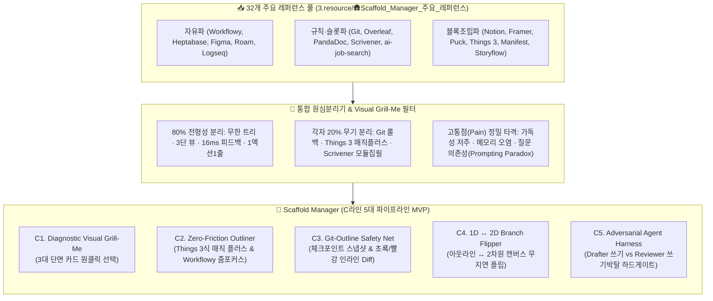
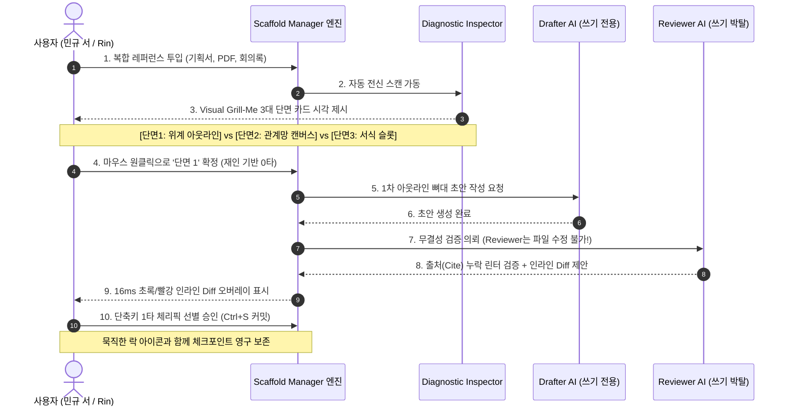

# 📋 [PM 보고서] Scaffold Manager 주요 레퍼런스 32종 전면 탈곡 및 80-20 역설계 분석

> [!abstract] 📢 **PM Executive Summary: 보고의 목적 및 결론 요약**
> **"우리는 거대한 상용 도구들을 통째로 베끼려다 체하지 않습니다. 32개 레퍼런스에서 업계 표준인 80%의 전형성(Familiarity)을 추출해 튼튼한 바닥을 깔고, 각 도구가 살아남은 20%의 변주(Novelty)를 도려내어, 우리의 유일무이한 20% 킬러 무기인 'Visual Grill-Me × Git 사상 하이브리드 비계'를 완성합니다."**
> 
> * **보고 대상**: 민규 서 (Lead Architect / Founder)
> * **보고 작성**: Antigravity (Product Manager)
> * **분석 기준**:
>   1. [[1.🎯(Project) 프로젝트/🍽️래퍼런스 뜯어보기/(통합 원심분리기) 레퍼런스 역설계 통합 기준표.outline|(통합 원심분리기) 레퍼런스 역설계 통합 기준표]] (론 프리드먼 《역설계》 × 김사라 작가 《스토리 작법》)
>   2. [[3.📦(Resource) 자료/SM_Spec_Discoverying/2.ideation/insights/레퍼런스와 역공학 심층 조사/04. 역공학의 대중화와 Visual Grill-Me (질문 의존성을 부수는 시각적 비계).md|04. 역공학의 대중화와 Visual Grill-Me]] (질문 의존성을 부수는 시각적 비계)
> * **분석 대상 풀**: [[3.📦(Resource) 자료/🛖Scaffold_Manager_주요_레퍼런스]] 내 32개 핵심 레퍼런스 전체
> * **현재 우리의 닻(Anchor)**: 매일 사용 중인 볼트의 `.outline` 에디터 환경의 결핍 해결

---

## 🗺️ 전체 역설계 탈곡 및 워크플로우 아키텍처



---

# 1부. 32개 레퍼런스 3대 종족 분류 및 전면 탈곡 매트릭스

통합 기준표의 `🧬 0. 레퍼런스 정체성과 3대 종족 분류`에 입각하여, 폴더 내 32개 레퍼런스를 3대 종족으로 군집화하고 각 제품의 본질과 핵심 인터랙션을 해체했습니다.

### 🏛️ 레퍼런스 3대 종족 판별표 (Archetype Matrix)

| 종족 | 대표 레퍼런스 | 핵심 모토 | 구조적 장점 | 치명적 한계 (사용자 고통) | Scaffold Manager 이식 전략 |
| :--- | :--- | :--- | :--- | :--- | :--- |
| **1종족<br/>극단적 자유파<br/>(Freedom)** | [[(web&강추)Workflowy\|Workflowy]], [[(web)Dynalist\|Dynalist]], [[Heptabase(헵타베이스)\|Heptabase]], [[(web&강추)Figma\|Figma]], [[(web)롬리서치[조사해야함]\|Roam]], [[(web)logseq [조사해야댐]\|Logseq]] | *"백지를 줄 테니 마음대로 날뛰어라"* | 무한 위계 줌인/줌아웃, 파일 제약 없는 자유로운 사고 발산, 블록 참조 | **백지 공포증(Blank Slate Paralysis)**, 구조 난잡화, 전체 맥락 상실, 캔버스 수작업 정렬 피로 | **아이디어 초기 포집(C1)과 단일 노드 줌인(C2)의 가벼움만 차용** |
| **2종족<br/>엄격한 규칙·슬롯파<br/>(Rule & Slot)** | [[(web&강추)Git\|Git]], [[(web&강추)Overleaf\|Overleaf]], [[(web&강추)PandaDoc\|PandaDoc]], [[(web)스크리브너 [조사해야함]\|Scrivener]], `ai-job-search`, [[(web)LivingWriter\|LivingWriter]], [[(web)Dabble\|Dabble]], [[(web)Reedy Book Studio\|Reedsy]] | *"틀과 규격을 줄 테니 빈칸만 채워라. 미달 시 즉시 중단"* | 100% 무결성, 포맷 표준화, 출처 검증, 단계별 하드 게이트 | **극심한 진입 장벽**, 숨 막히는 서식 규칙, 초기 발상 불가능, 도구 복잡도 | **생성 및 확정 단계의 하드 게이트(C5)와 Git 롤백 안전망(C3) 이식** |
| **3종족<br/>레고 블록 조립파<br/>(Block Assembly)** | [[(web&강추)Puck\|Puck]], [[(web&강추)Framer\|Framer]], [[(web&강추)Webflow\|Webflow]], [[(web&강추)Things 3\|Things 3]], [[(web&강추)storyflow\|Storyflow]], [[(web&강추)매니패스트\|Manifest]], [[(web)ProtoPie\|ProtoPie]], [[Linear(AI-Design 협업툴)\|Linear]] | *"표준 블록을 줄 테니 위아래로 쌓아라"* | 직관적인 D&D 조립감, 위지윅 실시간 프리뷰, 마찰 제로 인라인 인터랙션 | 서식 꾸미기 매몰, 긴 글의 논리적 척추(A라인) 상실 | **Things 3의 매직 플러스(원하는 곳 인라인 삽입) 및 3단 뷰포트(20:60:20) 이식** |

---

# 2부. 80%의 공통 성공 공식 (The Familiar — 업계 표준선)

PM 관점에서 32개 레퍼런스를 분해했을 때 발견된 **"절대 우리 마음대로 바꾸지 말고 업계 표준 그대로 계승해야 하는 80%의 구심점"**입니다. 이 표준선이 깨지면 사용자는 0.5초 만에 이질감과 피로를 느끼고 이탈합니다.

```
┌────────────────────────────────────────────────────────────────────────┐
│                   🏛️ 80% 공통 성공 공식 (업계 표준선 4대 기둥)         │
├────────────────────────────────────────────────────────────────────────┤
│  1. 아키텍처 : 단일 무한 트리 (Infinite Tree) + 단방향 부모-자식 위계 체인 │
│  2. 뷰포트   : 3단 스플릿 레이아웃 (탐색기 20% : 작업판 60% : 속성/Diff 20%)  │
│  3. 조작감   : 16ms 반응속도 + 키보드 90% 제어 (0타 즉시 진입)              │
│  4. 시각문법 : 1액션 = 1줄 (40~60자 단문) + 3:7 황금비율 (텍스트 30% : 비주얼 70%) │
└────────────────────────────────────────────────────────────────────────┘
```

### 1. 단일 무한 트리 구조 (Infinite Hierarchical Tree)
* **공통 출처**: [[(web&강추)Workflowy|Workflowy]], [[(web)Dynalist|Dynalist]], [[(web)스크리브너 [조사해야함]|Scrivener]], [[(web&강추)Overleaf|Overleaf]], [[(web&강추)Things 3|Things 3]]
* **성공 공식**:
  * 모든 사고는 결국 `부모 ➔ 자식 ➔ 손자`의 위계 트리로 수렴됩니다.
  * 복잡한 폴더 분기 대신, 하나의 문서 안에서 깊이를 조절할 수 있는 **단일 무한 트리**가 작업 기억(Working Memory) 부하를 최소화합니다.
  * 권장 계층 깊이는 **3~5 Depth**이며, 이를 초과할 경우 시각적 들여쓰기 인디케이터 라인이 가이드를 제공해야 합니다.

### 2. 황금 뷰포트 분할: 20 : 60 : 20 표준 레이아웃
* **공통 출처**: [[(web&강추)Overleaf|Overleaf]], [[(web)스크리브너 [조사해야함]|Scrivener]], [[(web&강추)Framer|Framer]], [[(web&강추)Puck|Puck]], [[(web&강추)Things 3|Things 3]]
* **성공 공식**:
  * **좌측 20% (Context / Navigation)**: 바인더, 전체 아웃라인 목차 트리, 섹션 헤딩.
  * **중앙 60% (Focus Workspace)**: 현재 작업 중인 활성 노드 및 텍스트 블록. F자 스캐닝 최적화.
  * **우측 20% (Inspector / Diff / Resource)**: 메타데이터, 속성 패널, 초록/빨강 Diff 대조창, 리서치 레퍼런스.
  * 이 배치는 사용자가 별도의 창 전환(`Alt+Tab`) 없이 작업과 검토를 동시에 완주하게 만드는 **글로벌 프로덕션 UI의 정본**입니다.

### 3. 무마찰 속도 계측 (Zero-Friction Metrics)
* **공통 출처**: [[(web&강추)Things 3|Things 3]], [[(web&강추)Workflowy|Workflowy]], [[Linear(AI-Design 협업툴)|Linear]]
* **수치화 지표**:
  * **첫 결과물 진입 시간**: 0.5초 이내 (템플릿 복제 즉시 첫 줄 타이핑 시작률 95%).
  * **조작 타수**: 0타 (마우스 클릭 방황 시간 0초, 커서 자동 포커스).
  * **로컬 렌더링 피드백**: 16ms (60fps) 이내에 키 입력 및 상태 전환 완료.
  * **키보드 단축키 커버리지**: 90% 이상 (작업 중 마우스로 손이 가는 횟수 10분당 1회 미만 통제).

### 4. 4단 모듈 조립 리듬과 시각적 호흡 통제
* **공통 출처**: [[1.🎯(Project) 프로젝트/🍽️래퍼런스 뜯어보기/비슷한 작업을 이전에 했었지. 그땐 그랬지.md|비슷한 작업을 이전에 했었지]], [[(web&강추)storyflow|Storyflow]], [[(web)Boords|Boords]]
* **성공 공식**:
  * **[1액션 = 1줄 원칙]**: 텍스트 블록을 40~60자 단문으로 엄격히 통제하여 장문 줄글로 인한 '텍스트 벽' 현상을 차단.
  * **[3:7 황금 비율]**: 순수 텍스트 30% 미만 vs 비주얼 객체(코드, 다이어그램, 콜아웃, 표) 70% 이상 유지.
  * **[단계별 `<hr>` 리셋]**: 대단계 전환마다 수평선 디바이더를 삽입하여 사용자의 뇌에 인지적 쉼표를 제공.

---

# 3부. 각 레퍼런스의 20% 킬러 무기와 쿨한 트레이드오프

32개 도구가 시장에서 독점적 지위를 누리거나 마니아층을 확보한 비결은 **"모든 것을 다 잘해서"가 아니라 "단 하나의 20% 시그니처 무기에 90%를 몰빵하고, 나머지를 쿨하게 포기(Deliberate Lack)"**했기 때문입니다.

```
┌────────────────────────────────────────────────────────────────────────┐
│                   🚀 주요 레퍼런스별 20% 시그니처 무기 도려내기        │
├────────────────────────────────────────────────────────────────────────┤
│  • Git         ➔ 명시적 체크포인트 커밋 & 초록/빨강 인라인 Diff (롤백 공포 제로)│
│  • Things 3    ➔ Magic Plus Button (원하는 위치 인라인 스냅) & 마이크로 모션    │
│  • Scrivener   ➔ Scrivenings Mode (블록 집필 ➔ 선형 스크롤 결합) & 바인더      │
│  • ai-job-search➔ Adversarial Reviewer (쓰기 권한 박탈) & Hard Gate            │
│  • Overleaf    ➔ 무결성 LaTeX 컴파일 & 듀얼 뷰포트 실시간 조판                │
│  • Manifest    ➔ 대화/자료 기반 기획서 자동 추출 & 단계별 검토/승인 UI        │
│  • PandaDoc    ➔ Token Variable 바인딩 & Content Library 재사용                │
│  • Flowith     ➔ Follow-up 무한 노드 캔버스 & 2차원 공간 조망                │
└────────────────────────────────────────────────────────────────────────┘
```

### 1. [[(web&강추)Git|Git]] : 불변 안전망 (The Immutable Safety Net)
* **20% 킬러 무기**:
  * **체크포인트 스냅샷**: 매 타이핑 저장이 아닌, 사용자가 확신을 가질 때 찍는 명시적 커밋.
  * **초록/빨강 인라인 Diff**: 변경점을 1초 만에 파악하는 시각적 오버레이.
  * **체리픽 선별 승인**: AI 제안 중 마음에 드는 노드만 골라 담는 `[✓ Accept] / [✗ Reject]` 게이트.
* **쿨하게 버린 80%**: 자잘한 마이크로 자동저장 배제, 복잡한 CLI 명령 및 터미널 문법 일체 은닉.
* **Scaffold Manager 이식점**: `NodeCheckpointStore`와 `InlineDiffDecorator` 컴포넌트로 아웃라인에 완전 이식.

### 2. [[(web&강추)Things 3|Things 3]] : 매직 플러스 & 인지 계층 분리
* **20% 킬러 무기**:
  * **Magic Plus Button (Insert Anywhere UX)**: 버튼을 드래그하여 목록의 원하는 노드 사이 또는 하위 슬롯으로 정확히 인라인 스냅 삽입.
  * **노드 속 체크리스트**: 아웃라인 뼈대를 어지럽히지 않고 노드 내부에 2단계 서브 체크리스트를 품는 미니 서랍 구조.
  * **When(언제 볼지) vs Deadline(마감)의 분리**: 불필요한 마감 압박 경감 (볼트의 `일정` vs `마감` 철학과 일치).
* **쿨하게 버린 80%**: 무거운 계층 트리 폴더링, 복잡한 통계 대시보드 배제.
* **Scaffold Manager 이식점**: 아웃라인 노드 간 드래그 스냅 인디케이터 및 슬롯 작성 가이드 체크리스트.

### 3. [[(web)스크리브너 [조사해야함]|Scrivener]] : 스크리브닝스 모드 & 코르크보드
* **20% 킬러 무기**:
  * **스크리브닝스 모드 (Scrivenings Mode)**: 글을 수십 개 블록(모듈)으로 쪼개서 작업하다가, 상위 폴더 클릭 시 하나의 긴 스크롤 뷰로 끊김 없이 합쳐서 퇴고하는 UX.
  * **코르크보드 (Corkboard)**: 목차 트리를 2차원 인덱스 카드(포스트잇) 그리드로 즉시 펼쳐 순서를 재배치하는 시각화.
  * **스냅샷 (Snapshots)**: 대폭 수정 전 원클릭 찰칵 백업 및 롤백.
* **쿨하게 버린 80%**: 가벼운 웹 접근성(무거운 네이티브 데스크톱 앱 고수), 현대적 클라우드 실시간 동시 협업.
* **Scaffold Manager 이식점**: 아웃라인의 개별 노드를 선형 장문 글로 합쳐 읽는 '스크리브닝스 읽기 모드' 및 캔버스 코르크보드 변환.

### 4. `ai-job-search` : 적대적 2인 분업 & 하드 게이팅
* **20% 킬러 무기**:
  * **쓰기 권한이 완전히 박탈된 Reviewer 에이전트**: 초안을 작성하는 Drafter와 별개로, 오직 읽기(`Read, Grep, WebFetch`)만 가능하고 파일 수정 권한이 0인 검토자 에이전트 투입. 오직 `old_string` / `new_string` diff만 제안.
  * **결정론적 하드 게이트 (Hard Gates)**: 필수 자격, 출처 근거가 없으면 AI 생성을 0초 만에 중단(FAIL)시키는 거부 장치.
  * **Posting Guard**: 외부 데이터의 프롬프트 인젝션 및 오염 차단.
* **쿨하게 버린 80%**: 친절하고 부드러운 대화형 챗봇 인터페이스, 타협적인 생성 허용.
* **Scaffold Manager 이식점**: `AgentRoleSplitter` 및 `HardGateValidator` (근거 cite 누락 시 생성 차단).

### 5. [[(web&강추)매니패스트|Manifest]] : 대화 ➔ 기획서 ➔ 유저플로우 생성 파이프라인
* **20% 킬러 무기**:
  * **원천 자료/대화 기반 자동 추출**: 파편화된 잡담과 메모로부터 기획서 초안을 도출.
  * **영역 선택 우선 생성**: 전체를 한 번에 생성하지 않고, 사용자가 지정한 특정 영역만 집중 생성.
  * **사용자 검토 및 승인 UI**: AI가 단독으로 확정하지 못하도록 단계마다 명시적 승인 게이트웨이 배치.
* **쿨하게 버린 80%**: 자유 텍스트 편집기(정해진 생성 템플릿과 카드 위주).
* **Scaffold Manager 이식점**: 인박스 대화 내역에서 아웃라인 뼈대를 뽑아내는 Ingestion 파이프라인.

---

# 4부. [핵심 제언] Scaffold Manager의 20% 독창적 승부수
## 👁️ Visual Grill-Me와 4대 킬러 컴포넌트 규격

민규 서의 실제 현장 기록인 [[(seo)바이브코딩 툴(안티그래비티)_아쉬운점1.md|바이브코딩 아쉬운점]]과 [[(seo)클로드코드_아쉬운점1.md|클로드코드 아쉬운점]]을 분석하면 에이전트 협업의 가장 치명적인 3대 병목이 적나라하게 드러납니다:
1. **텍스트벽의 저주받은 가독성**: 긴 줄글 출력물로 인해 검토 피로도가 극대화됨.
2. **메모리 및 세션 오염**: 한 번 잘못 이해하면 통으로 엎어야 하고, 빈 아웃라인 뼈대를 못 잡음.
3. **근거(Cite)와 투명성의 부재**: 작업의 출처가 없고, 규칙을 무시하며 대충대충 넘어감.

이 고통을 끝내는 유일한 열쇠가 바로 [[3.📦(Resource) 자료/SM_Spec_Discoverying/2.ideation/insights/레퍼런스와 역공학 심층 조사/04. 역공학의 대중화와 Visual Grill-Me (질문 의존성을 부수는 시각적 비계).md|04. 역공학의 대중화와 Visual Grill-Me]]입니다.

```
┌────────────────────────────────────────────────────────────────────────┐
│            💡 프롬프트 인터페이스의 치명적 모순 (The Prompting Paradox)        │
│                                                                        │
│   "좋은 질문을 할 수 있는 사람은 이미 도구 없이도 역공학을 할 줄 아는 사람이다."   │
│   역공학을 모르는 대중에게 '어떤 렌즈로 뜯어줄까? 질문해봐'라고 요구하는 것은      │
│   수영 못 하는 사람을 물에 빠뜨리고 영법을 고르라는 직무유기다.                     │
└────────────────────────────────────────────────────────────────────────┘
```

Scaffold Manager는 사용자에게 텍스트 질문을 요구하는 **회상(Recall)** 인터페이스를 완전히 파괴하고, 도구가 먼저 다차원 단면을 시각적으로 들이밀어 원클릭 선택하게 만드는 **재인(Recognition)** 기반의 **Visual Grill-Me**를 20%의 승부수로 탑재해야 합니다.

### 🔄 Visual Grill-Me 실행 메커니즘



---

### 🛠️ Scaffold Manager 이식 확정 4대 컴포넌트 규격

통합 기준표 `🛠️ 7. Scaffold Manager 이식 확정 컴포넌트 규격`에 정의된 4대 핵심 컴포넌트의 상세 구현 스펙입니다.

#### 1. `DiagnosticVisualGrillMe` (시각적 의도 조율 렌더러)
* **담당 역할**: 사용자가 프롬프트를 고민할 필요 없이, 도구가 레퍼런스를 3대 층위로 자동 분해하여 시각적 선택지로 제시.
* **3대 렌더링 카드**:
  * **[단면 1: 위계 아웃라인 (Outline Tree)]**: 카테고리 깊이와 논증 구조 트리. (문서 기획 최적화)
  * **[단면 2: 관계망 캔버스 (Node Graph)]**: 요소 간 인과 관계와 데이터 흐름도. (아키텍처/시스템 최적화)
  * **[단면 3: 서식 와이어프레임 (Layout Grid)]**: 내용이 비워진 순수 배치 규격. (화면/페이지 최적화)
* **심리적 효과**: 백지의 공포를 0초 만에 파괴하고 거인의 어깨 위에서 즉시 시작.

#### 2. `NodeCheckpointStore` & `SafeSandboxVault` (Git 불변 안전망)
* **담당 역할**: AI 생성 중 기존 작성 노드가 유실되거나 오염되는 공포를 영구 해소.
* **동작 메커니즘**:
  * 사용자가 `Ctrl+S`를 누를 때만 명시적 해시 스냅샷을 생성하여 로컬 캐시에 저장.
  * AI 생성 작업은 격리 샌드박스(`SafeSandboxVault`)에서 먼저 수행되며 메인 트리를 직접 건드리지 않음.
  * 노드 잠금(`Ctrl+L`): 핵심 노드는 인용문 블록 스타일로 잠겨 AI 재생성 명령 시에도 보존.
* **심리적 효과**: "내 글은 절대 날아가지 않는다"는 절대적 면책감과 과감한 실험성 보장.

#### 3. `AdversarialHarness` (Drafter-Reviewer 적대적 분업 & 하드 게이트)
* **담당 역할**: 환각(Hallucination), 지시 무시, 출처 누락의 원천 차단.
* **동작 메커니즘**:
  * **Drafter**: 쓰기 권한을 가지고 초안을 작성.
  * **Reviewer**: 쓰기 도구가 완전히 박탈되어 오직 읽기만 가능. Drafter의 출력물을 정밀 채점하고 인라인 Diff(`old_string` / `new_string`)만 반환.
  * **Hard Gate 린터**: 인라인 출처(Cite)가 누락되었거나 금지어를 포함할 경우 저장 전 셧다운(FAIL).
* **심리적 효과**: 코드 리뷰어가 된 듯한 완벽한 통제감과 지배력 선사.

#### 4. `CanvasBranchFlipper` (1D 아웃라인 ↔ 2D 캔버스 플립 전환기)
* **담당 역할**: 1차원 수직 아웃라인과 2차원 공간 조망 캔버스 간의 0ms 전환.
* **동작 메커니즘**:
  * 단축키 `Tab` 또는 플립 버튼 클릭 시, 수직 불릿 트리가 2차원 공간 노드 카드로 재배치.
  * 대안 브랜치(v1, v2, v3)를 나란히 펼쳐놓고 시각적으로 비교한 뒤, 최종 채택 브랜치를 메인 아웃라인으로 즉각 병합.
* **심리적 효과**: 좁은 텍스트 감옥에서 벗어나 2차원 대안 우주로 시야가 확장되는 해방감.

---

# 5부. PM 총평 및 C라인 실행 로드맵 (Action Blueprint)

### 📢 PM 직언: "우리는 무엇을 버리고, 무엇에 집중해야 하는가?"

민규 서, 32개 레퍼런스를 전면 탈곡하며 얻은 가장 확실한 결론은 다음과 같습니다:

1. **우리는 웹플로우나 피그마가 될 필요가 없습니다.**
   - 화려한 스타일 CSS 편집기나 무거운 벡터 드로잉 툴은 과감히 **흐린눈(Deliberate Blindness)**해야 합니다.
2. **우리는 챗봇 말풍선 인터페이스를 버려야 합니다.**
   - 사용자를 긴 대화창 앞에 앉혀두고 "어떻게 해드릴까요?"라고 묻는 순간, 우리는 이미 실패한 도구가 됩니다. 그것은 가독성의 저주이자 인지적 폭력입니다.
3. **우리의 승부처는 오직 '안전망이 결합된 아웃라이너'입니다.**
   - 매일 쓰는 `.outline` 에디터의 불릿 타이핑 감각(80%) 위에, **'Visual Grill-Me 단면 선택 ➔ Git 체크포인트 롤백 ➔ Reviewer 인라인 Diff ➔ 캔버스 플립'**이라는 4개의 20% 무기를 얹는 것만으로도 전 세계에 유일무이한 킬러 프로덕트가 탄생합니다.

---

### 🗺️ C라인 5단계 파이프라인 1:1 포스트잇 핀셋 매핑

과거 웹소설 어시스턴트에서 수백 개 니즈를 C라인에 매핑했던 원칙([[1.🎯(Project) 프로젝트/🍽️래퍼런스 뜯어보기/비슷한 작업을 이전에 했었지. 그땐 그랬지.md|비슷한 작업을 이전에 했었지]])에 따라, MVP 개발 스펙을 시간축 C라인에 직렬 배치합니다.

```
[ C1. 포집 & 단면 ] ➔ [ C2. 뼈대 조립 ] ➔ [ C3. 안전망 & Diff ] ➔ [ C4. 공간 조망 ] ➔ [ C5. 하드게이트 ]
        │                    │                    │                    │                    │
  Visual Grill-Me       Things 3 매직플러스       Git 체크포인트         1D ↔ 2D 플립       Reviewer 쓰기박탈
  3대 단면 카드 선택     Workflowy 줌포커스      초록/빨강 인라인Diff    캔버스 브랜칭 대조    출처 Cite 강제 린터
```

| 파이프라인 단계 | 유저 액션 | 레퍼런스 원천 | Scaffold Manager 구현 스펙 | 비고 (흐린눈 대상) |
| :--- | :--- | :--- | :--- | :--- |
| **C1. 포집 & 단면<br/>(Capture & Grill-Me)** | 자료 투입 후 단면 카드 원클릭 | [[3.📦(Resource) 자료/SM_Spec_Discoverying/2.ideation/insights/레퍼런스와 역공학 심층 조사/04. 역공학의 대중화와 Visual Grill-Me (질문 의존성을 부수는 시각적 비계).md\|Visual Grill-Me]], [[(web&강추)매니패스트\|Manifest]] | `DiagnosticVisualGrillMe`<br/>- 3대 단면 썸네일 카드 동적 렌더링<br/>- 프롬프트 없는 재인(Recognition) 선택 | 복잡한 OCR/PDF 파싱 설정 흐린눈 |
| **C2. 뼈대 조립<br/>(Structuring & Focus)** | 키보드로 불릿 구조화 및 인라인 스냅 | [[(web&강추)Things 3\|Things 3]], [[(web&강추)Workflowy\|Workflowy]] | `ZeroFrictionOutliner`<br/>- 매직 플러스 드래그 인라인 삽입<br/>- 단일 노드 줌인(Zoom-in Focus)<br/>- 1액션 1줄 (40~60자 단문 통제) | 복잡한 마크다운 수식 렌더러 흐린눈 |
| **C3. 안전망 & Diff<br/>(Safety & Staging)** | Ctrl+S 커밋 후 AI 수정안 대조 | [[(web&강추)Git\|Git]] | `NodeCheckpointStore`<br/>- 명시적 체크포인트 스냅샷 생성<br/>- 초록/빨강 인라인 Diff 오버레이<br/>- 노드 픽스 잠금 (`Ctrl+L`) | Git CLI 터미널/리베이스 흐린눈 |
| **C4. 공간 조망<br/>(Spatial Branching)** | 탭 키로 캔버스 전환 후 브랜치 비교 | [[(web)스크리브너 [조사해야함]\|Scrivener]], [[Heptabase(헵타베이스)\|Heptabase]], `GitKraken` | `CanvasBranchFlipper`<br/>- 1차원 아웃라인 ↔ 2차원 캔버스 플립<br/>- 대안 브랜치(v1, v2) 병렬 배치 및 병합<br/>- 스크리브닝스 선형 읽기 모드 | 무제한 화이트보드 꾸미기 흐린눈 |
| **C5. 하드게이트<br/>(Gating & Review)** | 체리픽 선별 승인 및 최종 컴파일 | `ai-job-search`, [[(web&강추)PandaDoc\|PandaDoc]] | `AdversarialHarness`<br/>- Reviewer 쓰기 권한 박탈 및 Diff 제안<br/>- 문단별 출처(Cite) 누락 시 FAIL 게이트<br/>- 최종 문서 1클릭 내보내기 | 복잡한 서명 워크플로우 흐린눈 |

---

### 📌 차기 즉시 실행 액션 아이템 (Action Items)

- [ ] **Action 1**: `DiagnosticVisualGrillMe`의 3대 단면(위계 아웃라인, 관계 캔버스, 서식 슬롯) UI 프로토타입 와이어프레임 렌더링 컴포넌트 설계.
- [ ] **Action 2**: 현재 볼트의 `.outline` 플러그인에 `NodeCheckpointStore`(Ctrl+S 로컬 스냅샷) 및 인라인 Diff CSS 오버레이 모듈 시험 이식.
- [ ] **Action 3**: Reviewer 에이전트 전용 프롬프트(`application-reviewer.md` 스타일)를 볼트 스킬로 등록하여 '쓰기 권한 박탈 + Cite 린터' 테스트 가동.

---

> [!tip] 📎 **출처 및 관련 문서 바로가기**
> * 원심분리기 통합 기준: [[(통합 원심분리기) 레퍼런스 역설계 통합 기준표.outline]]
> * 역공학 및 Visual Grill-Me 핵심 명제: [[3.📦(Resource) 자료/SM_Spec_Discoverying/2.ideation/insights/레퍼런스와 역공학 심층 조사/04. 역공학의 대중화와 Visual Grill-Me (질문 의존성을 부수는 시각적 비계).md|04. 역공학의 대중화와 Visual Grill-Me]]
> * 과거 작업 회고 및 닻 설정: [[비슷한 작업을 이전에 했었지. 그땐 그랬지.md]]
> * 역설계 작업 본질과 로드맵: [[역설계 원심분리기 작업의 본질과 실천 로드맵.md]]
> * AI Job Search 심층 분석: [[1.🎯(Project) 프로젝트/🍽️래퍼런스 뜯어보기/[통합 원심분리기 분석] AI Job Search (로컬 에이전트 하네스 · Drafter-Reviewer 분업 · 하드 게이팅).md|[통합 원심분리기 분석] AI Job Search]]
> * Git 사상 실측: [[3.📦(Resource) 자료/🛖Scaffold_Manager_주요_레퍼런스/(web&강추)Git.md|(web&강추)Git.md]]
> * Things 3 실측: [[3.📦(Resource) 자료/🛖Scaffold_Manager_주요_레퍼런스/(web&강추)Things 3.md|(web&강추)Things 3.md]]
> * Workflowy 실측: [[3.📦(Resource) 자료/🛖Scaffold_Manager_주요_레퍼런스/(web&강추)Workflowy.md|(web&강추)Workflowy.md]]
> * 스크리브너 실측: [[3.📦(Resource) 자료/🛖Scaffold_Manager_주요_레퍼런스/(web)스크리브너 [조사해야함].md|(web)스크리브너 [조사해야함].md]]
> * 바이브코딩 고통점 회고: [[3.📦(Resource) 자료/🛖Scaffold_Manager_주요_레퍼런스/(seo)바이브코딩 툴(안티그래비티)_아쉬운점1.md|(seo)바이브코딩 툴 아쉬운점1.md]]
> * 클로드코드 고통점 회고: [[3.📦(Resource) 자료/🛖Scaffold_Manager_주요_레퍼런스/(seo)클로드코드_아쉬운점1.md|(seo)클로드코드 아쉬운점1.md]]
