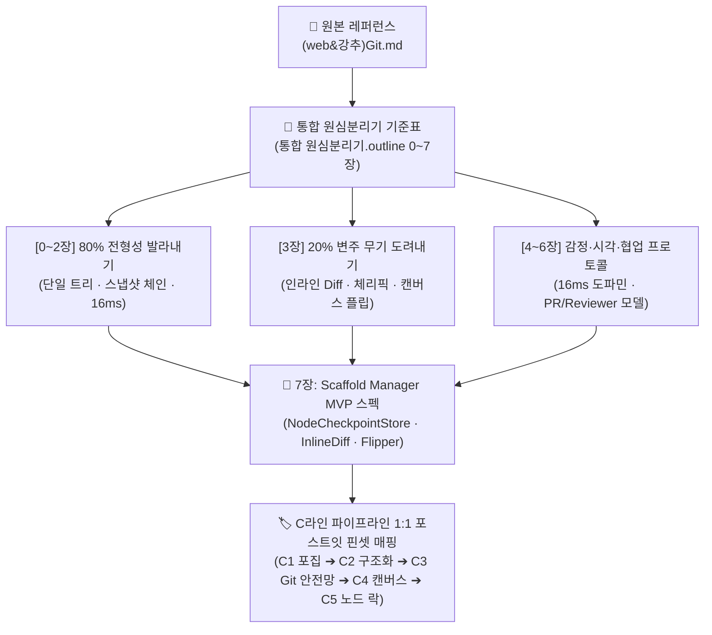

![[Pasted image 20261016144846.png]]

# 🔬 [통합 원심분리기 분석] Git 사상 전면 탈곡 및 C라인 포스트잇 매핑

> [!abstract] 💡 핵심 의도 및 분석 철학 (Core Intent)
> **"소프트웨어 엔지니어가 코드를 거침없이 엎고 실험할 수 있는 이유는 Git의 불변 안전망(Immutability & Rollback)이 있기 때문이다."**  
> 본 보고서는 Rin과 민규 서의 분석 지표를 하나로 융합한 **`[통합 원심분리기] 레퍼런스 역설계 통합 기준표 (8대 챕터)`**를 가동하여, 레퍼런스 [[(web&강추)Git|Git]]의 방대한 기능 중 복잡한 터미널/리베이스 등은 철저히 **흐린눈(Deliberate Blindness)**하고, 오직 현재 우리의 닻인 **`.outline`의 결핍을 영구히 해소할 20%의 킬러 무기**를 탈탈 털어 C라인(C1~C5) 캔버스용 원자형 포스트잇 카드로 세분화한 결과물입니다.

---

## 🗺️ 분석 프레임워크 및 실행 흐름



---

# 1부. 통합 원심분리기 8대 챕터 전면 탈곡 (Threshing Matrix)

### 🧬 [0. 레퍼런스 정체성과 3대 종족 분류]
* **원문 메타 정보**: 대상 제품: `Git (Distributed VCS)` / 핵심 참조: [[(web&강추)Git]]
* **Git의 본래 종족**: **2종족 (엄격한 규칙·슬롯파)**
  - SHA-1/SHA-256 해시 기반의 엄격한 DAG(Directed Acyclic Graph) 무결성 체계.
  - 규칙이 매우 엄격하여 비개발자가 진입하기엔 극심한 진입장벽과 질식감을 유발함.
* **Scaffold Manager의 하이브리드 교배점 (승부수)**:
  - 1종족의 **가벼운 시작(불릿 텍스트의 자유도)**을 겉면에 유지하면서,
  - 백그라운드에는 2종족인 **Git의 불변 체크포인트 엔진**을 장착하고,
  - 에디터 상단에서 3종족(레고 블록 조립)의 **스냅 바인딩**으로 체결.

---

### 🎯 [1. 타깃 페르소나와 심리적 장벽 해체]
* **📢 핵심 약속 (Core Value Promise)**:
  > *"무작정 코드부터 치지 마라 — 10분의 기획 점검이 10시간의 삽질을 막아준다."*  
  > 아웃라이너 작성자에게 **"마음껏 지우고 엎어도 언제든 1초 만에 복구된다"**는 심리적 면책권을 부여.
* **🚧 사용자가 마주하는 3대 핵심 장벽과 Git의 해소 처방**:
  1. **블랙박스 장벽**: 글이나 기획을 어디서 시작할지 모르는 막막함  
     ➔ **처방**: Git 저장소 초기화 템플릿처럼, 검증된 4단 슬롯 템플릿을 원클릭 복제해 0타로 진입.
  2. **데이터 오염 공포 (핵심 타격점 ⭐)**: AI에게 "이 섹션 다시 써줘" 했다가 기껏 쓴 소중한 문장이 통째로 날아갈까 봐 생기는 불안  
     ➔ **처방**: 명시적 체크포인트 커밋 + 인라인 초록/빨강 Diff로 기존 문장 안전 보호.
  3. **반복 노가다 피로도**: AI의 제안 중 일부만 반영하려고 복사/붙여넣기를 반복하는 인지 피로  
     ➔ **처방**: `[✓ Accept]` / `[✗ Reject]` 단축키 1타 체리픽 선별 승인.

---

### 🏛️ [2. 80%의 전형성 측정표 (업계 표준선 계측)]
우리가 창의력을 발휘하지 않고, 업계 표준 그대로 차용해야 하는 80%의 베이스라인입니다.

| 전형성 계측 항목 | Git 원본의 규격 및 수치 | Scaffold Manager 아웃라이너 이식 규격 |
| :--- | :--- | :--- |
| **문서 아키텍처** | Directed Acyclic Graph (DAG) | **단일 무한 계층 트리 (Infinite Tree)** |
| **데이터 연결 방식** | 부모 커밋 해시 포인터 체인 | **단방향 부모-자식 위계 + 스냅샷 해시 연결** |
| **생각의 최소 단위** | `Commit` (스냅샷) 및 `Hunk` (변경 텍스트 덩어리) | **노드 (Node) 단위의 텍스트 블록 (40~60자 단문)** |
| **화면 면적 분할** | 탐색기 20% : 작업 에디터 50% : Diff 대조창 30% | **좌측 아웃라인 60% : 우측/인라인 Diff 20% : 캔버스 20%** |
| **조작 반응 속도** | 로컬 인메모리 변경 감지 0ms | AI 수정안 도착 즉시 **16ms 로컬 렌더링 피드백** |
| **단축키 커버리지** | 터미널 CLI 100% / GUI 툴 80% 이상 | **90% 이상 (마우스 없이 Tab, Esc, Ctrl+S로 완결)** |
| **선제적 안전선** | `.git` 디렉토리 내 원본 객체 불변 보존 | **메인 볼트를 오염시키지 않는 독립 격리 샌드박스** |

---

### 🚀 [3. 20%의 변주 측정표 (최적의 새로움 — MAYA 실측)]
남들과 완전히 구별되는 Scaffold Manager만의 킬러 무기이자 변주 포인트입니다.

* **🗡️ 단 하나의 시그니처 무기**:
  - **`초록(+)/빨강(-) 인라인 Diff` + `노드 단위 체리픽([✓ Accept]/[✗ Reject])`**
  - **호출 비용**: AI 수정 제안 즉시 자동 오버레이 (단축키 0타 진입).
  - **발동 빈도**: 1시간 집중 집필/기획 중 30~50회 발동.
* **⚖️ 의도된 트레이드오프 (린의 설계 피드백 반영 ⭐)**:
  - **쿨하게 버린 것 (10% 포기)**:
    - 매 타이핑과 커서 이동을 자잘하게 다 기록하는 더러운 Undo/마이크로 자동저장 배제.
    - Git의 복잡한 원격 푸시, 리베이스(Rebase), 충돌 해결(Conflict resolution) 일체 배제 (흐린눈 🕶️).
  - **90% 극단적 몰빵 (집중)**:
    - 사용자가 명시적으로 단축키(`Ctrl+S` 또는 `Ctrl+Shift+C`)로 확정한 **`[의도적 체크포인트 커밋]`**만 깔끔하게 보존.
* **🧬 이종 도메인 교배 (뿌리 추적)**:
  - 개발자의 형상 관리 엔진(Git / IDE)을 비전형적 글쓰기 기획으로 전이.
  - 1차원 수직 아웃라인을 `Ctrl+Space`로 2차원 캔버스로 뒤집어 v1, v2, v3 브랜치를 공간적으로 비교하는 **`캔버스 브랜칭 플립(Canvas Branch Flipper)`**.

---

### 🎬 [4. 논지 전개와 인지적 감정 곡선 (Narrative Flow)]
* **1단계 (진입장벽 0)**: 복잡한 깃 세팅 없이 빈 노드에서 즉시 타이핑 시작.
* **2단계 (즉각적 도파민 공급 / 16ms)**: AI가 문장을 개선했을 때, 별도 팝업이 아니라 내 문장 위에 즉시 **초록/빨강 인라인 Diff**가 선명하게 켜지며 시각적 쾌감 선사.
* **3단계 (피로감 치트키)**: 10개 문장 중 마음에 드는 2개만 `Tab` 키로 콕콕 집어 수락(`Cherry-pick`)하고, 나머지는 `Esc`로 1초 만에 날려버림.
* **4단계 (선택권 부여)**: 2D 캔버스 브랜칭은 필수가 아닌 '(선택)'으로 두어, 깊은 고민이 필요할 때만 캔버스로 플립.
* **5단계 (인지적 종결 매듭)**: `[수정 ➔ 체리픽 승인 ➔ 체크포인트 커밋]`의 초간단 3단계 루틴으로 하루 작업 깔끔하게 마감.

---

### 🎨 [5. 시각적 리듬과 모듈 조립 문법 (Visual Anatomy)]
* **1액션 1줄 원칙**: Diff 표시는 문단 통짜가 아니라 노드(행) 단위로 엄격히 제한.
* **4단 모듈 조립 공식**:
  ```
  [ 노드 인덱스 ] ➔ [ 원본 텍스트 (빨강 취소선) ] ➔ [ AI 제안 텍스트 (초록 하이라이트) ] ➔ [ [✓] / [✗] 인라인 액션 버튼 ]
  ```
* **정보 밀도와 인지적 쉼표**:
  - 순수 텍스트 30% vs 시각적 비교 객체(인라인 Diff) 70% 비율 유지.
  - 대주제나 브랜치 전환점마다 `<hr>` 인지적 쉼표를 두어 시선 피로 차단.

---

### 🤝 [6. 인간 vs AI 분업비 측정표 (Division of Labor)]
* **단계별 지분율**:
  - **1단계 뼈대(목차) 설계**: 인간 80% vs AI 20%
  - **2단계 살(본문) 채우기**: 인간 30% vs AI 70% (AI가 적극적으로 대안 제안)
  - **3단계 최종 검증 및 날인**: **인간 100% (Maintainer 최종 결재권)**
* **협업 프로토콜**:
  - **AI의 역할 = Contributor (PR 제출자)**: 기존 노드를 덮어쓰지 못하고, 반드시 인라인 Diff 오버레이 형태로 'Pull Request'만 제안.
  - **인간의 역할 = Code Reviewer (유일한 커미터)**: 노드 단위로 체리픽 승인 및 거절.
* **보호 앵커**: `Ctrl+L` **노드 픽스(Lock)**를 걸어둔 노드는 AI가 어떤 재생성을 돌려도 절대 손대지 못함.

---

### 🛠️ [7. Scaffold Manager 이식 확정 컴포넌트 규격 (Component Specs)]
원심분리기 가동을 통해 최종 추출된 5대 소프트웨어 부품 명세서입니다:

```yaml
components:
  - id: NodeCheckpointStore
    type: Storage Engine
    spec: "매 타이핑 자동저장이 아닌, 사용자가 명시적으로 트리거한 스냅샷만 해시(Hash) 단위로 보존하는 로컬 체크포인트 저장소"
  - id: InlineDiffDecorator
    type: Editor UI Renderer
    spec: "텍스트 변경점을 원본 노드 위에 + (Green 하이라이트) / - (Red 취소선)로 16ms 내에 오버레이 렌더링하는 데코레이터"
  - id: CherryPickToolbar
    type: Interaction Controller
    spec: "노드 우측에 [✓ Accept] / [✗ Reject] 버튼을 마운트하고 키보드(Tab/Esc)와 바인딩하는 단축키 컨트롤러"
  - id: CanvasBranchFlipper
    type: Viewport Flipper
    spec: "단축키(Ctrl+Space) 트리거 시 1차원 아웃라인 트리를 2차원 대안 브랜치 캔버스로 즉시 전환하는 0ms 뷰포트 플리퍼"
  - id: SafeSandboxVault
    type: Isolation Container
    spec: "파괴적인 글쓰기 실험 도중 메인 볼트 데이터를 오염시키지 않도록 메모리 상에서 격리 구동하는 샌드박스"
```

---

# 2부. C라인(C1~C5) 배치를 위한 원자형 포스트잇 카드 세분화

과거 웹소설 어시스턴트에서 수백 개의 포스트잇 카드를 C라인에 꽂았던 방식([[비슷한 작업을 이전에 했었지. 그땐 그랬지.md#3. Scaffold Manager 역설계 적용 계획: "C라인 파이프라인 매핑"|C라인 매핑]])을 계승하여, Git에서 발라낸 부품을 **실제 작업 순서(C1~C5)**에 따라 낱알 포스트잇 카드로 세분화했습니다.

```
[ 상단 A라인 : 북극성 목표 ]
  ➔ "아웃라이너 글쓰기에서 파괴적 편집과 AI 디렉션 시의 롤백 불안증 완전 제로화"
                     │
[ 상단 C라인 : 시간축 실행 파이프라인 ]
  [C1. 포집] ➔ [C2. 구조화] ➔ [C3. Git 안전망] ➔ [C4. 캔버스 플립] ➔ [C5. 노드 잠금]
      │             │               │                 │               │
  (CARD-01)     (CARD-02)       (CARD-03~05)      (CARD-06~07)     (CARD-08)
```

---

### 🟨 C1. 포집 & 인박스 구간 (Capture & Inbox)
* **해결할 갈증**: 아이디어가 떠올랐을 때 정돈된 트리에 넣으려다 타이밍을 놓침.
* 🏷️ **`[CARD-C1-01] Git Stash 임시 저장소 사상`**
  - **도려낸 메커니즘**: `git stash` (작업 중이던 미완성 코드를 장롱 속에 1초 만에 쑤셔 넣기).
  - **아웃라이너 적용**: 글을 쓰다 불현듯 떠오른 딴생각을 단축키 하나로 아웃라인 흐름 방해 없이 `임시 Stash 서랍`에 떨궈두고 본래 흐름 복귀.

---

### 🟦 C2. 구조화 & 아웃라인 트리 구간 (Structuring & Focusing)
* **해결할 갈증**: 목차가 복잡해지면 상하 위계 관계가 뒤엉키고 뼈대가 무너짐.
* 🏷️ **`[CARD-C2-01] Git Commit-Tree 부모 포인터 사상`**
  - **도려낸 메커니즘**: Git의 커밋 오브젝트가 부모 커밋의 해시를 물고 늘어지는 단방향 체인.
  - **아웃라이너 적용**: 노드를 이동하거나 들여쓰기할 때 노드 간의 위계 포인터가 즉각 재연결되어, 수백 개 노드가 얽혀도 데이터 무결성 보장.

---

### 🟩 C3. 안전망 & Diff 대조 구간 (Branching & Staging) ⭐ [핵심 몰빵 구역]
* **해결할 갈증**: *"outline에 Git이 달리면 좋을 텐데!"* — AI에게 맡겼다가 원본이 훼손될까 봐 생기는 극심한 롤백 불안증.

* 🏷️ **`[CARD-C3-01] 의도적 체크포인트 스냅샷 (NodeCheckpointStore)`**
  - **도려낸 메커니즘**: `git commit -m "checkpoint"` (개발자가 의도적으로 찍은 영구 보존점).
  - **아웃라이너 적용**: 매 타이핑 저장이 아닌, 마음에 드는 목차가 나왔을 때 `Ctrl+S`로 찍는 명시적 마일스톤. 롤백 버튼 1타로 언제든 복구.

* 🏷️ **`[CARD-C3-02] 초록/빨강 인라인 Diff 데코레이터 (InlineDiffDecorator)`**
  - **도려낸 메커니즘**: GitHub Pull Request의 인라인 코드 변경점 시각화.
  - **아웃라이너 적용**: AI 제안 도착 즉시 삭제는 `붉은 취소선`, 추가는 `녹색 하이라이트`로 노드 위에 실시간 16ms 오버레이.

* 🏷️ **`[CARD-C3-03] 노드 단위 부분 체리픽 툴바 (CherryPickToolbar)`**
  - **도려낸 메커니즘**: `git cherry-pick <commit-id>` (원하는 커밋만 선별 적용).
  - **아웃라이너 적용**: AI 제안 노드 옆에 붙는 `[✓ Accept]` / `[✗ Reject]` 버튼으로 마음에 드는 문장만 골라서 본문 반영.

---

### 🟪 C4. 2차원 캔버스 변환 구간 (Canvas Visualization)
* **해결할 갈증**: *"outline이 캔버스로 변환되면 좋을 텐데!"* — 1차원 수직 트리로는 여러 대안 목차(Branch)를 나란히 비교하기 어려움.

* 🏷️ **`[CARD-C4-01] GitKraken식 대안 브랜치 공간 분기 (CanvasBranchFlipper)`**
  - **도려낸 메커니즘**: Git의 브랜치 생성 및 GUI 시각화 그래프.
  - **아웃라이너 적용**: `Ctrl+Space`로 1차원 아웃라인을 2차원 캔버스로 플립. v1, v2, v3 대안 목차가 가로 프레임으로 나란히 펼쳐짐.

* 🏷️ **`[CARD-C4-02] 비파괴적 원터치 브랜치 병합 (Safe Branch Merge)`**
  - **도려낸 메커니즘**: `git merge --no-ff` (선택된 브랜치의 메인 스트림 안전 통합).
  - **아웃라이너 적용**: 캔버스에서 낙점된 v2 브랜치를 선택하고 `[Merge to Outline]`을 누르면, 1차원 아웃라인의 본문이 깨끗하게 교체.

---

### 🟥 C5. 노드 픽스 & 부분 AI 발산 구간 (Lock & Regenerate)
* **해결할 갈증**: *"기껏 다듬어둔 대전제 노드가 AI 전체 재생성 때 통째로 날아간다!"*
* 🏷️ **`[CARD-C5-01] 보호된 브랜치/태그 사상 (Node Lock & Pinning)`**
  - **도려낸 메커니즘**: Protected Branch & Read-Only Tag (관리자 외 수정 불가 잠금).
  - **아웃라이너 적용**: 확정된 핵심 노드는 `Ctrl+L`로 자물쇠 잠금. 인용구 스타일로 굳어지며, 이후 AI에게 아무리 큰 명령을 내려도 잠긴 노드는 보존되고 빈칸만 재생성.

---

# 3부. 과거 1호 실측치와의 비교 평가 & MVP 실행 제언

### 📊 과거 1호 실측치 vs 이번 통합본 탈곡 비교표

| 평가 항목 | 과거 1호 실측치 (`(원심분리기 실측) Git 사상.md`) | 이번 통합본 탈곡 보고서 (현재) | 질적 도약 포인트 |
| :--- | :--- | :--- | :--- |
| **기준표 잣대** | 통합 전 Rin의 80-20 수치 중심 | **Rin × 민규 서 8대 챕터 통합 기준표 완벽 가동** | 정체성·장벽·감정곡선·조립문법 전방위 포괄 |
| **타깃 페르소나** | 미언급 (기능 위주 기술) | **파워 유저 & 입문자의 3대 심리 장벽 명확화** | "왜 만드는가"에 대한 인지 심리학적 당위성 확보 |
| **감정 리듬 통제** | 단순 반응 속도 계측 | **16ms 도파민 피드백 ➔ 체리픽 ➔ 3단계 매듭 공식** | 사용자가 지치지 않고 완주하는 리듬 설계 |
| **협업 프로토콜** | 단순 머메이드 다이어그램 | **AI(Contributor/PR) vs 인간(Maintainer/Reviewer)** | 명확한 책임 소재와 AI Hallucination 방어벽 |
| **최종 산출물 형태** | 서술형 줄글 리포트 | **C라인(C1~C5) 캔버스 직결 8대 원자형 포스트잇 카드** | 기획에서 즉시 시각 캔버스 카드로 전환 가능 |

---

### 💡 Scaffold Manager 첫 번째 프로토타입(MVP) 구현 로드맵 제언

* **P0 (최우선 구현 — 가설 검증 1순위)**:
  1. `[CARD-C3-01]` **`NodeCheckpointStore`**: 단축키 `Ctrl+S`로 찍는 명시적 스냅샷 및 롤백 엔진.
  2. `[CARD-C3-02]` **`InlineDiffDecorator`**: AI 수정안 발생 시 원본 노드에 입혀지는 초록/빨강 오버레이.
  3. `[CARD-C3-03]` **`CherryPickToolbar`**: `Tab`(수락) / `Esc`(거절)로 골라 담는 부분 승인 바.
* **P1 (차순위 확장)**:
  4. `[CARD-C5-01]` **`Node Lock (Ctrl+L)`**: 완성된 노드를 AI 파괴로부터 보호하는 잠금 장치.
  5. `[CARD-C4-01]` **`CanvasBranchFlipper`**: 1D 아웃라인을 2D 브랜치 대조 캔버스로 플립.
* **P2 (고도화)**:
  6. `[CARD-C1-01]` **`Stash 서랍`** 및 `[CARD-C4-02]` **`Canvas Merge`**.

> [!tip] 🎯 결론: 흐린눈(Deliberate Blindness)의 위대한 승리
> Git의 방대한 CLI와 복잡한 브랜치 트리, 리베이스를 다 구현하려 했다면 프로젝트는 100% 침몰했을 것입니다.  
> 하지만 통합 원심분리기를 통해 **"작업자의 롤백 불안증을 없애주는 3개 카드(체크포인트 · 인라인 Diff · 체리픽)"**만 핀셋으로 도려냈기 때문에, Scaffold Manager는 **가장 가벼우면서도 가장 안전한 차세대 아웃라이너**로 확실하게 포지셔닝할 수 있습니다.
