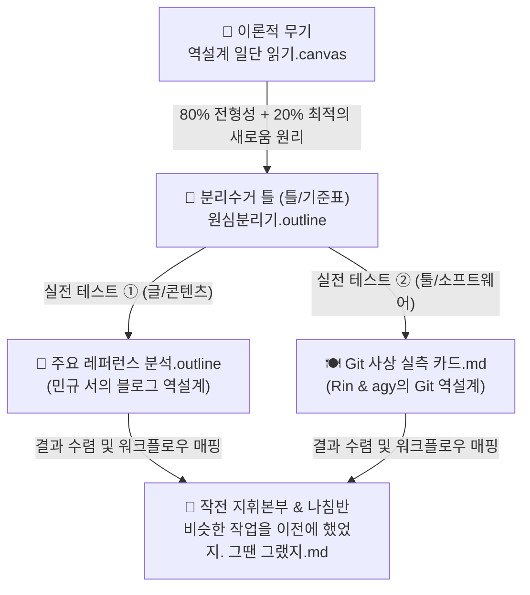

# 역설계 원심분리기 작업의 본질과 실천 로드맵

> [!abstract] 💡 한 줄 요약: 지금 하려는 작업의 본질
> **"거대하고 화려한 레퍼런스 제품들을 통째로 베끼려다 체하지 않고,**
> **① 남들이 다 하는 80%의 기본 공식(익숙함)과, ② 쟤들이 뜬 20%의 킬러 무기(변주)를 발라낸 뒤,**
> **③ 그 위에 '우리만의 20% 독창적인 무기'를 얹었을 때 진짜 성공할지 검증하고 딱 필요한 부품만 도려내는 작업"**입니다.

---

## 1. 흩어져 있던 자료들의 관계도 (퍼즐 맞추기)

지금 여러 곳에 흩어져 있는 자료들은 사실 **완벽한 하나의 파이프라인**으로 연결되어 있습니다.

1. **[[4.🗄️(Archive) 보관/(Library) 망고네 도서관/(Book) 서적/역설계/역설계 일단 읽기.canvas|역설계 일단 읽기.canvas]]**
   - **이론적 토대**: 론 프리드먼의 핵심 원리입니다. "완전히 새로운 것은 대중이 외면한다. **80%의 익숙한 공식에 20%의 변주(최적의 새로움)**를 섞어야 대박이 난다."
2. **[[1.🎯(Project) 프로젝트/🍽️래퍼런스 뜯어보기/소프트웨어를 해체하는 론 프리드먼의 역설계 원심분리기.outline|소프트웨어를 해체하는 론 프리드먼의 역설계 원심분리기.outline]]**
   - **원심분리기 측정표(분리 기준)**: 30개 소프트웨어를 **3대 종족**(자유파/규칙파/블록파)으로 나누고, **80% 전형성 수치**(단축키, 반응속도, 구조)와 **20% 변주 수치**(의도적 포기, 시그니처 무기, 도메인 교배)를 계측하는 시험대입니다.
3. **[[1.🎯(Project) 프로젝트/🥸옵시디언 플러그인 개발하는 법 글쓰기/주요 레퍼런스 분석.outline|주요 레퍼런스 분석.outline]]** & **[[(원심분리기 실측) Git 사상 (체크포인트 · 인라인 Diff · 캔버스 브랜칭)|[원심분리기 실측] Git 사상.md]]**
   - **실제 가동 성공 샘플**: 민규 서는 '글/콘텐츠'를 원심분리해 보았고, Rin은 'Git(소프트웨어)'을 원심분리기에 넣어 부품 4개(`NodeCheckpointStore`, `InlineDiffDecorator` 등)를 실제로 뽑아냈습니다.
4. **[[1.🎯(Project) 프로젝트/🍽️래퍼런스 뜯어보기/비슷한 작업을 이전에 했었지. 그땐 그랬지.md|비슷한 작업을 이전에 했었지. 그땐 그랬지.md]]**
   - **최종 작전 지휘본부**: 과거 웹소설 프로젝트에서 수백 개 카드를 뽑아 C라인에 배치했던 경험을 살려, 이번 Scaffold Manager 개발에 적용하기 위한 **작업 원칙과 행동 규칙**을 담고 있습니다.

---

## 2. 원심분리기를 돌리면 무엇이 해결되는가? (사용자의 2가지 니즈)

### ① "공통 성공 방정식(80%)과 상대방만의 20% 찾기"
- **80% 공통 성공 방정식 (업계 표준선)**:
  - 겉보기에 다른 서비스들도 속을 까보면 공통적으로 지키는 규칙이 있습니다. (예: 아웃라이너라면 반응 속도 16ms 이내, 100% 키보드 제어, 들여쓰기 위계 구조 등)
  - 원심분리기를 돌리면 **"아, 이 부분은 우리가 괜히 창의력 발휘하지 말고 업계 표준 그대로 가져다 써야 하는 영역이구나!"**가 명확해집니다.
- **상대방만의 20% (그들의 킬러 무기)**:
  - 그 서비스가 사랑받는 진짜 이유 1개입니다. (예: Workflowy의 '단일 노드 줌인', Things 3의 '무마찰 인박스')
  - 더 중요한 것은 **"그 20%를 얻기 위해 그들이 쿨하게 버린 80%가 무엇인가?"(트레이드오프)**를 알아내는 것입니다.

### ② "우리만의 20% 독창성 포인트가 성공할지 확인하기"
- 우리가 만들려는 20%는 **"아웃라이너에 Git의 버전 관리 안전망과 캔버스 브랜칭을 달아주는 것"**입니다.
- 원심분리기를 돌려보면:
  1. **과한가? 적절한가?**: 완전히 새로운 외계 물질을 발명한 게 아니라, '개발자 도메인(Git)'에서 이미 20년간 검증된 안전망을 '글쓰기 도메인'으로 **교배(Cross-over)**한 것이므로 **‘최적의 새로움(MAYA 원칙)’ 범위에 딱 들어맞는다**는 확신을 얻게 됩니다.
  2. **사용자가 피로하지 않은가?**: Git의 어려운 명령어(리베이스, 푸시 등)는 몽땅 버리고, 오직 **'의도적 체크포인트 커밋 + 초록/빨강 인라인 Diff'**만 핀셋으로 뽑아왔기 때문에 인지적 과부하 없이 성공할 수 있음을 검증할 수 있습니다.

---

## 3. [L113-L125]가 말해주는 핵심: "어디까지 뜯어야 하는가?" (흐린눈의 미학)

지정해주신 핵심 구절([[1.🎯(Project) 프로젝트/🍽️래퍼런스 뜯어보기/비슷한 작업을 이전에 했었지. 그땐 그랬지.md#L113-L125|L113-L125]])은 이 분석이 산으로 가지 않게 잡아주는 **절대적인 브레이크**입니다.

* **닻(Anchor)은 오직 현재의 `.outline`**:
  - 남의 멋진 기능을 구경하는 게 목적이 아닙니다. 지금 내가 매일 쓰고 있는 `.outline`에서 **"노드가 날아갈까 봐 불안하다", "대안을 펼쳐놓고 비교하고 싶다(캔버스)"**는 내 진짜 고통을 해결하는 것만이 목적입니다.
* **철저한 '흐린눈(Deliberate Blindness)'**:
  - 레퍼런스(Git, Things 3, ProtoPie 등)를 보면 탐나는 멋진 기능이 수백 개씩 있습니다.
  - 하지만 첫 번째 프로토타입(가설 검증기 MVP)을 만들 때는 **"딱 내 발등의 불을 끌 인터랙션 1~2개" 빼고는 전부 눈을 감아버리는 것(흐린눈)**입니다.

---

## 4. 앞으로 실제로 해야 할 일 (실천 로드맵)

복잡할 것 없이, 다음 **3단계 순서**로 작업을 진행하시면 됩니다:

1. **레퍼런스에서 핀셋 인터랙션 카드 뽑기 (이미 Git은 완료!)**:
   - `Git`: 복잡한 건 다 버리고 **`[체크포인트 스냅샷]`**, **`[초록/빨강 인라인 Diff]`** 카드 발췌 (완료).
   - `Things 3`: 태스크 관리 다 버리고 **`[무마찰 인박스 입력]`** 카드 1장 발췌.
   - `Workflowy`: 협업 기능 다 버리고 **`[단일 노드 줌인(Focus)]`** 카드 1장 발췌.
   - `ProtoPie`: 복잡한 엔진 다 버리고 **`[독립 샌드박스 시뮬레이션]`** 카드 1장 발췌.
2. **C라인 레일(작업 흐름)에 카드 꽂기**:
   - 옵시디언 캔버스나 노트 위에 시간 순서 레일을 만듭니다:
     - `C1(아이디어 포집)` ➔ `C2(구조화/줌인)` ➔ `C3(Git 안전망/Diff)` ➔ `C4(캔버스 변환)` ➔ `C5(노드 픽스)`
   - 발췌한 카드들을 해당 위치에 1:1로 결합합니다.
3. **Scaffold Manager의 첫 프로토타입 스펙(사양서)으로 확정**:
   - [[(원심분리기 실측) Git 사상 (체크포인트 · 인라인 Diff · 캔버스 브랜칭)|Git 사상 실측 카드]] 맨 밑에 적힌 것처럼:
     - `NodeCheckpointStore` (단축키로 찍는 로컬 스냅샷)
     - `InlineDiffDecorator` (취소선과 녹색 하이라이트)
     - `CherryPickToolbar` (Tab 승인, Esc 거절)
   - 딱 요 3~4개 컴포넌트만 코드로 구현하도록 개발 사양을 매듭짓는 것입니다.
