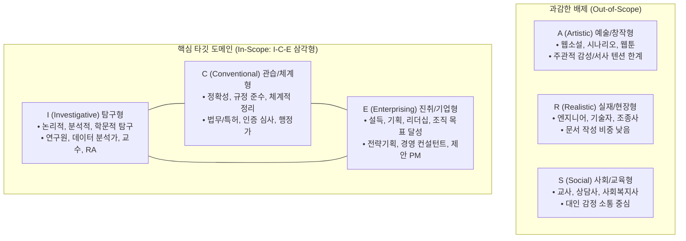

![[Pasted image 20261103195705.png]]
# 📋 (분석) DDD 기반 타깃 도메인 정의와 정형·비정형 보이스 전략

> [!abstract] 💡 **핵심 요약: "원래 하던 문서 노가다(논리 조립 + 규격 서식)와 AI 도입 후의 이중고를 모두 끝낸다"**
> * **DDD 디스커버리의 목적:** 솔루션(기능) 뇌에서 빠져나와 문제 공간(Problem Space)을 먼저 파고, 100개 직업군 중 버려야 할 90명을 쳐내어 단 10명의 심장에 칼을 꽂는 경계선(Bounded Context)을 긋는 것.
> * **균형 잡힌 진짜 문제:** 
>   1. **본원적 고통 (AI 이전부터 존재):** 방대한 자료를 설득력 있는 논리 구조(뼈대)로 조립하고, 복잡한 규격 서식(표/칸)에 맞춰 넣는 극심한 문서 노가다.
>   2. **2차 가중 고통 (AI 도입 후 발생):** 이를 덜어보고자 AI를 썼더니 오히려 맥락을 왜곡하고 섬세한 뼈대를 망가뜨려 검토·수정의 이중고를 낳음.
> * **포지셔닝:** 초보자가 AI로 흉내 내는 요술봉이 아니라, 이미 자기 분야의 뼈대와 지식이 확고한 **'시니어 전문가(Subject Matter Expert)를 위한 파워툴'**.
> * **타깃 도메인 (In-Scope):** 홀랜드 RIASEC 모델 중 예술(A)·현장(R)·교육(S)을 과감히 쳐내고, 논리(I)를 세우고 규정(C)을 맞춰 조직(E)을 설득해야 하는 **`I-C-E` 진성 문서 노동자 100선**.
> * **스캐폴드 매니저의 두 얼굴:**
>   * **정형 문서 (DocStudio):** 표 양식과 서식 껍데기를 분리수거하여, 각 슬롯 안의 논리 정합성과 백데이터 바인딩에 집중.
>   * **비정형 문서 (Outliner + RM):** GTD 같은 전공서, 테크 블로그, 기획편집 등 줄글 뒤에 숨겨진 보이지 않는 논리 척추(Invisible Scaffold & Beat)를 유연하게 조립.
> * **진입장벽 해소 (민규 서의 보이스 추출):** 프롬프트 설명 노동을 없애고, 과거 잘 쓴 글 1~2개에서 **'문체 DNA(Voice)'**를 역공학하여 내 스타일(곤조) 그대로 채워 넣는 3합(Scaffold × RM × Voice) 완성.

---

## 🗺️ SingleStone DDD 아웃라인 워크벤치

![[(분석) DDD 기반 타깃 도메인 정의와 정형·비정형 보이스 전략.outline]]

---

## 0. DDD(도메인 주도 설계)의 본래 원리와 디스커버리의 목적

### 0-1. Q. "이거 DDD 원리가 뭐야? 왜 문제 공간과 해결 공간을 분리해야 해?"
DDD는 단순한 개발 방법론이나 코딩 기법 이전에 **"인간의 착각을 깨부수는 생각의 기술"**입니다. DDD는 비즈니스를 바라볼 때 세상을 딱 둘로 엄격하게 분리합니다.

```text
┌───────────────────────────────────────────┐     ┌───────────────────────────────────────────┐
│        1. 문제 공간 (Problem Space)         │ ──> │        2. 해결 공간 (Solution Space)        │
│   현실의 실무자가 겪는 진짜 고통, 제약, 업무 사건   │     │   소프트웨어 시스템, AI 모델, 기능, UI 화면   │
└───────────────────────────────────────────┘     └───────────────────────────────────────────┘
            (여기를 먼저 파야 함)                               (여기로 성급히 점프하면 망함)
```

* **보통 개발자/기획자가 빠지는 솔루션 뇌의 함정:**  
  *"아웃라이너 만들고, 캔버스 붙이고, AI 하네스 달아서 슬롯 바인딩하자!"* ➔ 머릿속에 만들고 싶은 '기능(해결 공간)'이 너무 가득 차 있으면, 정작 이게 **"현실의 어떤 인간이 겪는 피눈물 나는 순간"**에 꽂혀야 하는지를 완전히 잊어버리게 됩니다.
* **DDD의 제1원칙:**  
  **"절대 기능(솔루션)을 먼저 이야기하지 마라. 현실 업무에서 돈과 시간을 쓰는 사람의 고통과 현업의 언어(Ubiquitous Language)의 '경계선(Bounded Context)'을 먼저 그어라."**

---

### 0-2. Q. "수개월 동안 구체화해왔는데, 지금 와서 왜 디스커버리를 다시 해? 우리 답정너 아니야?"

#### 1) 왜 우리가 "답정너"처럼 느꼈는가? (망치와 못의 착시)
우리는 이미 **'스캐폴드 매니저'라는 강력하고 정교한 솔루션(망치)**을 손에 쥐고 있습니다. 망치를 쥐고 '진성 문서 노가다 직업군 100선(못)'을 내려다보니:
* *"제안서 쓰는 사람도 이거 쓰면 좋겠네"*
* *"어? 웹소설 작가도 이거 필요하잖아?"*
* *"법무팀도 계약서 볼 때 쓰면 대박이겠네"*

모든 직업군이 다 우리 도구를 쓰면 좋을 것 같아 보이니까, 거꾸로 **'우리가 만들고 싶은 솔루션'에 현실을 억지로 끼워 맞추는 느낌(답정너)**이 들었던 것입니다.

#### 2) 왜 수개월 동안 볼트를 구축하고도 윤곽이 또렷하지 않았는가?
결코 우리가 고민을 덜 했거나 아이디어가 부족해서가 아닙니다. **"너무 많은 사람을 한꺼번에 구원하려고 했기 때문"**입니다.
* **100선 직업군의 파편화:**
  * **1번 (B2G 공공 제안서 PM):** 표 50개 채우고, 폰트 규격 맞추고, 발주처 요구조건 번호 1:1 매칭해야 통과됨.
  * **53번 (웹소설 윤문/교정자):** 인물의 말투 텐션, 복선 회수, 문체(바이브)가 안 깨지는 게 생명임.
  * **15번 (기업 법무팀):** 단어 하나, 쉼표 하나로 몇십억 소송이 갈림.
* 이 100명을 한 솥에 넣고 "문서 어시스턴트"를 정의하려 하니, **시스템이 감당해야 할 스펙이 괴물(Monster)처럼 비대해져서 윤곽이 안 잡혔던 것**입니다.

#### 3) 그럼 DDD 디스커버리를 지금 왜 해야 하는가? (진짜 목적)
지금 하는 프레임워크(SingleStone Frame the Problem)는 답정너를 합당화하는 서류 작업이 아니라, **"우리가 버려야 할 90명을 과감히 쳐내고, 단 10명의 심장에 칼을 꽂기 위한 '경계선 긋기(Bounded Context)'"** 작업입니다.
* **답정너식 접근 (X):** *"우리 스캐폴드 매니저는 100개 직업군 모두의 문서 노가다를 혁신할 수 있어!"* ➔ 아무도 안 씀.
* **진짜 DDD 디스커버리 (O):** *"100개 직업군 다 집어치우고, **'AI가 환각 치면 내 목이 날아가서, 쓰는 시간보다 검토에 4시간을 쓰고, 복잡한 표/슬롯 서식에 갇혀 매일 야근하는 놈'** 딱 한 놈만 골라내자."*

#### 4) 결론: Rin 님이 지금 내려야 할 단 하나의 결정
우리가 해온 수개월의 고민은 절대 헛된 게 아닙니다. 이미 훌륭한 재료(원자 254개, JTBD 86개)는 다 모였습니다. 지금 이 DDD 캔버스에서 하셔야 할 일은 "새로운 무언가를 발굴"하는 게 아니라,  
**"우리가 가진 강력한 무기(스캐폴드 매니저: 논리 구조화 + 슬롯 제어 + 백데이터 바인딩 + 1초 Diff 검토)로 누구의 대가리를 가장 먼저 깨부술 것인가?"**를 결정하는 것입니다.

---

## 1. 진짜 문제의 재발견: "본원적 문서 작업과 AI 도입 후의 이중고"

시니어 전문가가 겪는 문서 지옥은 **[AI 이전부터 존재하던 본래의 문서 작업 고통]**과 **[AI를 도입하고 나서 덮친 2차 왜곡 고통]**이 결합된 이중 구조입니다. 문제 정의는 이 양쪽의 밸런스를 모두 담아내야 합니다.

```text
┌────────────────────────────────────────────────────────────────────────┐
│ [1단계: AI 없을 때 하던 본원적 고통]                                     │
│ • 논리 구조화의 씨름: 방대한 팩트와 레퍼런스를 설득력 있는 뼈대로 조립하고       │
│   인과관계를 이리저리 맞춰보는 데 극심한 뇌 용량 소진                     │
│ • 규격 서식의 노가다: 표 칸 맞추기, 셀 너비, 번호 매칭, 자간 맞추기 같은         │
│   형식적 껍데기 작업에 수시간 야근                                      │
│                                  ▲                                     │
│                                  │ (덜어보려고 AI를 썼더니?)             │
│                                  ▼                                     │
│ [2단계: AI 도입 후 덮친 2차 왜곡 고통]                                   │
│ • 맥락 훼손: 정교하게 짜둔 논리 뼈대와 고유 문체를 AI가 제멋대로 뭉개버림       │
│ • 검토 마비: 구라(환각)와 무출처 때문에 차라리 손으로 쓰는 것보다 더 많은        │
│   에너지를 전수 검사와 팩트체크에 쏟아부음                               │
└────────────────────────────────────────────────────────────────────────┘
```

### 1-1. 본원적 고통: 논리 구조화 씨름과 규격 서식 노가다의 결합
* 빈칸이 정해진 서식이 주어지더라도, **그 안에 들어갈 논리 구조를 어떻게 빌드업할 것인가?**
* 수많은 데이터와 레퍼런스 중 **무엇을 어떤 인과관계로 엮어서 상사/발주처/독자를 설득할 것인가?**
* 이 목차를 올릴까 내릴까 고민하는 뼈대 조립과, 이를 표와 서식 규격에 일일이 욱여넣는 수작업 노가다가 전체 작업의 80%를 차지합니다.

### 1-2. 2차 왜곡 고통: AI의 통제 불능과 검토 지옥
* 이 짐을 덜고자 AI를 도입했더니:
  1. 기껏 사람이 세워둔 논리 척추와 고유 스타일을 AI가 모범생 쓰레기(AI Slop)로 갈아엎고,
  2. 출처도 대지 못하는 거짓말을 섞어놓아 문서 전체를 토씨 하나까지 전수 검사해야 하는 검토 지옥을 낳았습니다.
* **결과:** 원래 하던 문서 노가다에 AI 뒤치다꺼리까지 얹어져, 시니어 전문가의 뇌 용량이 완전히 소진되고 있습니다.

### 1-3. Rin의 캔버스 4대 본심 텍스트와 직결되는 현실적 고통
1. **시작 단계:** *"어쩌란 건지 모르겠고 결국 하던 대로 하게 되어버리는 매직"* ➔ 막막함과 파편화된 자료로 옛날 비효율 방식으로 회귀.
2. **생성 단계:** *"알잘딱 설명 힘들고 내 스타일도 아님 설명해바짜"* ➔ 문체 DNA 주입 불가로 모범생 쓰레기만 받아보는 가짜 노동.
3. **검토 단계:** *"나를 못믿어서 너를 쓰는데 너도 못믿게 된 지경 ㅅㅂ"* ➔ AI 환각과 덮어쓰기로 사람도 도구도 못 믿는 검토 마비.
4. **운영 단계:** *"ㅇㅋ 그럼 내 매일 하던 거 할 테니까 자비스나 가져와 뒤치닥거리나 잘 해"* ➔ 행정 잡무에 치여 본업 소진.

---

## 2. 타깃 고객의 정밀 정의: "초짜의 요술봉"이 아닌 "시니어의 파워툴"

### 2-1. 고객 페르소나의 재정의
* **시중의 일반 생성형 AI 툴 (Junior Toy):**  
  아무것도 모르는 주니어가 프롬프트 대충 쳐서 그럴싸한 모범생 글 긁어오는 장난감. (현업 전문가가 보면 쓸 수 없는 쓰레기)
* **우리 서비스의 고객 (Senior Power Tool):**  
  **이미 자기 머릿속에 전문 지식, 뼈대, 기준(곤조)이 확고한 시니어 전문가.**
  * 생각과 뼈대(Outliner)는 전문가인 내가 직접 짠다.
  * 골치 아픈 자료 조사와 근거 수집은 백그라운드 리서치(RM)로 돌려놓는다.
  * 빈칸 채울 때 논리와 근거가 고민이면 레퍼런스 매니저를 써서 구조화한다.

### 2-2. 북극성 가치 제안 (Value Proposition)
> **"전문가인 당신이 하루 8시간 동안 야근하며 피똥 싸던 고강도 전문 문서를 4시간 만에 끝내고 칼퇴하게 해준다."**

---

## 3. 홀랜드 RIASEC 모델 기반 타깃 도메인 필터링

Rin 님이 정의하신 필터링 기준에 따라, 기술적 한계가 뚜렷하거나 문서 비중이 낮은 영역은 과감히 배제(Out-of-Scope)하고 핵심 도메인(In-Scope)을 확정했습니다.



### 🎯 왜 '진성 문서 노가다 직업군 100선'인가?
100선에 선정된 직무들은 대충 줄글을 끄적이는 직군이 아닙니다:
* **논리(I)**를 세우고,
* **규정/서식/정확성(C)**을 빈틈없이 맞춰,
* **조직과 고객(E)**을 설득해야 하는 **고난도 비즈니스·학술·행정 텍스트 노동자들**입니다.
  * **B2G 제안서 PM:** 제안 전략(E)은 머리에 있는데, 발주처 RFP 요구조건 수백 개 표에 맞춰 증빙(C) 채우느라 3일 밤샘.
  * **임상/RA/ISMS 규정 담당자:** 전문 분석(I)은 끝났는데, 인증 규정 양식(C) 한 글자 틀리면 반려당해서 전수 검사하느라 퇴근 못 함.
  * **전략기획실 / 경영 컨설턴트:** 시장 가설(E)은 섰는데, 시장 조사 텍스트(I) 취합하고 임원 보고용 표/서식(C) 맞추느라 탈진.

---

## 4. 정형과 비정형을 관통하는 스캐폴드 매니저의 두 얼굴

### 4-1. '비정형 전문 문서'란 무엇인가? (예술 A와의 결정적 차이)
GTD(쏟아지는 일 완벽하게 하기) 같은 전공/실용 서적, 인사이트 테크 블로그, 단행본 기획편집, 전문 번역서는 웹소설이나 시(예술 창작, A)와는 완전히 다릅니다.
* **예술 창작(A):** 작가의 감성, 주관적 직관, 기승전결의 예술적 텐션이 지배함.
* **비정형 전문 문서(I-E-C 하이브리드):**  
  겉으로는 자유로운 줄글처럼 보이지만, **안에는 극도로 촘촘한 '지식 아키텍처(Knowledge Architecture)'와 '논리적 척추(Spine)'**가 반드시 존재해야 하는 글입니다.

### 4-2. 편집자, 번역가, 전공서 필진이 겪는 "비정형 문서 노가다"의 실체
이분들에게 겉으로 채워야 할 '네모난 표'는 없을지 몰라도, **겪는 노가다의 강도는 정형 문서보다 훨씬 잔인합니다.**
* **GTD 같은 전공/실용서 집필:** 10만 자의 긴 줄글 속에서 수백 개의 메모, 논문, 사례 백데이터를 하나의 논리 체계로 조립해야 함. 3장 쓰다 보면 1장과 충돌나서 숲에서 길을 잃음.
* **단행본 기획편집자:** 저자가 횡설수설 던져놓은 날것의 원고에서 뼈대(Scaffold)를 다시 발라내고, 문단 순서를 재배치(Re-structuring)하는 막노동.
* **전문/기술 번역가:** 단순 직역이 아니라, 원문의 맥락과 전문 용어 정합성을 100% 유지하면서 우리말 호흡에 맞게 전 문장을 뜯어고쳐야 함.
* **인사이트 테크 블로그:** 독자의 주의력을 쥐고 흔드는 '도입 ➔ 문제 제기 ➔ 프레임워크 ➔ 결론'의 보이지 않는 비트(Beat)를 수동으로 깎아냄.

### 4-3. 스캐폴드 매니저의 두 얼굴 아키텍처
스캐폴드 매니저는 정형과 비정형 양쪽의 지옥을 서로 다른 방식으로 관통합니다.

```text
                  ┌─────────────────────────────────────────────────────────┐
                  │          스캐폴드 매니저 (Scaffold Manager)             │
                  └───────────────────────────┬─────────────────────────────┘
                                              │
                    ┌─────────────────────────┴─────────────────────────┐
                    ▼                                                   ▼
     [ 1. 정형 문서 (DocStudio) ]                       [ 2. 비정형 문서 (Outliner + RM) ]
     • 대상: B2G 제안서, 인증서, 공문서                  • 대상: GTD 책, 기획편집, 번역, 테크블로그
     • 특징: 겉으로 보이는 '외재적 칸(Slot)'            • 특징: 겉으로 보이지 않는 '논리 척추(Spine)'
     • 해결:                                            • 해결:
       - 서식 템플릿 슬롯 분리수거                         - 레퍼런스의 '기능적 비트(Beat)' 역공학
       - 백데이터 1:1 바인딩                              - Outliner를 통한 1D 트리 ↔ 2D 조망 플립
       - 표 채우기 자동화 및 1초 Diff 검증                - 백그라운드 리서치(RM) 자료 바인딩 & 윤문
```

* **정형 문서를 쓸 때:**  
  *"표 서식과 칸 채우기(C) 노가다를 분리수거해서, 껍데기 맞추는 시간을 0으로 만들고 각 슬롯 안의 논리 정합성에 집중하게 한다."*
* **비정형 문서를 쓸 때:**  
  *"수만 자의 긴 줄글 속에서 길을 잃지 않도록, 보이지 않는 생각의 뼈대(Outliner)와 원천 자료(RM)를 결합해 '논리적 조립'을 완성하게 돕는다."*

### 4-4. 그렇다면 타깃 정의가 어떻게 더 완벽해지는가?
타깃은 "관공서 양식 채우는 사람"으로 좁아지는 게 아니라, 아주 날카롭고 포괄적으로 완성됩니다:

> **"방대한 전문 지식과 자료를 다루며,  
> '정형화된 서식의 빈칸'을 채우든 '비정형의 깊이 있는 한 권의 책·아티클'을 조립하든,  
> 구조화와 팩트 검증 노가다에 짓눌려 있는 모든 I-C-E 지식 작업자들(기획자, 연구원, 편집자, 번역가, 전문 필진)."**

이로써 100선에 **단행본 편집자(51번)**, **전문 기술 번역가(57번)**, **교과서/참고서 기획자(70번)**가 왜 당당하게 한자리를 차지하고 있었는지가 완벽히 증명됩니다.

---

## 5. 진입장벽의 파괴: 민규 서의 "보이스(Voice) 뽑기" 전략

### 5-1. 왜 기존 프롬프트 방식은 "알잘딱 실패"로 끝나는가?
* 사용자가 프롬프트 창에 *"전문가처럼 써줘", "로펌 톤으로 써줘"*라고 아무리 형용사를 입력해도, AI는 평균치 모범생 말투(AI Slop)만 뱉습니다.
* 이는 사용자에게 **"신입사원을 매번 처음부터 인수인계하는 극심한 피로(알잘딱 실패)"**와 **"내 글이 아니라는 인지 부채(Cognitive Debt)"**를 안겨줍니다.

### 5-2. "보이스를 뽑는다"의 진짜 실체
사용자에게 긴 설명을 요구하지 않고, **"당신이 과거에 쓴 제일 마음에 드는 글 1~2개"**를 투척받아 문체 DNA를 역공학합니다.
1. **종결 어미 규칙:** 개조식(~함/음) vs 단정적 평서문(~다) vs 구어체(~해요)
2. **문장 호흡:** 단문 위주의 찌르기 vs 논리 연결 복문
3. **선호/금기 어휘:** 사내 고유 전문 약어, 선호하는 접속사, 진부한 표현 배제
4. **논리 전개 텐션:** 질문 던지기 vs 데이터 선제시

```text
[ 과거 잘 쓴 글 1~2개 투척 ] ──> [ 🎙️ 보이스(Voice) 프로필 추출 ]
                                               │
       ┌───────────────────────────────────────┴───────────────────────────────────────┐
       ▼                                                                               ▼
[ 정형 문서 슬롯 결합 ]                                                         [ 비정형 아웃라인 결합 ]
• 템플릿: "B2G 제안서 RFP 서식"                                                • 템플릿: "GTD 전공서 4장 뼈대"
• 보이스: "우리 회사 수주용 사내 표준 톤"                                        • 보이스: "저자/번역가 고유의 곤조 있는 문체"
➔ 표의 각 빈칸에 부장님 결재 통과용 말투로 자동 렌더링.                           ➔ 아웃라인 각 비트에 내 문체 그대로 초안 생성.
```

---

## 6. 결론: 전문가 문서를 완성하는 3합 (The Trident Engine)

Scaffold Manager가 제공하는 궁극적인 해결책은 다음 세 가지 축이 결합할 때 비로소 완성됩니다.

$$\text{완벽한 전문가 문서} = \text{Scaffold (논리 뼈대)} \times \text{RM / 백데이터 (근거)} \times \text{Voice (문체)}$$

1. **Scaffold (논리 뼈대):** 아웃라이너 목차 / 정형 서식 슬롯 ➔ **"논리 구조를 어떻게 설계하고 조립할 것인가"**
2. **RM / 백데이터 (근거):** 백그라운드 조사 데이터 / 레퍼런스 ➔ **"어떤 팩트와 수치로 논지를 증명할 것인가"**
3. **Voice (문체):** 조직 및 저자 고유의 톤앤매너 DNA ➔ **"어떤 목소리로 설득할 것인가"**

이 3합이 갖춰짐으로써, 정형 문서든 비정형 문서든 사용자가 겪는 논리 조립의 인지 과부하와 서식 피로를 소거하고 **진정한 4시간 칼퇴 워크벤치**를 구현합니다.

---

### 🚨 공식 DDD 문제 정의 선언문 (원초적 노가다 × AI 왜곡 통합 정본)

> **"전문 지식과 전략을 갖춘 시니어 전문가들이, 방대한 자료를 논리 구조로 조립하고 규격화된 서식에 맞추는 본원적 문서 노가다에 짓눌려 있으며, 이를 덜고자 도입한 AI마저 맥락을 훼손하고 통제되지 않아 검토와 수정의 이중고 속에 매일 야근을 반복하고 있습니다."**
> 
> * **핵심 해결:** 논리 뼈대 조립(Scaffold)과 사고는 전문가 당신이 주도하고, 백그라운드 리서치(RM)와 서식 슬롯 바인딩, 보이스(Voice) 입히기는 시스템이 전담하여, 8시간 동안 헤매던 고강도 전문 문서를 4시간 만에 무결점으로 완성하고 칼퇴한다.
