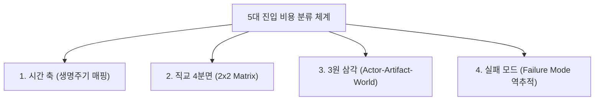

# 🎯 실행 영역 확장을 이끈 5대 진입 비용과 포괄성 검증

> [!abstract] 💡 핵심 명제
> **"실행 영역의 폭발적 확장은 작업자가 초능력을 얻어서가 아니라, 무언가를 시작하고 완수하기 위해 치러야 했던 '5대 진입 통행세'가 증발했기 때문이다. 이는 생명주기와 직교 매트릭스 전 영역에 걸쳐 완벽한 망라성(Exhaustiveness)을 가진다."**

---

### 1. 바이브 코딩에서 증발한 5대 진입 비용 (The 5 Friction Costs)

#### ① 문법과 규칙을 외워야 하는 「인출(Retrieval) 인지 비용」
* **이전의 고통**: 프로그래밍 언어의 엄격한 문법, 함수 파라미터 시그니처, 정규식 규칙을 뇌 메모리에 일일이 로드(Load)해야만 코드를 쓸 수 있었습니다. 생각이 문법에 가로막혀 앞으로 나가지 못했습니다.
* **증발한 것**: 문법을 기억해내는 인지 부하가 0이 되어, 작업자는 오직 "무엇을 구현할 것인가"에만 집중합니다.

#### ② 시작하기도 전에 지치는 「환경 설정 및 보일러플레이트 비용」
* **이전의 고통**: 런타임 설치, 의존성 패키지 세팅, 빌드 도구 설정, 기본 폴더 구조 잡기에만 반나절이 걸려 본선은 시작도 못 하고 지쳤습니다.
* **증발한 것**: '일단 돌아가는 뼈대(Scaffold)'가 즉시 생성되어, 준비 운동에 드는 실행 마찰력이 완전히 사라졌습니다.

#### ③ "모르면 어떡하지?"라는 「탐색 및 검토 스트레스」
* **이전의 고통**: 수많은 공식 문서와 블로그를 뒤지며 *"어느 라이브러리가 최선인가?", "이 방법이 정답인가?"*를 검토하느라 에너지를 소모했습니다.
* **증발한 것**: 완벽한 정답을 찾아 헤매는 대신, **"일단 하나 뽑아서 눈으로 보고 판단하자"**로 전환되어 탐색 피로가 극단적으로 낮아졌습니다.

#### ④ 실패했을 때의 「복구 및 롤백(Rollback) 비용」
* **이전의 고통**: 낯선 도구를 쓰다가 코드가 꼬이면 디버깅 지옥에 빠졌고, 실패에 대한 두려움 때문에 시도 자체를 꺼렸습니다.
* **증발한 것**: 컴파일러와 터미널이 실패 지점을 콕 집어주고, `Ctrl+Z`나 "다시 짜줘" 한마디로 원상복구되므로 **'실패해도 리스크가 전혀 없는 상태'**가 되었습니다.

#### ⑤ 타인의 자산(Git·API·도구)을 소화하는 「외부 결합 비용」
* **이전의 고통**: 남의 깃 레포지토리나 낯선 API를 쓰려면 그 사람의 거대한 아키텍처와 규격을 **내 뇌로 통째로 '퍼먹고 소화(Digest)'**해야 했습니다.
* **증발한 것**: 방대한 외부 자산을 사람이 다 소화하지 않아도, 에이전트가 핵심 로직과 접착제(Glue-code)를 대신 생성해 주어 레고 블록처럼 외부 자산을 조합할 수 있게 되었습니다.

---

### 2. 포괄성(Exhaustiveness / MECE) 검증 4대 렌즈

"이 5가지 항목이 과연 사각지대 없이 전체 제작 과정을 망라하고 있는가?"를 검증하는 메타 방법론입니다.

#### ① 시간 축 / 생명주기(Lifecycle) 매핑 렌즈
* **제작의 전 타임라인 대조**:
  * `자료/도구 조사` ➔ **[3. 탐색 스트레스 완화]**
  * `외부 자산 연동` ➔ **[5. 외부 결합 비용 소멸]**
  * `초기 환경 세팅` ➔ **[2. 보일러플레이트 세팅 비용 제거]**
  * `본문 타이핑/구현` ➔ **[1. 문법 인출 비용 소멸]**
  * `에러 수습/디버깅` ➔ **[4. 롤백 비용 소멸]**
* **판정**: 착상부터 디버깅까지의 '개인 제작 루프' 전 구간이 빈틈없이 1:1로 매핑됩니다.

#### ② 직교 4분면(Orthogonal Matrix) 렌즈
* **행위 성격(`생성` vs `흡수`) × 자원 성격(`인지적` vs `물리적`) 교차**:

| 구분 | 생성 (Internal Creation) | 흡수 (External Integration) |
| :--- | :--- | :--- |
| **인지적 (Mental)** | **1. 문법 인출 비용** | **3. 탐색 스트레스** |
| **물리적 (Tooling)** | **2. 세팅 비용**, **4. 롤백 비용** | **5. 외부 결합 비용** |

* **판정**: 4개 사분면 전체가 골고루 채워져, '내적 창작'과 '외적 수용', '두뇌 부하'와 '도구 부하'의 대칭적 균형을 이룹니다.

#### ③ 주체-객체-환경 3원 삼각 렌즈
1. **인간 내부(Mental)**: 기억, 판단, 심리적 공포 ➔ `1번`, `3번`
2. **에디터 내부(Workspace)**: 코드, 파일 구조, 런타임 ➔ `2번`, `4번`
3. **바깥 세상(Ecosystem)**: 깃허브, 오픈소스, 외부 API ➔ `5번`

#### ④ 실패 모드(Failure Mode) 역추적 렌즈
* 과거 작업자가 코딩을 포기했던 모든 이유(문법 모름, 세팅 에러, 막막함, 코드 꼬임, 남의 코드 소화 불가)가 5대 비용 항목에 정확히 1:1로 대응되어 해소됩니다.
