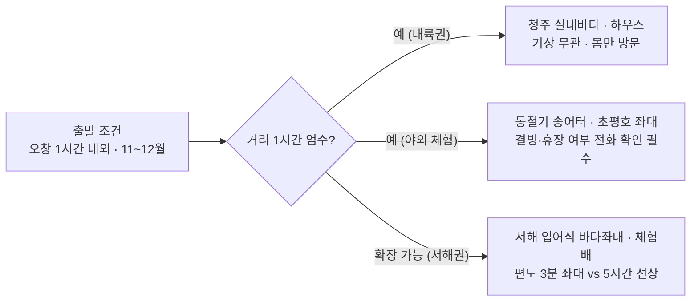
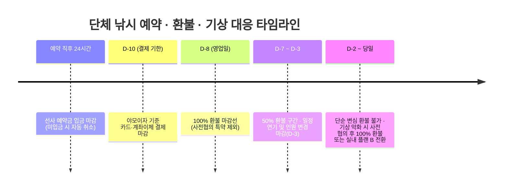
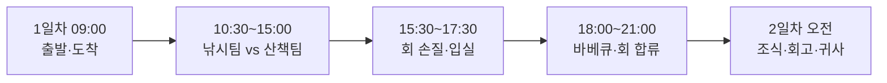

# 11~12월 단체 낚시 워크샵, 예약 전 반드시 확인할 체크포인트 7가지

![[04_충북_송어낚시터_04.jpg]]
*11월 늦가을 송어터 저수지 전경 (경기도 시흥 뒷방울낚시터, 2026.11.11 현장)*

오창 본사에서 차량 1시간 내외, 1박 2일 일정으로 단체 낚시 워크샵을 검토할 때 가장 먼저 부딪히는 벽은 **"11~12월에 실제로 가능한 종목이 무엇인가"**와 **"초보·비낚시 인원을 어떻게 지루하지 않게 안고 갈 것인가"**입니다.

이 글은 기획 담당자가 업체에 전화하기 전에 꼭 확인해야 할 7가지 판단 기준을 실제 현장 사진과 1차 이용 후기, 공식 규정 원문으로 묶어 정리했습니다.

## 한눈에 보는 종목 선택과 핵심 결론

* ==거리 1시간 엄수·날씨 리스크 0==: 청주 실내바다낚시터(3시간 44,000원, 장비 대여·회센터 완비) 또는 청주 하우스 낚시터가 가장 안정적입니다.
* ==분반·합류가 성패를 가름==: 2026년 11월 실제 기업 1박 2일 사례처럼 낚시 희망자만 출조하고 비낚시 인원은 산책·휴식 뒤 저녁 바베큐에 합류하는 구조가 만족도가 높습니다.
* ==현장 거부·취소 변수 차단==: 선상낚시는 실물 신분증과 구명조끼가 법적 의무이며, 기상 악화 환불과 24시간 내 예약금 입금 기한을 반드시 서면 확인해야 합니다.

---

## 1. 11~12월 오창 1시간권에서 실제로 어떤 낚시가 되나?

![[04_충북_송어낚시터_12.jpg]]
![[03_진천_초평호수상좌대_01.jpg]]
*좌: 11월 송어 루어 캐스팅 현장(시흥 뒷방울낚시터) / 우: 진천 초평저수지 수상좌대 외관(태공좌대)*

11월 말~12월 내륙 낚시는 여름·가을과 운영 환경이 완전히 다릅니다. 충북 진천 초평호의 대표 좌대인 초평집좌대 공식 공지를 보면 ==2026년 2월 23일부터 공식 개장==한다는 안내가 남아 있어, 겨울 결빙기에는 민물 노지·수상좌대가 휴장하거나 조황이 급락할 수 있습니다.

반면 같은 11월에도 바로 굴릴 수 있는 대안이 뚜렷합니다. 동절기 시즌을 여는 **유료 송어터**(예: 시흥 뒷방울낚시터는 2026년 11월 7일 송어 2톤 방류로 개장)는 수온이 낮을수록 활성도가 살아나 초보도 루어 손맛을 보기 좋습니다.

![[01_청주락_실내바다낚시터_11.jpg]]
![[03_진천_초평호수상좌대_08.jpg]]
*좌: 청주락 실내바다낚시터 이용요금·대여료 안내판 / 우: 진천 초평호 태공좌대 물가 낚시 데크*

오창에서 20~30분 거리인 청주권 실내바다낚시터와 하우스 낚시터는 영하권 한파와 비·바람 영향을 받지 않습니다. 청주락 실내바다낚시터(흥덕구 동촌로)는 매일 10:00~01:00(화요일 휴무) 실내에서 바다 어종을 낚고 바로 회까지 해결할 수 있고, 서원구 성화낚시터 하우스는 12월 초에도 붕어 손맛을 본 실전 조행기가 확인됩니다.

> **담당자 판단 기준**: 11월 말~12월 일정이라면 ① 초평호 수상좌대는 동절기 정상 운영 여부를 먼저 전화 확인하고 ② 결빙·추위 변수가 크다면 청주 실내바다·하우스 또는 동절기 송어터로 1순위를 잡아야 합니다.

🔗 [청주락 실내바다낚시터 후기 노트](리소스/01_청주락_실내바다낚시터.md)
🔗 [진천 초평집좌대 공식 공지 노트](리소스/10_진천_초평집좌대_공식.md)
🔗 [청주 성화낚시터 하우스 12월 조행기](리소스/02_청주_성화하우스낚시터.md)

---

## 2. 초보와 낚시 안 하는 인원이 섞였을 때, 실패하지 않는 분반·운영

![[03_진천_초평호수상좌대_03.jpg]]
![[01_청주락_실내바다낚시터_07.jpg]]
*좌: 진천 초평호 태공좌대 원목 난방 실내 / 우: 청주락 실내바다낚시터 휴게 소파·테이블·매점*

단체 워크샵에서 낚시가 실패하는 가장 흔한 이유는 **전원 강제 참여**입니다. 낚시에 관심 없는 인원을 배나 찬 바람 부는 물가에 4~5시간 묶어 두면 추위와 멀미, 지루함이 한꺼번에 터집니다.

실제 2026년 11월 16~17일 안면도 1박 2일 기업 워크샵 후기(나우커뮤니케이션)는 이 문제를 ==사전 수요 조사 기반 분반==으로 깔끔하게 풀었습니다.

> "워크샵 전에 낚시를 하고 싶은 분들을 미리 모집했습니다 신청한 직원들은 낚시팀으로 나머지는 점심을 먹는 팀으로 움직였습니다" — [회사 워크샵 낚시후기](리소스/06_회사_워크샵_낚시후기.md)

![[07_서해_바다좌대_초보후기_14.jpg]]
![[08_서해_체험배낚시_초보후기_08.jpg]]
*좌: 태안 대원바다좌대 내부 단체 테이블 / 우: 서해 덕적호 선실 내부(성인 3명 나란히 앉는 좁은 구조)*

해당 사례에서는 신청자 8명만 펜션 연계 바다낚시 투어에 탑승했고, 비낚시 팀은 점심 식사 뒤 해안길을 산책하다가 저녁 바베큐 자리에서 자연스럽게 합류했습니다. 전원이 같은 공간에 머물러야 한다면 배 대신 ==난방 실내와 화장실·테이블이 분리된 수상좌대나 실내 낚시터==를 골라야 비낚시 인원도 버틸 수 있습니다.

* **옵션 분반형(추천)**: 숙소 거점을 잡고 낚시 신청자만 3~4시간 출조, 비낚시 팀은 인근 산책(초평호 농다리·미르숲 등)·휴식 후 저녁 합류
* **체류 병행형**: 진천 초평호 수상좌대(난방·TV·화장실·넷플릭스) 또는 청주 실내바다(휴게 소파·매점)에서 낚시와 수다를 동시 진행
* **선상 주의점**: 체험선 선실은 좁아(성인 3명이 나란히 앉는 수준) 비낚시 인원의 대기 공간으로 부적합하며, 정원 초과 현장 추가 탑승도 불가합니다.

🔗 [2026 기업 1박 2일 낚시 워크샵 분반 후기](리소스/06_회사_워크샵_낚시후기.md)
🔗 [진천 초평호 태공좌대 내부 시설 후기](리소스/03_진천_초평호수상좌대.md)

---

## 3. 1인당·총 예산은 얼마로 잡아야 하나? (실측 요금 기준)

![[04_충북_송어낚시터_08.jpg]]
![[07_서해_바다좌대_초보후기_12.jpg]]
*좌: 송어장 입어료 안내판(남성 30,000원·여성 20,000원, 뒷방울낚시터) / 우: 태안 대원바다좌대 입어식 가두리(성인 60,000원)*

초판 기획서처럼 검색 추정치를 섞지 않고, 이번 조사에서 ==현장 안내판과 1차 후기로 직접 확인한 실측 요금==만 항목별로 정리했습니다. 아웃라인 기준 총예산(300~1000, 팀비 200 + 참가비) 안에서 체험비 비중을 바로 가늠할 수 있습니다.

* 동절기 유료 송어터 (뒷방울낚시터): 남성 30,000원 / 여성 20,000원 (14시 이후 20,000원)
* 청주 실내바다낚시터 (청주락): 3시간 44,000원 / 6시간 66,000원 / 10시간 99,000원

* 서해 입어식 바다좌대 (태안 대원좌대): 성인 60,000원 / 초등생 40,000원 (낚싯대 무료 대여)
* 서해 체험 배낚시 (인천 덕적호): 평일 45,000원 / 주말 50,000원 + 낚싯대 대여 10,000원

> **숨은 추가 비용 체크**: 낚시 입장료 외에 ① **버스 대절**(야모이자 원데이 패키지 기준 미포함 항목) ② **채비·미끼 소모비** ③ **잡은 고기 회 손질비**(대원좌대 기준 1kg 6,000원) ④ **숙박·바베큐 상차림비**가 별도로 붙습니다.

단체 원스톱 진행이 필요하다면 워크숍 전문 플랫폼 야모이자처럼 ==치프(진행자)·점심·명찰·현수막을 묶고 버스 대절만 분리==하는 패키지 방식도 비교 대상입니다. 최소 인원 미달 시에도 최소 인원 기본가격으로 진행 가능하다고 안내되어 있으므로, 인원 확정 전 견적서로 1인당 단가를 교차 확인하세요.

🔗 [서해 대원바다좌대 요금·이용 후기](리소스/07_서해_바다좌대_초보후기.md)
🔗 [서해 덕적호 11월 요금·대여 후기](리소스/08_서해_체험배낚시_초보후기.md)
🔗 [야모이자 바다낚시 워크숍 패키지 안내](리소스/05_야모이자_바다낚시워크숍.md)

---

## 4. 비·바람·결빙 시 취소·환불 기준과 당일 플랜 B는?

![[08_서해_체험배낚시_초보후기_01.jpg]]
![[01_청주락_실내바다낚시터_12.jpg]]
*좌: 덕적바다낚시 예약금 100,000원·24시간 미입금 자동취소 문자 실물 / 우: 기상 무관 플랜 B 청주락 실내바다낚시터 운영방침*

겨울철 낚시 일정에서 가장 치명적인 리스크는 **출항 직전 풍랑·한파 취소**와 **예약금·환불 위약금 분쟁**입니다. 실제 예약 문자와 공식 규정을 보면 일반 펜션보다 기한이 훨씬 촘촘합니다.

야모이자 공식 환불 규정은 영업일 기준 **D-8까지 100% 환불, D-7~D-3 50% 환불, D-3~D-day 환불 불가**로 명시되어 있습니다. 기상 변수의 경우 아래 문구가 핵심 보호 장치입니다.

> "진행이 불가로 판단되는 기상 악화 시 사전에 협의 후 취소 가능하며 100% 환불 처리됩니다." — [야모이자 바다낚시 워크숍](리소스/05_야모이자_바다낚시워크숍.md)

하지만 개인 선사나 영세 낚시터는 기상 악화 판단 기준이 제각각이고, ==비가 와도 출항 가능하다고 판단하면 단순 변심 취소로 위약금이 발생==할 수 있습니다. 따라서 예약 단계에서 ① 강풍·결빙·우천 시 전액 환불 기준을 문자로 남기고 ② 당일 기상 악화 시 바로 이동할 **청주 실내바다낚시터·실내 하우스·숙소 인근 실내 공간**을 플랜 B로 미리 찜해 두어야 합니다.

🔗 [야모이자 결제·환불 규정 원문 노트](리소스/05_야모이자_바다낚시워크숍.md)

---

## 5. 승선 거부·안전사고를 막는 법정 규정과 겨울 현장 수칙은?

![[08_서해_체험배낚시_초보후기_07.jpg]]
![[08_서해_체험배낚시_초보후기_09.jpg]]
*좌: 서해 덕적호 출항 전 선상 낚시 자리와 안전난간 / 우: 선실 내 구명조끼 구비 및 안전수칙 게시물*

바다 선상낚시나 통통배로 이동하는 해상좌대를 선택했다면 안전 수칙은 권고가 아니라 **법적 강제 사항**입니다. 「낚시 관리 및 육성법」 원문은 신분증 미지참과 구명조끼 미착용 시 ==선장의 승선 거부 의무==를 못 박고 있습니다.

> "낚시어선업자는 승객이 정당한 사유 없이 승선자명부를 작성하지 아니하거나 제3항 후단에 따른 신분증 제시 요구에 따르지 아니하는 경우에는 승선을 거부하여야 한다." — [낚시관리및육성법 조문원문](인용/04_낚시관리및육성법_조문원문.md)

![[07_서해_바다좌대_초보후기_09.jpg]]
*태안 대원바다좌대 이동 통통배 구명조끼 보관함 — 편도 3분 이동이라도 탑승 시 착용 필수*

* 실물 신분증 전원 지참: 단 1명이라도 신분증을 빠뜨리면 승선 자체가 거부됩니다. 출발 전날과 당일 아침 인솔자 일괄 확인이 필수입니다.
* 구명조끼 착용·선상 음주 금지: 제29조에 따라 전원 착용 의무이며 위반 시 300만원 이하 과태료 대상(제55조)입니다. 다수 선사(덕적호)와 실내터(청주락) 모두 만취 음주를 금지합니다.

* 출항 1시간 전 집결: 덕적호 12:10 오후배 후기에서도 승선명부 작성과 자리 배정 때문에 ==10:30 도착을 권장==할 만큼 항구 수속 시간이 넉넉히 필요합니다.

🔗 [「낚시 관리 및 육성법」 핵심 조문 원문](인용/04_낚시관리및육성법_조문원문.md)

---

## 6. '몸만 가도' 되나? 장비 대여·멀미약·동절기 복장 준비 기준

![[07_서해_바다좌대_초보후기_06.jpg]]
![[09_서해_배낚시_회먹기후기_17.jpg]]
*좌: 태안 대원낚시 매장 채비·미끼 진열대 / 우: 11월 남당항 은가비호 선상 방한 복장·목토시·구명조끼 착용 실물*

초보가 많은 회사 워크샵에서 가장 조심해야 할 함정은 **전업 출조선**과 **초보 체험선·좌대**를 혼동하는 것입니다. 11월 서해 남당항 은가비호 후기에서도 ==낚싯대를 빌려주는 체험용 배가 아니니 주의하라==는 경고가 나올 만큼, 일반 출조선은 장비 대여나 강습이 없습니다.

반면 초보 친화형 입어식 좌대(태안 대원좌대: 낚싯대 무료 대여, 채비·미끼 현장 구매)나 청주락 실내바다낚시터, 야모이자 패키지(낚싯대·미끼·어망 일괄 대여)는 정말 몸만 가도 낚시 자체는 시작할 수 있습니다. 다만 **겨울 방한과 멀미약은 대여되지 않으므로 개인·회사 공용 준비가 필수**입니다.

![[04_충북_송어낚시터_10.jpg]]
*11월 물가 송어터에서 실제 사용한 휴대용 방한 난로(시흥 뒷방울낚시터)*

* 동절기 복장 공지: 11월 물가·바다는 최저 7도 이하로 떨어집니다. 방풍 패딩, 목토시, 방한 장갑, 미끄럼 방지 방한화, 핫팩을 사전 공지하세요.
* 멀미약 & 상비약: 서해 해상좌대는 편도 3분 이동이라 부담이 적지만, 45분 이상 이동하는 선상 체험배는 승선 전 멀미약 복용이 안전합니다.

* 송어터 전용 규정: 동절기 송어터는 뒷방울낚시터 안내판처럼 미늘 없는 바늘(싱글바늘)·실리콘 뜰채만 허용하는 곳이 많으니 대여 세트 포함 여부를 전화로 확인하세요.

🔗 [남당항 11월 선상 낚시 체험 주의 후기](리소스/09_서해_배낚시_회먹기후기.md)
🔗 [동절기 송어터 장비·방한 조행기](리소스/04_충북_송어낚시터.md)

---

## 7. 낚시 뒤 식사(회·바베큐)·1박 2일 타임테이블 & 전화 확인 질문

![[07_서해_바다좌대_초보후기_01.jpg]]
![[01_청주락_실내바다낚시터_16.jpg]]
*좌: 태안 대원바다좌대에서 직접 잡은 고기로 뜬 즉석 회와 컵라면 / 우: 청주락 실내바다 회센터 가격 안내(우럭 회 1kg 40,000원)*

낚시 워크샵의 하이라이트는 낚시 자체가 아니라 **잡은 고기와 바베큐로 이어지는 저녁 합류 식사**입니다. 태안 대원좌대는 피를 뺀 고기를 매장에서 **1kg 6,000원**에 필렛 손질·무료 진공포장해 주며, 청주락 실내바다낚시터는 한 마리도 못 잡아도 내부 회센터에서 우럭 회(1kg 40,000원)와 매운탕을 바로 주문할 수 있습니다.

![[03_진천_초평호수상좌대_04.jpg]]
![[07_서해_바다좌대_초보후기_17.jpg]]
*좌: 진천 초평호 태공좌대 야외 테라스 식사 테이블 / 우: 태안 대원바다좌대 무료 취사장(가스버너·냄비·전기포트)*

단, **화기 규정은 반드시 확인**해야 합니다. 진천 초평집좌대 공식 공지에는 ==가져오시는 개인용/일회성 야외 숯불바베큐는 전면 금지==라고 못 박혀 있으며, 대신 지정된 불판·버너 대여만 허용합니다.

### 업체에 전화할 때 바로 물어볼 확인 질문 6가지

1. 11월 말~12월 기준 정상 운영하나요? (결빙 휴장 여부 및 동절기 방류 일정)
2. 초보 단체가 '몸만' 가도 낚싯대·채비·미끼·강습이 모두 가능한가요?
3. 비낚시 인원이 따뜻하게 쉴 실내 공간과 수세식 화장실이 있나요?

4. 강풍·우천·결빙 취소 시 전액 환불 기준과 예약금 입금 기한은 어떻게 되나요?
5. 잡은 고기 회 손질·포장이나 저녁 바베큐(지정 불판) 연계가 되나요?
6. 선상·해상좌대 승선명부 작성 시간과 최대 정원은 몇 명인가요?

---

## 조사 노트

* **레퍼런스 적용 결과**: `레퍼런스/cards.md`의 R-A(당진 좌대 워크샵 후기)·R-B(서귀포 체험배낚시 준비물 후기)·R-C(11월 진천 가이드) 3편에서 `소제목 → 2장 나란히 현장 사진+캡션 → 짧은 문단 2~3개 → 요약/도식/링크` 리듬을 채택했습니다.
* **리소스 수집·검수 결과**: 공식 출처 3건(`야모이자`, `초평집좌대`, `낚시관리 및 육성법`) + 독립 현장 후기 8건에서 총 23장 검수 통과 사진을 확보해 본문에 **20장 + Mermaid 도식 3개**를 배치했습니다. (`리소스/수요표.md` 참조)
* **지역 투명성**: 동절기 송어터 현장 사진(`04_충북_송어낚시터_*`)은 실제 촬영지인 경기도 시흥 뒷방울낚시터(2026.11.11 개장 사례)로 명시했습니다.
