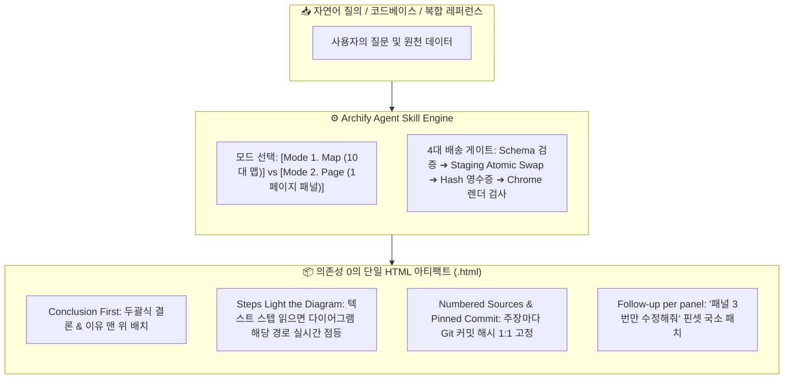

![[Pasted image 20261025124814.png]]
# 🏛️ (web&강추) Archify — AI Agent Skill for Interactive Diagrams and One-Page Answers

> [!abstract] 💡 **핵심 가치 선언 (Core Value Promise)**
> **"긴 텍스트벽과 에이전트의 환각(거짓말)을 끝내는 유일한 방법은, 결론을 맨 앞에 두고 출처를 커밋 단위로 박제한 '의존성 0의 단일 인터랙티브 HTML 아티팩트'뿐이다."**
> 
> * **공식 사이트**: https://tt-a1i.github.io/archify/?utm_source=pytorchkr&ref=pytorchkr
> * **GitHub 레포지토리**: https://github.com/tt-a1i/archify (v3.2.0 · MIT License)
> * **지원 에이전트 런타임**: Claude Code, Codex, Cursor, OpenCode, GitHub Copilot 등

---

## 🗺️ Archify 핵심 메커니즘 한눈에 보기

---

## 왜 래퍼런스로 채택했는가?
- 시각적으로 그래프를 그리고 앞뒤 과정이 뭔지, 그리고 그 프로세스에서 추가하고 싶거나 수정하고 싶은 기능을 화면 바로 위에서 ai 챗으로 수정 가능
- 공장에서 민규가 많이 하던거라니 잘 알듯