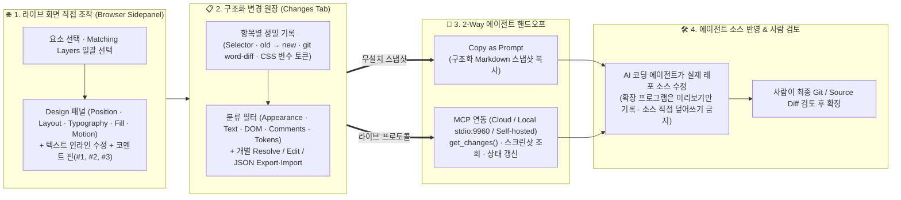

![[DesignMode_01_Hero_Overview.png]]

# 🎨 (web&강추) Design Mode — Browser Visual Editor for AI Coding Agents

> [!abstract] 💡 **핵심 가치 선언 (Core Value Promise)**
> **"말로 설명하거나 스크린샷을 던지면 셀렉터와 계산된 CSS 값이 전부 유실된다. 렌더링된 화면 위에서 직접 고쳐서 보여주고(`Show the change`), 변경된 정확한 값·토큰·코멘트 핀을 구조화된 Diff로 기록해 AI 에이전트에게 넘긴 뒤, 최종 소스코드 Diff는 사람이 검토한다."**
>
> * **공식 사이트**: https://designmode.app/
> * **공식 GitHub**: https://github.com/SandeepBaskaran/design-mode (MIT License · 무료 오픈소스 · 제작자 Sandeep Baskaran)
> * **지원 브라우저**: Chrome / Firefox 140+ / Safari (localhost · 스테이징 · 로그인된 실서비스 페이지 모두 동작)
> * **연동 에이전트**: Claude Code, Cursor, Windsurf, Codex, OpenCode 등 MCP 호환 에이전트 및 Markdown 프롬프트 복사
> * **핵심 벤치마킹 포인트**: VibeDocStudio의 **`2D 캔버스 직접 조작 → 변경 델타(Staged Changes) 기록 → AI Composer / .vstyle 정본 반영`** 양방향 핸드오프 루프

---

## 🗺️ 1. Design Mode 핵심 메커니즘 한눈에 보기



---

## 📸 2. 화면 구성 및 핵심 기능 분석

### ① `Matching Layers` 다중 동시 선택 & 코멘트 핀 (`#1, #2, #3`)
![[DesignMode_02_Matching_Layers_MultiSelect.png]]

* **동일 패턴 요소 자동 일괄 선택 (`3 selected · ☑ Matching layers`)**:
  * 카드 제목(`h2.card-title`) 하나만 찍고 `Matching layers`를 켜면, 같은 구조의 모든 제목(`PROFILE`, `PREFERENCES`, `DANGER ZONE`)이 파란 점선 박스로 동시 선택되며 간격 치수(`331px`, `244px`)가 실시간 표시됩니다.
  * 반복되는 카드·섹션·표 헤더를 한 번에 일괄 스타일링할 때 클릭 노가다를 제거합니다.
* **공간 앵커링 코멘트 핀 (`1`, `2`, `3`)**:
  * 스타일 조작으로 표현하기 어려운 의도(예: `"Typo: Compact density"`, `"Keep"`)는 화면의 정확한 DOM 위치에 번호가 붙은 노란 핀으로 꽂아 기록합니다.
* **상태별 의사 클래스(`Hover`, `Focus`, `Focus vis.`, `Active`) & 브레드크럼 셀렉터**:
  * 상단에 `body > div.app > main.panel > section.card > h2.card-title` 경로와 `<> CSS` 토글을 함께 노출해, 디자이너와 개발자가 같은 언어로 대상을 확인합니다.

---

### ② 단일 사이드 패널 실시간 비주얼 인스펙터 (`Layers · Design · Changes`)
![[DesignMode_03_Live_Design_Controls.png]]

* **3대 탭 + 고정 하단 핸드오프 바**:
  * 상단 헤더(`127.0.0.1` · `● MCP` 상태 칩 · 다크모드 · 설정) 아래에 `Layers` / `Design` / `Changes 42` 3개 탭이 결합되어 브라우저를 떠나지 않고 작업합니다.
  * 맨 하단에는 항상 **`[Copy as Prompt]`**와 **`[Send to your AI agent]`** 두 버튼이 고정되어 "수정 → 전달" 전환 비용이 0에 가깝습니다.
* **Figma급 직교 CSS 컨트롤 + 인라인 텍스트 수정**:
  * `Position`, `Layout`(W/H·Margin·Padding), `Appearance`(투명도·코너 라운딩), `Typography`(텍스트 본문·폰트·굵기·크기·정렬), `Fill`, `Stroke`, `Effects`, `Motion`, `Layout guide`까지 한 패널에서 제어합니다.
  * `Fill`에서 원시 HEX뿐 아니라 기존 CSS 디자인 토큰(`var(--ink)`, `var(--accent)`)을 인지·매핑합니다.

---

### ③ 구조화 변경 원장 — `Changes` 탭 (Diff · 필터 · 그룹화 · JSON 이식성)
![[DesignMode_04_Changes_Tab_Diff_Tracker.png]]

* **모든 편집이 `old → new` 델타 원장으로 자동 축적**:
  * 상단 필터 칩(`All 42` · `Appearance 36` · `Text 3` · `DOM 0` · `Comments 3` · `Tokens 0`)과 검색창으로 수십 건의 변경을 즉시 좁혀 봅니다.
  * 다중 선택으로 바꾼 항목은 **`MULTI-SELECT 3 elements — Corner radius (12)`**처럼 의도 단위로 그룹화되고, 각 줄마다 취소선 빨강(`0px`) → 초록(`16px`) 인라인 Diff와 `×3` 배지가 붙습니다.
* **선별 승인·보류·JSON 백업**:
  * 항목별 체크박스, 코멘트별 **`[✓ Resolve]` / `[Edit]`**, 그리고 전체 변경 내역의 **`Export` / `Import` (JSON)**를 지원해 세션을 팀원이나 이슈 트래커로 그대로 넘길 수 있습니다.

---

### ④ 에이전트 핸드오프 페이로드 & 소스코드 Diff 반영
![[DesignMode_05_Agent_Handoff_Source_Diff.png]]

* **스크린샷이 아닌 '기계 판독 가능한 의도 명세' 전달**:
  * 실제로 에이전트(예: OpenCode + Gemini 3.1 Pro)에게 넘어가는 Markdown/MCP 페이로드는 3개 섹션으로 정제됩니다:
    1. **`## Changes`**: 텍스트 수정은 git word-diff 표기(`[-Acount-]{+Account+}`, `[-chnages-]{+changes+}`), 스타일 수정은 `selector: property old → new` 형식으로 손실 없이 기록.
    2. **`## Comments`**: 핀 위치 셀렉터 + 지시 문구(`note on main.panel > ...: Typo: Compact density`).
    3. **`## Design tokens used`**: 하드코딩 HEX 대신 실제 사용된 디자인 토큰 정의(`--ink: #1c1917`, `--accent: #c4b5a0`)를 별도 요약해 코드베이스의 토큰 정본을 깨지 않음.
* **권한 경계 분리 (Preview vs. Source Truth)**:
  * 확장 프로그램은 절대 원본 소스를 직접 덮어쓰지 않고 **미리보기 변경안(Delta)**만 기록하며, 실제 코드 수정은 레포 권한을 가진 코딩 에이전트가 수행하고 사람이 최종 Diff를 승인합니다.
* **3가지 MCP 연결 모드**:
  * **Cloud** (기본 · 별도 로컬 프로세스 불필요 · 익명 Bearer 토큰 페어링), **Local** (stdio + localhost:9960 브릿지 · 외부 트래픽 0), **Self-hosted** (Node.js + Redis 자체 릴레이).

---

## 🎯 3. VibeDocStudio / Scaffold Manager 적용 시사점

```text
┌───────────────────────────┬──────────────────────────────────────────┬──────────────────────────┐
│  2D 캔버스 (.vdoc)         │     Changes 원장 (Staged Delta Queue)    │     AI Composer          │
│                           │                                          │                          │
│ • 요소 클릭 + 동일 역할    │  [필터] All · Style · Text · Struct · Pin│ • 구조화된 Delta 수신    │
│   일괄 선택(Matching Role) │  • old → new 인라인 Diff & 토큰 보존      │   (셀렉터·역할·토큰명)   │
│ • 직교 스타일 즉시 미리보기 │  • 코멘트 핀(#1,#2)별 Resolve / Edit     │ • .vstyle 정본 변형 갱신 │
│ • 위치 앵커 코멘트 핀 꽂기 │  [Copy as Prompt] | [Send to Composer ▶] │ • 최종 Diff 사람 승인    │
└───────────────────────────┴──────────────────────────────────────────┴──────────────────────────┘
```

### 1) "말로 설명하기"에서 "직접 고쳐서 Delta 넘기기"로의 전환
* 사용자가 AI Composer에 "표 헤더 좀 더 진하게, 여백 줄이고, 배점 칸 가운데 정렬해줘"라고 장황하게 프롬프트를 치는 대신, **캔버스에서 한두 군데 직접 만진 변경 기록(`old → new` 델타 + 코멘트 핀)을 `Changes` 묶음으로 AI에게 넘겨 나머지 반복 요소 전체와 `.vstyle` 정본에 일괄 확장 적용**하는 워크플로우가 매우 강력합니다.

### 2) `Matching Layers` 개념의 `.vdoc` 역할(`cellRole` / `styleKey`) 이식
* Design Mode가 동일 CSS 클래스의 `h2.card-title`을 한 번에 잡아주는 것처럼, VibeDocStudio 캔버스에서도 **같은 `cellRole`(예: `value.score`, `total.subtotal`)이나 같은 `styleKey` 블록을 원클릭으로 동시 선택(`Matching roles`)**해 일괄 조작하고 `.vstyle`로 승격(Push to `.vstyle`)하는 UX가 그대로 맞물립니다.

### 3) 디자인 토큰 보존(`## Design tokens used`)과 Preview/Truth 경계 분리
* 변경 내역을 넘길 때 원시 `#1c1917`만 던지지 않고 **`var(--accent) → var(--ink)`처럼 토큰 이름을 보존**하는 방식은, 우리가 추구하는 **`.vdoc` 인라인 hex 굽기 금지 + 문서 옆 단일 `.vstyle` 정본 유지** 원칙과 100% 일치합니다.
* 또한 "시각 편집은 안전한 미리보기(Staged)로만 쌓고, 최종 정본 반영은 Diff 검토 후 승인"하는 구조는 기존 `Git` 사상(`[[(web&강추)Git]]`)과 완벽하게 결합됩니다.
