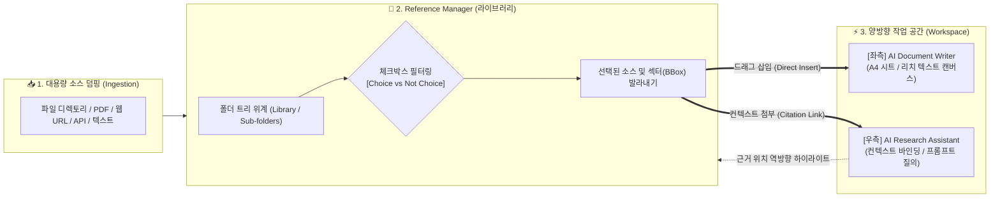

![[Logically_02_Reference_Manager.png]]

# 🏛️ (web&강추) Logically (구 Afforai) — AI Research & Reference Workspace

> [!abstract] 💡 **핵심 가치 선언 (Core Value Promise)**
> **"수백 편의 논문과 문서를 지능형 데이터룸(Data Room)에 뭉탱이로 덤핑하고, 체크박스로 필요한 소스만 솎아내어(Choice/Not Choice), 원본 문서의 정확한 페이지·문단(Sector BBox)을 에디터와 AI 어시스턴트 양방향으로 직결하는 차세대 리서치 워크스페이스"**
> 
> * **공식 사이트**: https://logically.app/ (구 Afforai 리브랜딩)
> * **핵심 포지셔닝**: AI Document Writer + Reference Manager + AI Research Assistant 통합 허브
> * **벤치마킹 대상**: VibeDocStudio의 `Resource Manager` (에디터 ↔ AI Composer 사이 공간)

---

## 🗺️ 1. Logically 메커니즘 한눈에 보기



---

## 📸 2. 화면 구성 및 핵심 아키텍처 분석

### ① 메인 대시보드 및 4대 핵심 모듈 조망
![[Logically_01_Home_Dashboard.png]]

* **4대 주력 작업 모듈**:
  1. **AI Document Writer**: AI 자동완성과 인용구 삽입이 결합된 본문 작성 에디터.
  2. **AI Research Assistant**: 신뢰성 있는 출처(Citation-backed) 기반 실시간 질의응답 어시스턴트.
  3. **Reference Manager**: 수백 편의 논문, 기사, 데이터를 폴더·태그로 체계화하는 원천 자원 창고.
  4. **File Annotator**: PDF 원본에 AI와 함께 주석을 달고 영역(BBox)을 발라내는 인터랙티브 뷰어.

---

### ② Reference Manager & Data Room 덤핑 구조
![[Logically_02_Reference_Manager.png]]

* **폴더 트리 기반 라이브러리 (`Library`)**:
  * 카테고리별 디렉토리(`Quantum computing`, `Algorithms`, `Error Correction` 등)를 계층형으로 관리.
  * 상단에 `Import`, `Upload`, `+ Create` 버튼을 배치하여 로컬 디렉토리, 웹 링크, 외부 서지 데이터를 뭉탱이로 인제스천.
* **메타데이터 중심 테이블 뷰**:
  * `Title`: 문서명 및 상태 인디케이터.
  * `Author`: 저자 및 발행처.
  * `Size` & `Date`: 용량 및 날짜.
  * `Indexed (Yes/No)`: AI 에이전트가 즉각 검색 및 임베딩 참조할 수 있는 벡터화 완료 여부 시각화.

![[Pasted image 20261105161120.png]]

---

## 🎯 3. VibeDocStudio Resource Manager 구현에의 핵심 시사점

사용자가 정의한 **"에디터 패널과 AI Composer 사이 공간"**에 들어갈 Resource Manager 사양에 Logically의 설계를 다음과 같이 이식합니다.

```text
┌─────────────────────────┬───────────────────────────────────────────┬─────────────────────────┐
│     Editor Panel        │         Resource Manager (Split Dock)     │       AI Composer       │
│     (문서 캔버스)       │                                           │      (우측 사이드바)     │
│                         │  [상단] 📂 소스 덤핑 & Choice 체크박스     │                         │
│  • 슬롯 및 2차원 표 캔버스 │   ☑ 전체 선택  |  + 대량 폴더/URL 덤핑     │  • 에이전트 대화 및 지시 │
│  • WYSIWYM 본문 집필     │   ├─ ☑ 폴더 A (수십 개 파일)              │  • "선택된 리소스 12개" │
│                         │   └─ ☐ 폴더 B (미선택)                   │    자동 프롬프트 바인딩  │
│                         │  ───────────────────────────────────────  │                         │
│                         │  [중앙] 🗂️ Choice 카드 덱 & 발라내기      │                         │
│                         │   • '선택된 놈'만 모아둔 Bento 카드 덱    │                         │
│                         │   • PDF / 웹 / 표 원본 섹터(BBox) 하이라이트│                         │
│                         │  ───────────────────────────────────────  │                         │
│                         │  [하단] ⚡ 양방향 주입 액션                 │                         │
│  ◀ [슬롯으로 드래그 삽입] │   [◀ 본문 삽입]  |  [AI 컨텍스트 첨부 ▶]  │ ──── [원클릭 인용 첨부] ▶ │
└─────────────────────────┴───────────────────────────────────────────┴─────────────────────────┘
```

### 1) 디렉토리 뭉탱이 임포트 & 선별 (Choice / Not Choice)
* 수백 개 파일이 들어와도 화면이 번잡해지지 않도록 **폴더 단위 접기/펼치기**와 **체크박스 토글**을 기본 제공합니다.
* 사용자가 체크박스로 선택한 파일(Choice)만 중앙의 **'Active Resource Card Deck'**으로 승격되어 작업 시야에 유지됩니다.

### 2) 몇 백 페이지 중 '사용된 놈(섹터)'만 발라내기
* 원본 파일 전체를 억지로 다 띄우는 대신, Logically의 Citation 메커니즘처럼 **실제 본문 작성에 인용되거나 북마크된 특정 페이지·사각 영역(BBox)만 독립 카드**로 추출합니다.
* 이 카드는 클릭 시 원본의 해당 위치로 0.1초 만에 줌 스크롤됩니다.

### 3) 에디터 ↔ AI Composer 사이의 '중간 허브' 인터랙션
* **좌측 에디터로**: 리소스 카드의 텍스트/표/이미지를 마우스로 끌어다 에디터 슬롯에 툭 던져 넣음 (Direct Drag & Drop).
* **우측 AI Composer로**: "선택된 리소스 N개"가 실시간 프롬프트 컨텍스트로 바인딩되며, 칩 형태로 표시됨.

