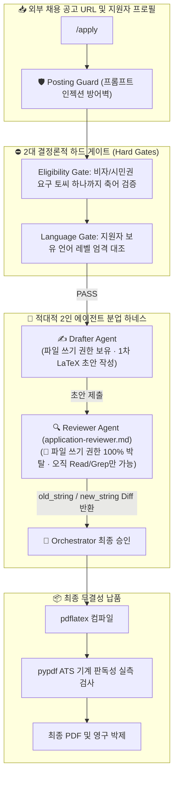

![[Pasted image 20261025124634.png]]
# 🤖 (web&강추) ai-job-search — 로컬 에이전트 하네스 & Drafter-Reviewer 적대적 분업

> [!abstract] 💡 **핵심 설계 철학 (Core Architecture Intent)**
> **"단일 AI에게 '알아서 작성해줘'라고 맡기면 환각(Hallucination)과 자화자찬의 쓰레기가 나온다. 진짜 프로덕션 AI 시스템은 '쓰는 놈'과 '까는 놈'을 철저히 격리하고, 규칙을 어기면 0초 만에 거부하는 '하드 게이트'로 굴러간다."**
> 
> * **공식 GitHub 레포지토리**: https://github.com/MadsLorentzen/ai-job-search
> * **제작자**: Mads Lorentzen (덴마크 지구물리학자 ➔ AI 엔지니어 전향자)
> * **실전 성과**: 69개 맞춤 지원, 20개 인터뷰 달성, 글로벌 GitHub 트렌딩 1위 기록
> * **볼트 내 심층 분석 보고서**: [[1.🎯(Project) 프로젝트/🍽️래퍼런스 뜯어보기/[통합 원심분리기 분석] AI Job Search (로컬 에이전트 하네스 · Drafter-Reviewer 분업 · 하드 게이팅).md|[통합 원심분리기 분석] AI Job Search]]

---

## 🗺️ ai-job-search 핵심 파이프라인 메커니즘

---

## 왜 래퍼런스로 채택했는가?
- 우리가 구현해야하는 한 부분을 그대로 구현한 듯함.
	- 자동으로 탐색해서 맞는 공고 긁어오기
	- 나랑 얼마나 잘 맞는지 점수 체크하기
	- 자소서 맞춰서 작성하기
	- 첨삭하기
- 걍 우리의 지원금 자동빵 돌리는 사업 계획서 쓰는 부분 그대로 아님?