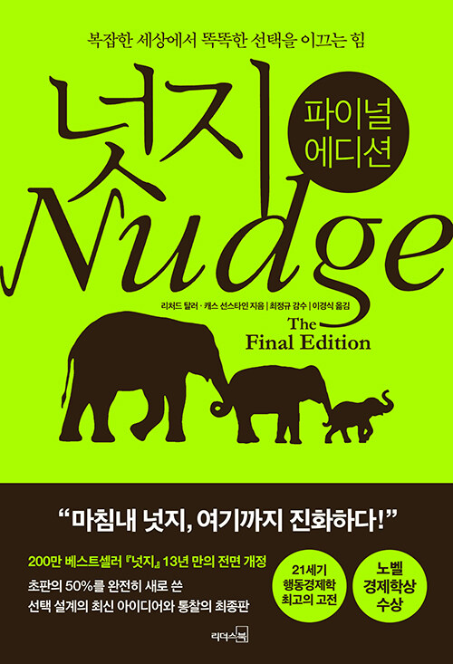

> **"복잡한 세상에서 똑똑한 선택을 이끄는 힘"**

> [!quote] 💭
> ### 나의 감상평
>
> ---
>

> [!warning] 🏷️
> ### 기억에 남는 글귀
>

## 💬 댓글

- 1장 - 편향과 실수
	- 어림짐작, 간편 추론법 - 기준점 효과 / 가용성 / 대표성
		- 당신은 행복합니까? 그리고 당신은 데이트를 얼마나 자주 합니까? 의 질문 순서보다 질문 순서를 뒤바꾸자 상관성이 62퍼센트 높아짐
			- 아무 상관 없어보이는 질문도 기준점을 무엇으로 두냐에 따라 사람들이 느끼는 감정 자체가 달라짐 (=넛지) 단, 반발은 경계해야함 너무 높은 기준점을 제시하면 반발 심리가 생김.
			- 이걸 우리 서비스에 대입한다고 했을 때 어떻게 기준점 효과를 누릴 수 있는가
		- 대규모 홍수나 지진이 발생하면 그 자연재해에 대비하는 보험 상품이 불티나게 팔리고, 그 시점부터 보험 가입자수는 점점 줄어듦 (기억이 희미해지기 때문)
			- 언론과 관심이 많은 분야는 더욱 위험하고 생생하게 느끼는 반면, 정말 위험하더라도 다뤄지지 않으면 둔감하게 됨
			- 해당 위험의 진정한 발생 가능성을 판단하도록 넛지가 필요함
		- 대표성 (=유사성) 대충 고정관념임
	- 낙관주의와 과신 - 내가 평균 이상은 될거라고 생각하는 것 ㅋㅋ
		- 우리 서비스도 평균 이상만 이용 가능이라고 하면 긁혀서 많이 들어오려나? 이 툴 씀? 그럼 님 전문가인가보네? 같은 인식 주는거지 아닌가 이 예시는 ;;ㅎ
	- 이득과 손실 - 손에 쥔걸 절대 놓지 않겠다는 바람
		- 손실 회피 성향을 대부분 지니고 있기에 어떤 것을 잃었을 때 느끼는 고통은 똑같은걸 얻었을 때 느끼는 행복감의 2배다.
		- 이게 또 현상 유지 편향이랑 이어짐. 
			- 이월 효과로 ott 에서 자동 스트리밍 설정 되어있으면 잠깐 보려고 했어도 밤새 보게되는 것도 현상 유지 편향임
	- 프레이밍 효과 - 100명 중 90명이 선택했다 vs 100명 중 10명만 선택하지 않았다
	- ==🟡★ 자동시스템과 숙고시스템==
		- 숙고 시스템은 정교해서 여러 시스템을 사용함 - 낯선 곳을 여행할 때, 로스쿨 갈지 비즈니스 스쿨 갈지 결정할 때 
		- 자동 시스템은 샤워하거나 산책할 때, 공을 피할 때 사용 되는데 - 이때 이런저런 아이디어가 불쑥불쑥 튀어나오곤 함
			- 우리 서비스에서 모든 단계 사이엔 숙고 시스템을 거의 사용하겠지만 자동 시스템 적으로 사용 될 수도 있는거임 그래서 오류도 막아야하고 아이디어도 받아적어야하고 그걸 숙고 시스템 작동할 때 검수 받고, 강제적으로 체크하고
			- 아 그리고 그럼 우리 서비스 개념이 어려우니 ui 라도 숙고 시스템을 안거치도록 직관적이고 쉬워야하는거 아닌가?
			- 여기서 ui/ux 짤 때, 이 단어로 고려해보면 좋겠네 이 과정은 자동 시스템을 쓰는 플로우인가 숙고 시스템을 쓰는 플로우인가 그걸로 ai랑 대화해서 풀어가면 답이 나올 듯
			 - 만일 사람들이 자동 시스템에 한층 더 많이 의존하면서도 끔찍한 문제에 휘말리지 않을 수 있다면 사람들의 삶은 한층 더 쉽고 낫고 길어질 것 - 그래 호머 심슨들을 위한 서비스..
	- 즉, 우리가 설정한 목표는 쉽게 오류를 저지르는 인간의 성향을 간략하게 살피는 것이였음
		- 바쁘고 복잡하게 살아서 대충 생각 하고 대충 행동하고 그런 것
		- 넛지로 얼마든지 사람들을 바꿀 수 있다!
- 2장 - 유혹에 저항하기
	- 토요일 오후에 조깅하러 가기로 마음 먹고선 쇼파에 앉아서 드라마 정주행 하고 있는 모습을 보라!
	- 유혹과 mind-lessness 
		- 세이렌 노래소리에 죽지 않으려 율리시스는 스스로 돛대에 묶었고, 선원들은 밀랍으로 귀를 막으라 지시했음 ㅋㅋ (=자기 결박 전략)
	- 계획하는 자아(원시안적)와 행동하는 자아(근시안적)
		- 사람은 자기 약점을 부분적으로나마 알기 때문에 외부에 도움을 청하기도 함
			- 메모하고 알람 맞추고 뭐 막 어플 깔고 하잖슴
			- 대부분 호머 심슨이 이김 행동 자아 못 막지 그래서 계획하는 자아를 돕기 위해 많은 기업이 서비스를 출시함
			- 장기적으로 뭐 너가 성장할거고, 수익률이 오를거고, 이런 장기적인 성과를 제시해주는 것 보다 다이어트 할 때, 내가 살 빼면 건강해지겠지 그치만 10키로 못 빼면 머리 밀게. 너한테 100만원 줄게 라고 말하는게 더 동기부여 잘 됨
			- 새로운 발상으로 새로운 작업을 하는 것이 예전에 하던 작업을 마무리 하는 것보다 보통은 더 재밌어서 시작은 하고 끝은 잘 없는 프로젝트들이 많은 것 - 이걸 좀 우리 서비스가 도울 수 있을 듯!
			- 꼭 계획 자아를 도우는 서비스를 출시해야하나? 호모 심슨한테 도넛 많이 팔아도 장사는 될것인데 ? ㅋㅋㅋ 완급 조절을 하면 양쪽 다 먹을 수 있을까?
		- 심리적 회계 전략
			- 토큰에 대입해 볼 수 있겠는데? 각각 파트에서 토큰을 얼마씩 쓸 수 잇다 혹은 쓰는 만큼 부과된다고 하면 좀 아껴 쓸거고, 한번에 다 주고 경계 없이 쓰라고 하면 막 쓸 듯 - 이거 맞나 ;; ai야 알려줘 토큰에 빗대어 설명해줘
- 3장 - 인간은 떼지어 다닌다
	- 이콘이 아닌 인간은 남들 따라하는대로 간다
		- 아주 작은 넛지라 하더라도 자신감이 담겨 있기만 하다면 해당 집단이 내리는 결론에 큰 영향을 줄 수 있다
		- 이게 그 마케팅에서도 추종자? 몇몇의 광신도를 먼저 만들라고 하는 그건거 같애
		- 자신감 간편 추론법 - 어림짐작의 방식으로 자신 있게 말하는 사람의 주장이 틀릴 리 없다고 여기는 것
			- 전통이라는 아무 의미도 목적도 없는걸 계속 지켜가는 이유임. 집단 보수주의
		- 사람은 대부분 함께 식사하는 동료의 식습관에 영향을 받음
			- 이처럼 광고업자들 정치인들은 이런식으로 사람들을 넛지하려함
	- 사람들의 정체성 혹은 자이이해가 매우 중요하게 작용할 수 있음을 깨닫는 것이 중요함
		- 텍사스 고속도로에 쓰레기를 너무 버려 골칫거리였고, 대부분 18-24세 남자였음
			- 버리지 말라고 호소하고 캠페인을 벌여도 ㅇㅉ 꼰데 마인드로 무시함
			- 미식축구 선수들과 인기 가수들로 'Don't mess with Texas!'라고 으르렁거리는 광고를 만들었고 이 광고로 인해 투기가 줄었을 뿐더러 텍사스의 대표 슬로건이 됨
			- 요즘 진짜 많이 하는 마케팅 전략이긴 함. 그래서 관공서에서도 충주맨 같은 괴물을 길러낸게 아닐까
	- 폭포 효과나 편승효과를 촉발하는 넛지에서 시작됨
		- 실제로 다른 사람들이 어떻게 생각하는지 느끼게 해주고, 그래서 자기가 생각하는 것을 말할 수 있게 해주기 때문에 (ex. 미투 운동, 흑인 인권 운동 등)
		- 불편하다고 무의식에 생각하고 있었지만 직접적인 툴 교체나 추가 서비스 구독을 하지 않았던 사람들이 이런 넛지로 우리 서비스에 오게 하려면 어떤 고통을 받았고 어떤 침묵 속에서 분노를 삼켰는지 그 니즈를 알아야 할듯?
			- 지금 당장 떠오르는건 좀 아는건 많고 수기 작성 잘하는 사람인데 나이가 좀 있는? 시니어급? 자기가 어떻게 문서 작업 못해서 아래 직원에게 막 부탁하는 그런? 노하우는 많은데 ai 쓰고 이런 사회 변화에 뒤떨어진 사람들 도움 어때
			- 아니면 육아휴직 같은걸로 경력 단절된 여성들, 노하우는 있는데 직장이 없잖아? 그치만 프리랜서로 활동할 수 잇게 도와주는거지
	- 강력한 넛지로 작용하는 새로운 사회적 규범
		- 선택 설계자가 사람들의 행동을 바꾸고자 하고 이를 넛지를 통해 수행하고자 한다면 무척 간단 할 수 있다 - 어떻게? 다른 사람들이 생각하거나 행동 하는 것을 알려주기만 하면 되기 때문 :) 개꿀딱
		- 세금을 내라는 예시 4그룹에게 다른 슬로건 알려줌
			- 1. 너네 세금 미네소타에 다방면 개꿀 도움 받음
			- 2. 처벌로 협박
			- 3. 신고, 납부 어려우면 언제든 도와드림
			- 4. 이미 주민 90프로 성실 납세중 (압도적 승리)

- 4장 - 넛지가 필요한 순간
	- 도움이 될 가능성이 가장 높으며 해를 끼칠 가능성이 가장 낮은 넛지를 제공하는 것
		- ==🟡특별한 주의력이 필요한 의사 결정을 내려야 할 때, 의사 결정 상황에서 즉각적인 피드백을 받지 못할 때, 그 상황의 여러 측면을 쉽게 이해할 수 있는 언어로 해석하기 어려울 때 사람들은 넛지를 필요로 함==
		- 매우 낯설거나 드문 상황에 놓은 사람에게 넛지가 필요할 수 있음
	- 최상의 선택을 설계하는 법
		- 당신은 선택 설계자이고, 한 무리의 사람들이 가까운 미래에 어떤 선택을 해야 한다는 말을 들었다.
			- 그 선택 환경을 어떻게 설계해야 할지
			- 어떤 종류의 넛지를 제공해야 할지
			- 그 넛지들이 얼마나 미묘해야할 지 판단하고 결정해야 함
			- 나잖아 ㅠㅠㅠ 나잖아 ㅠㅠㅠ나아아아아아아아아아아아아으아아아아 알려줘!
			- 사람들이 흔히 저지르는 가장 평범한 실수는 무언가를 깜빡 잊어버리는 것이 아닐까 - 넛지로 방지해줘 알랏 알랏! / 점검표 체크리스트!
		- 이익은 지금, 비용은 나중에!
			- 투자재 반대편 극단엔 유혹재가 있음. 둘 다 넛지의 우선적인 후보임. 
			- 기억을 필요 하거나 결과가 한참 뒤에 나타나는 선택
		- 난이도가 높은게 넛지 후보임. 적절한 양의 빵을 선택할 때보다 적절한 조건의 담보대출을 선택할 때 한층 더 많은 도움을 필요로 함
		- 빈도가 낮은게 넛지 후보임. 식료품점에서 우유 사기는 많이 해봤지만 배우자 고르기는 안해봤고, 한번 하는 선택이기 때문에
		- 피드백이 넛지 후보임. 피드백이 없으면 아무리 연습해도 완벽해질 수 없다.
		- 자신이 좋아하는 것을 모를 때 넛지 후보임. 선택과 경험의 관계가 분명하지 않은 선택
- 5장 - 선택 설계의 세계
	- 자극 반응 일치성!! - 표지판 예시로 빨간색 표지판에 go 라고 적혀있으면? 자동 시스템이 숙고 시스템보다 빠르게 반응함
		- 어떤 행동이나 활동을 장려하고 싶다면 그것을 쉽게 할 수 있게 만들면 됨 Make it Easy!!
		- 특정 방향으로 억지로 밀기보단 작은 장애물을 제거함으로써 좋은 행동을 하도록 유도할 수 있음
	- 기본 설정이 중요하지만, 선택 설계자는 선택자가 스스로 어떤 선택을 하도록 강요할 수 있음
		- 선택 요구(동의 체크해야만 페이지 넘어감), 선택 위임, 능동적인 선택하기(특정 조건에 동의해도 한번 더 명시하고 확약 받기), 선택 권유(관련상품 추천 받기) 여튼 이게 기본값으로 들어가있어야함.
		- 선택이 복잡하고 어려울 때 사람들은 똑똑한 기본 설정을 무척 반길 것
		- 선택 요구는 복잡한 것 보단 단순한 찬반 결정에 더 적합함 (동의/미동의)
	- 오류를 예상하라
		- 인간은 실수를 하기 마련이고 잘 설계한 시스템은 사용자가 실수할 것을 예상하고 여유 공간을 최대한 확보해둔다
			- 이거 git 스펙을 이식하려고 하는 우리의 노력과 일맥상통하는 거신가.
			- 아 카드 단말기 어디로 꼽든 인식해주는 그런거구나 꼭 방향이 맞게 넣어야만 하는게 아니라
		- 자동차는 넛지 집합체이다. 주유구 뚜껑 플라스틱 연결선으로 달아준 것. 경고음 뜨는 것. 졸음 운전 주의 시간이라고 알려주는 것. 등등
			- 현금 인출기에서 카드를 먼저 뽑아야 목적인 현금을 열어서 주는 것. (카드 두고 가지 말라는 뜻)
	- 피드백 하라
		- 이콘이 아닌 인간이 보다 나은 성괄를 내도록 돕는 탁월한 방법은 피드백 하는 것
		- 잘 설계된 시스템은 사람들이 잘하고 있을 때, 실수를 하고 있을 때 그 사실을 알려줌
		- 하지만 너무 남발하게 될 경우 모든 경우가 쓸모없어지고, 사람들이 생각하지 않고 예/아니오 눌러버림
	- 매핑 이해하기 : 선택에서 복지로
		- 선택과 결과의 연결성을 이해하는 능력을 향상 시켜주는 것
			- 예를 들어 타이어 검사를 받으러 갔는데 4등급이래. 어쩌라고 뭔데, 그럼 기준을 주는거지 1-3등급은 양호, 4-6등급은 주의, 7-9등급은 위험 이런식이라던가 기준을 들어 설명해줘야 함
		- 복잡한 선택 구조화하기
			- 선택지가 적을 땐, 잘 살펴보고 하지만 많아지면 곤란하다
			- 셀프 넛지로 강제로 선택지를 못 본 척하거나 줄이거나 삭제해버리는 경우도 있음
			- 예를 들면 집을 구한다치면 수천개 다 볼거 아니니깐 예산, 직장과 거리, 주변 인프라 등등 소거법으로 필터링 함
			- 자신과 비슷한 사람들의 취향을 알면, 그들이 좋아한다는 이유만으로도 직접 경험하지 않은 제품이라도 마음놓고 선택함
			- 하지만 또 사람들이 새로운 것을 배우도록 도와서 스스로 더 나은 선택을 할 수 있게 만드는 것도 선택을 구조화 한다는 것임
		- 선택 설계 시스템과 인센티브
			- 적절한 사람들에게 적절한 인센티브가 돌아가도록 시스템을 설계할 것
				- 누가 선택하는가?
				- 누가 사용하는가?
				- 누가 지불하는가?
				- 누가 이득을 얻는가?
- 6장 - 기다려라, 더 많은 것이 있다
	- 큐레이션 : 약자에게 더욱 필요한 선택 설계
		- 엄격한 큐레이션 과정을 거쳐 선정된 소수의 선택지 혹은 좋은 기본 설정이야말로 매우 만족스로운 결과를 가져다준다
	- 재미있게 만들기
		- 재미는 좋은 선택 셜계의 최종 요소다
		- 넛지를 한마디로 말하면 바람직한 행동을 쉽게 할 수 있도록 만들어 주는 것
		- 진짜 젼나 공감이다 나는 이게 필요하다고 봄 ㅠㅠ
		- 어떤 활동이 놀이처럼 보이게 하거나, 사람들로 하여금 호기심을 품게 하거나 흥분하게 하거나, 무언가를 기대하게 할 때 사람들은 그 활동을 기꺼이 하겠다고 달려든다. ㅆㅇㅈ
		- 일이 노잼이지만 유잼으로 만들어 주고 싶다~ (그럼 노잼 포인트가 뭔지 알아야지. 뭐가 질리는지 쉽게.)
- 7장 - 스마트 공개
	- 표준화된 단위와 현명한 선택
	- 연비 예시로 사용을 했고, 그래서 선택 설계자는 표준화된 측정 방법을 선택해야 할 뿐만 아니라, 이콘이 아닌 인간이 혼란스러워하지 않을 방식으로 내용을 보고하려면 어떻게 해야할지 신중하게 생각해야함
	- 쉽게 말해 평범한 사람도 한층 나은 선택을 할 수 있도록 소프트웨어에 해당 자료를 불러올 수 있어야 한다
	- 이거 ai 나오면서 가능해졌잖아! 개꿀이잖아! 그럼에도 불구하고 이제 그럼 근거 자료 보여주면서 얼마나 신뢰있는 결과있는 보여줘야하는디~