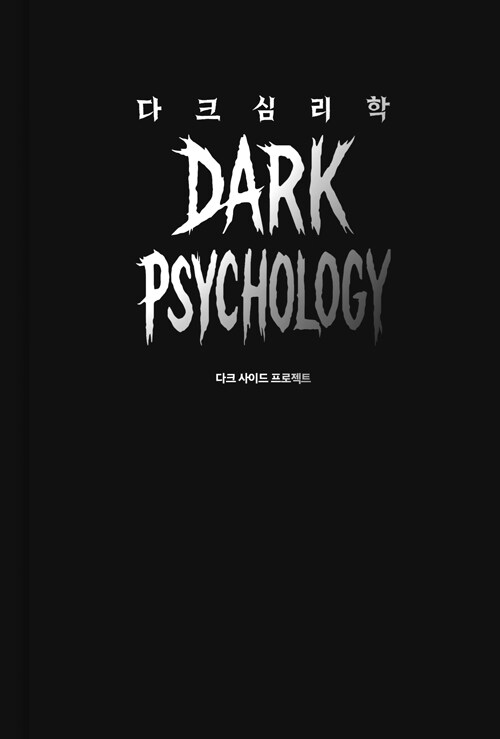

> **"자기 파괴적 언행은 책임 회피의 또 다른 방식이다. 당신을 이용해서 자기 감정 쓰레기통을 만들려는 전략일 수 있다. 도와줄 수 있는건 나의 몫 안에서만 해야한다."**
>
> 1. 상대의 고통은 내가 해결해 줄 문제가 아니다 - 공감은 줄 수 있어도 책임까지 떠맡을 의무는 없다.
> 2. 내가 준 적 없는 빚에 대해 죄책감을 느낄 필요는 없다. - 누군가 기대했을 뿐이지 합의된 적은 없다.
> 3. 거절은 공격이 아니라, 나를 지키는 최소한의 권리다 - 상대가 분노하든 무너지든 그건 내 책임이 아니다

> [!quote] 💭
> ### 나의 감상평
>
> ---
>'감정은 해킹 포인트다'
>일상에서 우리의 감정은 어떻게 해킹 되는가?
>- 누군가 반복적으로 친절과 호의를 베풀 때
>- 죄책감이나 연민을 자극하는 말투로 부탁할 때
>- 과거의 추억을 들먹이며 함께 울고 웃게 할 때
>- 넌 나없이는 안돼 같은 은근한 의존을 유도할 때
>- 외로움 피로 허영심 같은 감정적 틈새를 찌를 때
>-> 그럼 우리 서비스는 어떤 감정을 해킹해야하는가?

> [!warning] 🏷️
> ### 기억에 남는 글귀
>명령하지 말고 유도하라
>- 자신이 직접 선택했다고 느끼게끔 상대방이 원하는 행동의 틀을 만들어라.
>- 1) 선택지는 제한하고 유도하는 질문을 하라
>- 2) 직접 선택하고 동의했다는 점을 강조하라
>- 3) 강제적으로 요구하지 않았다고 알려줘라
>- 보이지 않는 암시를 반복하는 것이 상대방을 직접 통제하는 것보다 더 효과적이다

## 💬 댓글

