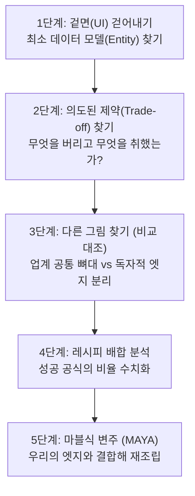

# 2026-10-13 대화 내역: 《역설계》 4장 점수판 원칙 및 스캐폴드 구현 이식

> **세션 메타데이터**
> - **세션 ID**: `9aec2206-ee67-4e90-afa4-3bea77fa5d98`
> - **대화 일시**: 2026-10-13 17:22:03 ~ 17:40:24
> - **참여자**: [[Antigravity]], [[Rin]]
> - **관련 문서**:
>   - [[역설계 일단 읽기.canvas]]
>   - [[역설계 일단 읽기]]
>   - [[구현_scaffold_Manager]]
>   - `3.📦(Resource) 자료/🛖Scaffold_Manager_주요_레퍼런스`

---

## 💬 질문 1. 《역설계》 2부 4장 내용 파악 및 브리핑

### 👤 사용자 질문 (2026-10-13 17:22:03)
> 1.🎯(Project) 프로젝트/🛖Scaffold_Manager_프로토타입_구현/역설계 일단 읽기.canvas  
> 여기 내가 캡쳐한 부분 역설계 > 2부 > 4장 내용 파악해서 나한테  브리핑 해봐

---

### 🤖 에이전트 답변 (Antigravity)
캡처해주신 **《역설계》 2부 4장: 〈점수판 원칙 — 스스로를 측정하라〉** 파트의 캔버스 노드 내용을 맥락과 흐름에 맞추어 일목요연하게 브리핑해 드립니다.

---

#### 📌 4장의 핵심 메시지
> **"측정이 발전을 낳는다 (The Scoreboard Principle)"**  
> 1부에서 뛰어난 대상을 역설계해 '성공 공식'을 알아냈더라도, **자신의 이상(비전)과 현재 역량 사이의 격차**를 줄이지 못하면 좌절하게 됩니다. 이 간극을 메우고 실제 실행력을 끌어올리는 가장 강력한 도구가 바로 **행동을 객관화하는 '점수판(측정 지표)'**입니다.

---

#### 🗺️ 노드 흐름별 세부 브리핑

---

##### 1. 측정만 해도 행동이 바뀐다 (리츠칼튼 & 식단 기록)
* **의사의 처방 = 성공 기업의 비밀 무기**: 건강 문제로 식단을 기록하기 시작했을 때, 단지 **'기록하는 행위' 자체만으로도 다음 선택에 영향을 주어 개선**이 일어남.
* **리츠칼튼의 감동 서비스**: 장미 욕조, 렌치 초콜릿, 잃어버린 곰인형 사진 등 남다른 고객 서비스의 비결은 막연한 친절이 아니라 **철저한 성과 지표(체크인 대기 시간, 사전 예약 건수 등) 점검과 행동의 연계**에서 나옴.
* **명시적 질문을 넘어 숨은 니즈 파악**: "체크인 몇 시인가요?"라는 질문에 시간만 답하는 것이 아니라, *"더 일찍 도착하시나요? 먼저 도와드릴까요?"*처럼 선제적 행동으로 이어지도록 지표와 프로세스를 설계함.

##### 2. 인간은 왜 점수에 열광하는가? (게이미피케이션 & 유능함)
* **비디오게임의 원리**: 성과 지표(점수, 랭킹)가 붙는 순간 몰입도가 극대화됨.
* **자기결정성 이론의 3대 욕구**: 소속감 · 자율성 · **유능함(Competence)** 중 점수는 **'내가 성장하고 숙련되고 있다'는 유능함 욕구를 직접 충족**시킴. 진화생물학적으로도 숫자를 민감하게 파악하는 개체가 생존에 유리했음.

##### 3. 조심해야 할 함정: '허세 지표'와 '대체 효과'
* **허세 지표 (Vanity Metrics)**: 린 스타트업의 교훈처럼, 전환율 대신 단순 방문자 수에 집착하거나 유료 고객 대신 가입자 수에만 매몰되는 현상.
* **대체 효과 (Surrogate Effect / 굿하트의 법칙)**: 원래 지표를 만든 본질적 목표는 잊은 채, **숫자 그 자체를 올리는 데만 혈안이 되어 도덕적 해이나 왜곡**이 발생하는 위험.
* **해결책**: 최종 비전과 현재 실력의 격차를 좁혀주는 **'진짜 통제 가능한 행동 지표'**를 측정해야 함.

##### 4. 무엇을 어떻게 측정할 것인가? (페더러 모델 & 3대 접근법)
로저 페더러가 약점이었던 백핸드를 강점으로 바꾼 비결은 경기를 단일 덩어리가 아닌 **서브, 포핸드, 백핸드, 네트 포인트 등 세부 구성 요소로 해체해 분석**했기 때문입니다. 일터에서도 마찬가지로 적용할 수 있습니다.

1. **하위 기술로 쪼개기**: 복잡한 과업을 세부 요소로 분해해 평가 (예: PT 발표 → 암기, 메시지 전달력, 제스처, 시선 처리 등).
2. **정성적 특성의 루브릭(척도)화**: 결과물의 품질 요건을 1~7점 척도로 평가 (예: 약속 이행 요청 이메일의 5가지 핵심 요소 충족 여부 채점).
3. **일상 습관 자가진단 (선행 지표 관리)**: 매일 밤 이상적인 자신의 행동 리스트(수면 시간, 조깅, 식단 등)를 체크.
   * *선행 지표(Leading Indicator)*: 결과가 확정되기 전에 좋은 결과를 미리 담보해 주는 통제 가능한 행동 지표.

##### 5. 효과적인 점수판을 만드는 4대 원칙
1. **다양한 지표 수집**: 단일 지표의 왜곡을 방지.
2. **지표의 균형**: 행동 지표 vs 결과 지표, 단기 vs 장기.
3. **짝꿍 지표 (Counter-metric) 필수**: 
   * 한 지표를 좇다가 생길 수 있는 부작용을 통제하는 견제 지표를 반드시 한 쌍으로 둘 것. (예: 미슐랭 셰프가 주문량뿐 아니라 **'손님이 남긴 잔반량'**을 같이 확인하는 것).
4. **주기적 갱신**: 분기별 등으로 상황과 목표에 맞춰 지표를 진화시키기.

---

#### 💡 캔버스 메모 및 프로젝트 연계 시사점
노드 하단에 메모해 두신 **"점수로 수치화해서 객관적으로 보여주고 레벨업하게 하는 것, 우리 먼저 써볼까?"**라는 고민과 완벽히 부합합니다.

현재 진행 중인 **Scaffold Manager / Outliner** 프로젝트에 적용해 본다면:
* 아웃라인 작성이나 작업 분해 시 막연한 "열심히 하기" 대신, **계층 깊이, 노드 완료율, 회고 점수, 선행 행동 체크리스트** 같은 개인 점수판(Scoreboard) 메커니즘을 시스템 내에 스캐폴딩으로 녹여내는 데 핵심 레퍼런스가 될 수 있습니다.

---

## 💬 질문 2. 레퍼런스 역분석 및 스캐폴드 프로토타입 이식 관점

### 👤 사용자 질문 (2026-10-13 17:38:52)
> 이게 지금 개인 성공 자가개발 위주로 안내하는 안내책자잖아. 근데 나는 이 책을 @[c:\Users\user\Desktop\개똥이 머릿속\3.📦(Resource) 자료\🛖Scaffold_Manager_주요_레퍼런스] 여기 있는 래퍼런스들을 어떻게 역분석을 하고, 그중 어떤 부분을 취해서 우리 @[c:\Users\user\Desktop\개똥이 머릿속\1.🎯(Project) 프로젝트\🐕망고독 R&D 프로젝트 관리\구현_scaffold_Manager.md] 이 스캐폴드 구현에 이식할지가 고민이라 이런 과점에서는 어떻게 바라보는게 맞을까? 우리  서비스를 먼저 수치화해서 점검하는 입장이라면 아직 프로토타입을 만드는 중이라 약간 애매하네 초고 쓰는 ㅣ과정이라고 생각하면 될까?

---

### 🤖 에이전트 답변 (Antigravity)
질문해주신 지점은 프로덕트 빌더들이 가장 많이 겪는 혼란이자, **《역설계》라는 책을 '자기계발서'에서 '프로덕트 아키텍처 바이블'로 전환시키는 결정적 질문**입니다.

질문하신 내용에 대해 결론부터 말씀드리면, **사용자님의 직관이 100% 맞습니다.**  
지금 단계는 서비스를 정식 출시해 MAU나 전환율 같은 거시 지표를 재는 단계가 아니라, **"소설가가 뼈대(Outline)를 잡고 챕터별 초고를 검증하는 단계"**입니다.

따라서 이 책과 4장의 '점수판 원칙'을 `3.📦(Resource) 자료/🛖Scaffold_Manager_주요_레퍼런스` 분석과 `1.🎯(Project) 프로젝트/🐕망고독 R&D 프로젝트 관리/구현_scaffold_Manager.md` 프로토타입 구현에 이식할 때는 **다음 3가지 관점**으로 바라보아야 합니다.

---

#### 1. 관점의 전환: "개인 자기계발"이 아니라 "프로덕트 분해(Deconstruction)"로 읽기

책에서는 글쓰기나 스포츠 사례를 들지만, 본질은 **"잡스가 제록스 PARC를 역분석해 매킨토시를 만든 방식"**, **"제약회사가 신약을 복제할 때 화학 성분을 분해(배합분석)하는 방식"**과 정확히 같습니다.

레퍼런스 폴더에 모아두신 30여 개 도구(Workflowy, Scrivener, PandaDoc, Overleaf, Heptabase 등)를 대할 때 책 1부의 기법을 적용하면:
* **디테일 무시 & 줌아웃 (Zoom-out)**: 예쁜 UI나 기능 목록을 보지 말고, 그 도구가 문서를 다루는 **최소 단위(Data Model)**가 무엇인지 파악합니다.
  * Workflowy: 무한 중첩 트리(Node)
  * PandaDoc: 고정 서식(Boilerplate) + 가변 슬롯(Token)
  * Overleaf: 논리 텍스트(TeX) ↔ 렌더링 뷰(PDF)의 양방향 핀포인트
* **다른 그림 찾기**: 왜 어떤 도구는 아웃라인에 강한데 레이아웃이 무너지고, 왜 어떤 도구는 조판은 완벽한데 작성이 답답한가? 그들이 **의도적으로 포기한 요소와 취한 핵심 규칙**을 추출하는 것입니다.

---

#### 2. 지금 단계에서 '수치화/점수판'의 진짜 대상은 누구인가?

> *"우리 서비스를 먼저 수치화해서 점검하는 입장이라면 아직 프로토타입을 만드는 중이라 약간 애매하네"*

이 애매함은 당연합니다. 아직 나오지도 않은 서비스의 '결과 지표(완성도, 만족도)'를 잴 수는 없기 때문입니다.  
지금 시점에서 4장의 점수판을 들이대야 하는 대상은 **'완성된 우리 서비스'가 아니라 다음 두 가지**입니다.

##### ① [레퍼런스 분해용 점수판] — 4장의 "하위 기술 쪼개기(페더러 모델)"
30여 개 레퍼런스를 그냥 "좋아 보인다"로 끝내지 않고, 우리가 구현하려는 4대 축 `[Outline, Segment, Wireframe, Recipe]`에 대해 **루브릭(채점 기준표)**을 매겨보는 것입니다.

| 레퍼런스 | Outline (구조 유연성) | Segment (블록 조립성) | Wireframe (슬롯/규격 고정) | Recipe (작성 지침 강제) | 우리가 훔쳐올 핵심 파츠 (배합분석) |
| :--- | :---: | :---: | :---: | :---: | :--- |
| **Workflowy** | **9점** | 5점 | 1점 | 1점 | 무한 줌인/줌아웃 트리 조작감 |
| **PandaDoc** | 3점 | 6점 | **9점** | 6점 | 토큰-슬롯 분리 및 빈 슬롯 가드레일 |
| **Overleaf** | 4점 | 4점 | **9점** | 3점 | 소스 코드 ↔ 뷰포트 양방향 동기화 |
| **DSPy / LangGraph** | 2점 | **8점** | 5점 | **9점** | 스키마 기반 자가 치유(Assertion) |

> 💡 **효과**: 이렇게 점수판으로 쪼개면 "PandaDoc에서는 슬롯 고정 방식을 가져오고, Workflowy에서는 트리 조작 방식을 가져와서 조합하자"는 **마블식 변주(결합)**가 매우 명확해집니다.

---

##### ② [프로토타입 가설 검증용 선행 지표] — 4장의 "선행 지표(Leading Indicator)"
`구현_scaffold_Manager.md`에서 메모해 두신 질문이야말로 최고의 점수판 대상입니다:

> *"이런 듣도 보도 못한 것(Outline, Segment, Wireframe, Recipe)을 활용한다면 투자 대비 확실한 퍼포먼스를 보여주는가?"*  
> *"SM 순정 파츠만으로 실제 '문서 작성' 효율성이 얼마나 올라가는가?"*

이 질문을 검증하기 위해 **'초고 작성 실험'의 비포/애프터 점수판**을 만드시는 것입니다.

* **실험 방식**: 동일한 주제의 문서(예: 블로그 글 1편, 또는 지원사업계획서 1섹션)를 두 가지 방식으로 작성해 봅니다.
  * **A안 (통짜 방식)**: 기존처럼 agy에게 한 번에 프롬프트로 생성시키고 사람이 다듬기
  * **B안 (Scaffold Manager 방식)**: Outline 잡기 → Wireframe 슬롯 분리 → Recipe(지침) 주입 → 슬롯별 agy 생성 & 조립
* **측정 지표 (선행 지표 점수판)**:
  1. **초안 도달 시간(분)**: 작성 완료까지 걸린 총 소요 시간
  2. **에이전트 할루시네이션/탈선 수정 횟수**: 엉뚱한 소리를 지우거나 다시 쓰게 만든 횟수
  3. **인간 개입 피로도**: 사람이 프롬프트를 다시 치거나 직접 문장을 뜯어고친 클릭/편집 횟수
  4. **짝꿍 지표 (Counter-metric)**: 속도가 빨라진 대신 **문서의 필수 요건(Fact) 누락률**은 없는가?

---

#### 3. 실전 적용 요약: 지금 당장 취할 액션

1. **레퍼런스 폴더를 볼 때**:  
   감상이 아닌 **'부품 해체소'**로 보고, 각 도구가 `[Outline / Segment / Wireframe / Recipe]` 중 어디에 극단적인 강점을 가졌는지 1~10점 루브릭을 매겨 강점 부품만 추출합니다.
2. **프로토타입을 만들 때**:  
   "우리가 초고를 쓰는 과정"이 맞으므로, **"Scaffold Manager를 썼을 때 실제로 문서 작성 피로도와 탈선 횟수가 줄어드는가?"**를 비교 측정할 수 있는 **1페이지짜리 A/B 테스트 점수판**을 정의하고 실험에 들어가는 것이 가장 이상적입니다.

캔버스에 정리해 두신 책의 원문 질문(*"이 근방의 인기 있는 음식/음료/디저트를 다른 지역에 출시한다면?"*)은 맥도날드나 레이 크록 같은 **전통적인 로컬 F&B의 지리적 차익거래(Geo-arbitrage)** 사례를 다룬 초반부 예시라 시야가 다소 좁게 느껴질 수 있습니다.

이를 소프트웨어, SaaS, 플랫폼, 지식 비즈니스 등 **현대 비즈니스 전반의 역설계 질문**으로 확장하고, 우측의 질문들을 **실제 작동하는 '경쟁사·래퍼런스 분석기'**로 구체화하는 프레임워크를 정리해 드립니다.

---

## 1. 비즈니스 설계도: F&B를 넘어선 전방위 비즈니스 질문 확장

"검증된 제품을 새로운 시장에 소개한다"는 역설계의 본질은 **'차익거래(Arbitrage)'와 '전이(Transfer)'**입니다. F&B의 "지역 A → 지역 B"라는 공간적 이동을 현대 비즈니스로 치환하면 다음 4가지 핵심 질문으로 확장됩니다.

### ① 도메인 간 교차 전이 (Cross-Domain Arbitrage)
> **"다른 분야에서는 당연하게 쓰이는데, 우리 타깃 분야에는 아직 없는 인터랙션/구조는 무엇인가?"**
* **질문 1**: 게임, 금융, 법률, 영상 편집 등 완전히 다른 버티컬에서 사용자들을 열광시키는 핵심 메커니즘(예: 슬롯 조립, 퀘스트/점수판, 캔버스 프리뷰, 브랜치 머지 등) 중 **문서/창작 시장에 아직 이식되지 않은 것은 무엇인가?**
* **질문 2**: "영상 쪽의 다빈치 리졸브나 샷그리드가 씬(Scene)을 다루는 방식"을 "글쓰기 도구가 챕터와 세그먼트를 다루는 방식"으로 바꾸면 어떤 새로운 서비스가 탄생하는가?

### ② 고객 티어 및 페르소나 전이 (User-tier Arbitrage)
> **"엔터프라이즈의 헤비한 권력을 인디/개인에게 쥐어줄 수 있는가?"**
* **질문 1 (다운마켓 이식)**: 판다독(PandaDoc)이나 오버리프(Overleaf) 같은 대기업/학술용 툴에서만 쓰이던 강력한 규칙(포맷 잠금, 슬롯 검증, 데이터 바인딩) 중 **1인 창작자나 작은 팀이 쓰기에 알맞도록 극단적으로 가볍게 단순화할 수 있는 핵심 부품은 무엇인가?**
* **질문 2 (업마켓 이식)**: B2C 소비자들이 장난감처럼 다루는 직관적인 UX(노션 블록 드래그, 틴더 스와이프, 숏폼 조립)를 **B2B의 진지한 실무 문서 작성 환경에 결합하면 어떤 사용성이 나오는가?**

### ③ 패러다임 전환 이식 (AI/에이전틱 환경으로의 전이)
> **"과거 사람이 손으로 하던 도구의 뼈대를 에이전트가 뛰어노는 환경으로 바꾸면 무엇이 되는가?"**
* **질문 1**: 스크리브너(Scrivener)나 워크플로위(Workflowy)는 '인간의 손'을 위해 만들어진 뼈대다. **이 구조를 'AI 에이전트가 스스로 채우고 검증하는 스캐폴드'로 재설계한다면 데이터 모델이 어떻게 바뀌어야 하는가?**
* **질문 2**: 과거 툴에서 인간이 가장 고통받던 병목(초고 채우기, 팩트 누락 검사, 서식 맞추기)을 **에이전트에게 외주 줄 수 있는 '슬롯과 레시피' 구조로 분해할 수 있는가?**

### ④ 언번들링(Unbundling) 전이
> **"거대 공룡 툴에서 유저들이 가장 애정하는 '단 1개의 기능'만 떼어내면 무엇이 남는가?"**
* **질문 1**: 노션, 워드, 피그마 같은 올인원 툴에서 사람들이 가장 자주 쓰지만 가장 불편해하는 **핵심 워크플로우 1개(예: 아웃라인 트리 구조화, 서식 템플릿화)만 극단적으로 뾰족하게 깎아낸다면?**

---

## 2. 'ㅇㅋ 그럼 다음 질문'의 역설계적 확장: 경쟁사/래퍼런스 분석기 5단계

우측 카드의 질문(*"동경하는 작품을 분석하려면? 공식을 추출하려면? 믿을 만한 해부 방법론은?"*)과 핑크색 메모(*"경쟁사 혹은 래퍼런스 분석기로 쓰면 되겠구먼"*)를 실행 가능한 시스템으로 전환하려면, **《역설계》 책 전체를 관통하는 5단계 해체 렌즈**를 장착해야 합니다.

---

### [1단계] 겉면(Skin) 걷어내고 '최소 데이터 모델(Skeleton)' 보기 (줌아웃)
영화 비평가가 대사 하나하나에 취하지 않고 뼈대(플롯 비트, 3막 구조)를 보듯, 프로덕트 분석 시 예쁜 색상과 부가 버튼을 완전히 무시해야 합니다.
* **관찰 포인트**: "이 서비스가 다루는 **가장 작은 데이터 원자(Atomic Entity)**는 무엇인가?"
  * 워크플로위 = 끝없는 중첩 노드(Node)
  * 노션 = 독립된 블록(Block)
  * 판다독 = 고정 틀(Boilerplate) + 빈칸(Token Slot)
  * 피그마 = 캔버스 좌표(Coordinate Frame)
* **역설계 질문**: *"이 툴의 데이터베이스를 만든다면 테이블 컬럼을 어떻게 짤 것인가?"*

### [2단계] '선택'이 아니라 '의도된 제약(Trade-off)' 역추적하기 (포기한 것 찾기)
많은 분석가가 기능(Feature)을 나열하는 실수를 합니다. 하지만 **진짜 차별화는 '의도적으로 포기한 것'에서 나옵니다.**
* **관찰 포인트**: 원작자가 사용자에게 **자유를 주지 않고 금지한 규칙**이 무엇인가?
  * 트위터는 긴 글 작성을 금지함으로써 실시간성을 얻음.
  * 워크플로위는 서식 꾸미기를 포기함으로써 극단적인 아웃라인 집중도를 얻음.
  * 오버리프는 직관적인 위지윅(WYSIWYG)을 포기하고 코드 편집을 강제하여 완벽한 조판 품질을 얻음.
* **역설계 질문**: *"이 프로덕트가 사용자에게 **못 하게 막아둔 것**은 무엇이며, 그 대가로 사용자에게 안겨준 압도적 이득은 무엇인가?"*

### [3단계] 2개 이상을 나란히 두고 '다른 그림 찾기' (공통 뼈대 vs 변주된 엣지)
1개만 보면 그것이 유일한 정답처럼 보이지만, 같은 문제를 푸는 상위 3개 도구를 나란히 두면 **'업계의 필수 공식'과 '그들만의 엣지'가 분리**됩니다.
* **관찰 포인트**: 
  * A, B, C 도구가 **모두 공통으로 가진 기능** → 시장 진입을 위한 '최소 필수 요건(Table Stakes)'.
  * A에만 있고 B, C에는 없는 기능 → 그 브랜드의 '핵심 가설이자 킬러 피처'.
* **역설계 질문**: *"이 시장에서 성공하기 위해 반드시 지켜야 할 최소 뼈대는 무엇이고, 어디서 나만의 차별점을 비틀 수 있는가?"*

### [4단계] 레시피 배합 분석 (Recipe Deconstruction)
셰프가 국물을 맛보고 소금, 설탕, 육수의 비율을 가늠하듯 수치화해 봅니다.
* **관찰 포인트**:
  * **자유도 vs 가이드라인의 배합 비율** (예: 유저 자율 30% : 시스템 강제 70%)
  * **피드백 루프 속도** (유저가 입력을 넣었을 때 시각적/데이터적 보상이 몇 초 만에 오는가?)
  * **인간 입력 vs 기계 처리 비율**
* **역설계 질문**: *"이 도구가 유저에게 마법처럼 느껴지는 순간(Aha moment)은 정확히 어떤 배합(인풋 대비 아웃풋)에서 터지는가?"*

### [5단계] 마블식 변주 (MAYA 원칙에 따른 재조합)
책에서 말하듯 완전한 오리지널은 환상입니다. 기존의 성공 공식을 훔치되 **"최적의 새로움(MAYA: Most Advanced Yet Acceptable)"**을 부여합니다.
* **마블의 성공 공식**: 친숙한 고전 장르(스파이물, 하이틴물, 신화)의 검증된 플롯 + 슈퍼히어로라는 우리만의 캐릭터 이식.
* **프로덕트 역설계 공식**:  
  `[Workflowy의 줌인 아웃라인 조작감]` + `[PandaDoc의 엄격한 슬롯 검증]` + **`[우리만의 에이전트 자동 생성 파이프라인]`**

---

## 3. 캔버스 핑크 박스에 얹을 수 있는 1장짜리 '래퍼런스 분석 시트'

캔버스 하단의 *"이걸 잘 다듬어서 나의 래퍼런스 분석기로 쓰면 되겠구먼"*을 실전 템플릿으로 옮기면 다음과 같습니다:

| 역설계 분석 항목 | 핵심 점검 질문 (Checklist) | Scaffold Manager 적용 착안점 |
| :--- | :--- | :--- |
| **1. 원자 단위 (Data Model)** | 이 도구가 문서를 쪼개는 가장 작은 단위는 무엇인가? | `Outline` 노드인가, `Segment` 블록인가? |
| **2. 의도된 제약 (Trade-off)** | 유저에게 주지 않고 '일부러 잠가버린 자유'는 무엇인가? | 텍스트 줄바꿈/스타일링을 막고 구조 배선에만 집중하게 할 것인가? |
| **3. 선행 지표 (Scoreboard)** | 유저는 이 툴 안에서 자신의 성장을 어떤 지표로 확인하는가? | 완성률 프로그레스 바? 슬롯 충족도 100%? 에이전트 검증 통과 횟수? |
| **4. 버티컬 전이 (Cross-Domain)** | 이 툴의 메커니즘을 우리 타깃 유저(글 쓰는 사람/기획자)에게 주면 어떤 반응이 나올까? | 개발자의 Git 브랜치 개념을 글 작가의 '초고 버전 갈래'로 이식 |
| **5. 마블식 엣지 (Unique Plus)** | 훔쳐온 2~3개 뼈대 위에 얹을 **우리만의 결정타 1개**는 무엇인가? | 슬롯마다 전문 에이전트(Agy)가 레시피대로 살을 채워주는 자동화 |